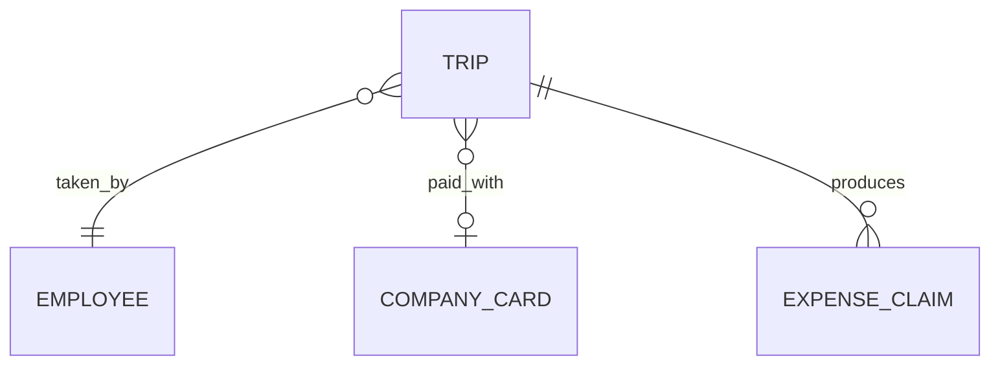
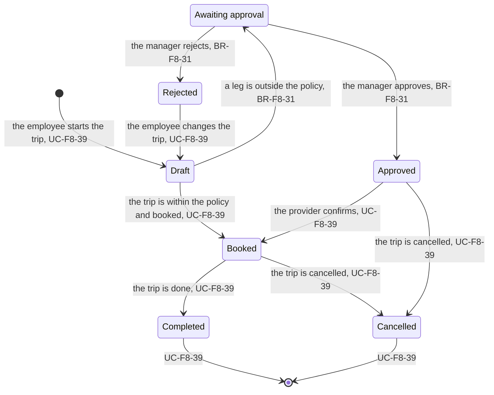

🏠 [Specs](../../../README.md) › 🧩 [Functional capabilities](../../README.md) › 📒 [F8 Accounting](../README.md) ›
🗃️ [Data](README.md) › 🗃️ E-F8-43 Trip

# 🗃️ E-F8-43 Trip

**Status:** ✅ specified

## Purpose

A business trip: its purpose, legs, cost, policy check and approval
([D527](../../../06-decisions/f08-accounting/d527-benchmark-gaps-f08-accounting.md)).

## Fields

| Name | Type | Required | Validation | Default | Example | Personal data | Custom fields |
|---|---|---|---|---|---|---|---|
| traveller | employee | yes | an active employee | the requester | Anne B. | yes | no |
| purpose | text | yes | - | - | Client visit, Lille | no | no |
| start date, end date | two dates | yes | start before end | - | 2027-01-12, 2027-01-13 | no | no |
| legs | list of kind, from, to, price | yes | at least one | - | train, hotel | no | no |
| total cost | amount with currency | yes | sum of the legs | computed | 204 EUR | no | no |
| policy check | within or outside, with reasons | yes | computed per leg | computed | outside: hotel above cap | no | no |
| approved by | user | no | the traveller's manager | - | Marc T. | yes | no |
| payment | company card or expense claim | yes | one of the two | company card | company card | no | no |
| state | Draft, Booked, Awaiting approval, Approved, Rejected, Completed, Cancelled | yes | the lifecycle below | Draft | Booked | no | no |
| owner | user | yes | a user of the company | the creator | Claire P. | yes | no |

## Relations

- [E-F8-15 Company card](e-f08-15-company-card.md)
- [E-F8-09 Expense claim](e-f08-09-expense-claim.md)

## Lifecycle

## Indexes and search

By traveller, state, dates, total cost and policy check.

## Retention

Kept 6 years with the expense records.

## Audit

Every trip, policy check, approval or rejection with its reason, booking and cancellation, with who and when.

## Import and export

Export the trips of a period as a CSV; no import.

## Used by

- [UC-F8-39](../use-cases/12-audit-leases-and-special-books/uc-f08-39-book-business-travel.md)

## Open questions

None.

---

⬅️ [E-F8-42 Peppol participant](e-f08-42-peppol-participant.md) · ⬆️ [Up](README.md)
