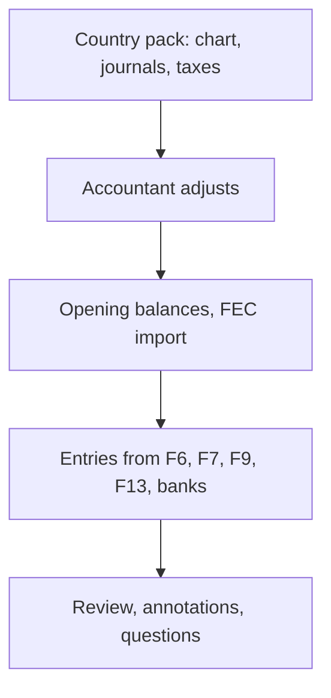

🏠 [Specs](../../../README.md) › 🧩 [Functional capabilities](../../README.md) › 📒 [F8 Accounting](../README.md) ›
🔀 [Flows](README.md) › 🔀 FL-F8-01 Set up and post

# 🔀 FL-F8-01 Set up and post

**Status:** ✅ specified

## Summary

Covers UC-F8-01, UC-F8-02, UC-F8-14.

## Personas

- [U05 Accounting](../../../01-users/personas/u05-accounting.md)
- [U07 Administrator](../../../01-users/personas/u07-administrator.md)
- [U08 External accountant](../../../01-users/personas/u08-external-accountant.md)

## Flowchart

## Sequence diagram

See each use case.

## Steps

| Step | Persona | Screen | Use case | What happens |
|---|---|---|---|---|
| 1 | U05, U08, U07 | [S-F8-01](../screens/01-set-up-and-post/s-f08-01-books-setup.md) | [UC-F8-01](../use-cases/01-set-up-and-post/uc-f08-01-set-up-the-books.md) | Set up the books |
| 2 | U05, U08 | [S-F8-02](../screens/01-set-up-and-post/s-f08-02-journal-entries.md) | [UC-F8-02](../use-cases/01-set-up-and-post/uc-f08-02-post-and-review-entries.md) | Post and review entries |
| 3 | U08, U05 | [S-F8-14](../screens/01-set-up-and-post/s-f08-14-accountant-workspace.md) | [UC-F8-14](../use-cases/01-set-up-and-post/uc-f08-14-work-with-the-external-accountant.md) | Work with the external accountant |

### Entities and screens

| Entity | States in this flow | Shown at step and screen | Aggregated view |
|---|---|---|---|
| [E-T11-01 Country pack](../../../03-technical/t11-legal-corpora/data/e-t11-01-country-pack.md) | Active | Shown elsewhere: [S-T11-01 Country pack](../../../03-technical/t11-legal-corpora/screens/s-t11-01-country-pack.md), from the admin list [S-T11-L01](../../../03-technical/t11-legal-corpora/screens/00-lists/s-t11-l01-country-packs.md) | Country packs |
| [E-F8-01 Account](../data/e-f08-01-account.md) | Active | 1 [S-F8-01](../screens/01-set-up-and-post/s-f08-01-books-setup.md) | Accounts |
| [E-F8-02 Journal](../data/e-f08-02-journal.md) | Recorded | 1 [S-F8-01](../screens/01-set-up-and-post/s-f08-01-books-setup.md); 3 [S-F8-14](../screens/01-set-up-and-post/s-f08-14-accountant-workspace.md) | Journals |
| [E-F8-33 Tax rate](../data/e-f08-33-tax-rate.md) | Active | 1 [S-F8-01](../screens/01-set-up-and-post/s-f08-01-books-setup.md) | Tax rates |
| [E-F8-03 Journal entry](../data/e-f08-03-journal-entry.md) | Draft, Posted, Reversed | 2 [S-F8-02](../screens/01-set-up-and-post/s-f08-02-journal-entries.md); 3 [S-F8-14](../screens/01-set-up-and-post/s-f08-14-accountant-workspace.md) | Journal entries |
| [E-F8-27 FEC file](../data/e-f08-27-fec-file.md) | Active | 1 [S-F8-01](../screens/01-set-up-and-post/s-f08-01-books-setup.md) | FEC files |
| [E-F8-04 Bank line](../data/e-f08-04-bank-line.md) | To reconcile, Reconciled, In suspense | Shown elsewhere: [S-F8-06 Bank reconciliation](../screens/03-bank-and-collect/s-f08-06-bank-reconciliation.md) | Bank lines |
| [E-F8-29 Entry annotation](../data/e-f08-29-entry-annotation.md) | Active | 1 [S-F8-01](../screens/01-set-up-and-post/s-f08-01-books-setup.md) | Entry annotations |
| [E-F8-26 Accountant request](../data/e-f08-26-accountant-request.md) | Open, Answered, Closed | 3 [S-F8-14](../screens/01-set-up-and-post/s-f08-14-accountant-workspace.md) | Accountant requests |

## Errors

As each use case.

## Images

Every step and error, for each persona taking part, in light and dark mode (D120). Steps are numbered as in the Steps
table; E rows are the error cases.

| Step | Persona | Device | Light | Dark |
|---|---|---|---|---|
| 1 | U05 | desktop | [light](../images/01-set-up-and-post/u05-accounting/1-set-up-the-books-desktop-light.png) | [dark](../images/01-set-up-and-post/u05-accounting/1-set-up-the-books-desktop-dark.png) |
| 1 | U07 | desktop | [light](../images/01-set-up-and-post/u07-administrator/1-set-up-the-books-desktop-light.png) | [dark](../images/01-set-up-and-post/u07-administrator/1-set-up-the-books-desktop-dark.png) |
| 1 | U08 | desktop | [light](../images/01-set-up-and-post/u08-external-accountant/1-set-up-the-books-desktop-light.png) | [dark](../images/01-set-up-and-post/u08-external-accountant/1-set-up-the-books-desktop-dark.png) |
| 2 | U08 | desktop | [light](../images/01-set-up-and-post/u08-external-accountant/2-post-and-review-desktop-light.png) | [dark](../images/01-set-up-and-post/u08-external-accountant/2-post-and-review-desktop-dark.png) |
| 2 | U05 | desktop | [light](../images/01-set-up-and-post/u05-accounting/2-post-and-review-desktop-light.png) | [dark](../images/01-set-up-and-post/u05-accounting/2-post-and-review-desktop-dark.png) |
| 3 | U08 | desktop | [light](../images/01-set-up-and-post/u08-external-accountant/3-accountant-workspace-desktop-light.png) | [dark](../images/01-set-up-and-post/u08-external-accountant/3-accountant-workspace-desktop-dark.png) |
| 3 | U05 | desktop | [light](../images/01-set-up-and-post/u05-accounting/3-accountant-workspace-desktop-light.png) | [dark](../images/01-set-up-and-post/u05-accounting/3-accountant-workspace-desktop-dark.png) |
| E1 | U05 | desktop | [light](../images/01-set-up-and-post/u05-accounting/e1-unbalanced-entry-desktop-light.png) | [dark](../images/01-set-up-and-post/u05-accounting/e1-unbalanced-entry-desktop-dark.png) |

## Open questions

None.

---

⬆️ [Up](README.md) · ➡️ [FL-F8-02 Purchase to pay](fl-f08-02-purchase-to-pay.md)
