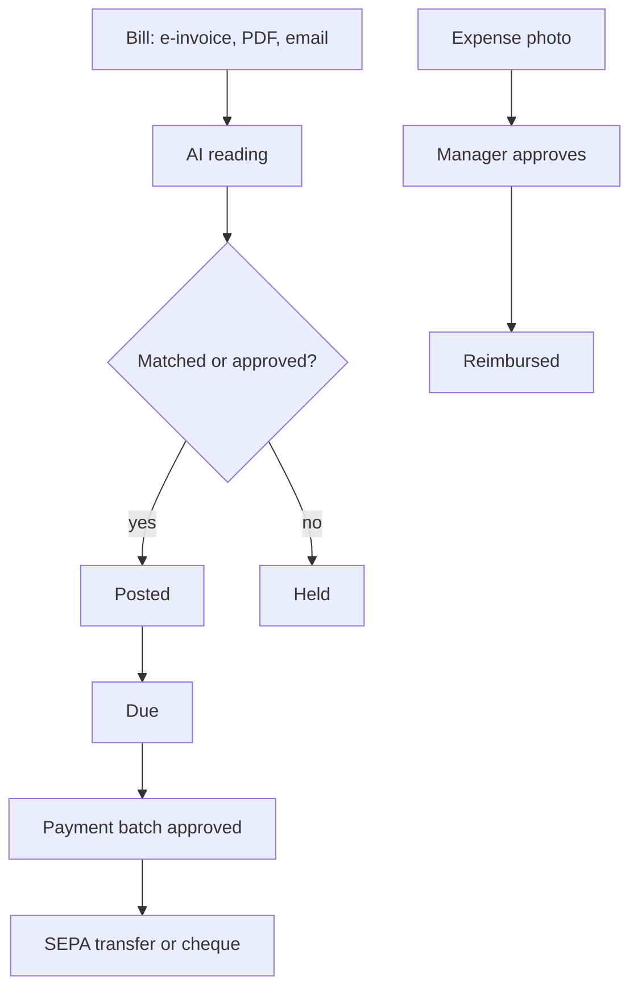

🏠 [Specs](../../../README.md) › 🧩 [Functional capabilities](../../README.md) › 📒 [F8 Accounting](../README.md) ›
🔀 [Flows](README.md) › 🔀 FL-F8-02 Purchase to pay

# 🔀 FL-F8-02 Purchase to pay

**Status:** ✅ specified

## Summary

Covers UC-F8-03, UC-F8-04, UC-F8-12.

## Personas

- [U01 Employee](../../../01-users/personas/u01-employee.md)
- [U02 Manager](../../../01-users/personas/u02-manager.md)
- [U05 Accounting](../../../01-users/personas/u05-accounting.md)
- [U13 Owner](../../../01-users/personas/u13-owner.md)

## Flowchart

## Sequence diagram

See each use case.

## Steps

| Step | Persona | Screen | Use case | What happens |
|---|---|---|---|---|
| 1 | U05 | [S-F8-03](../screens/02-purchase-to-pay/s-f08-03-supplier-bills.md) | [UC-F8-03](../use-cases/02-purchase-to-pay/uc-f08-03-process-supplier-bills.md) | Process supplier bills |
| 2 | U05, U13 | [S-F8-04](../screens/02-purchase-to-pay/s-f08-04-supplier-payments.md) | [UC-F8-04](../use-cases/02-purchase-to-pay/uc-f08-04-pay-suppliers.md) | Pay suppliers |
| 3 | U01, U02, U05 | [S-F8-12](../screens/02-purchase-to-pay/s-f08-12-expenses.md) | [UC-F8-12](../use-cases/02-purchase-to-pay/uc-f08-12-submit-and-approve-expenses.md) | Submit and approve expenses |

### Entities and screens

| Entity | States in this flow | Shown at step and screen | Aggregated view |
|---|---|---|---|
| [E-F7-05 Supplier invoice](../../f07-purchasing-and-stock/data/e-f07-05-supplier-invoice.md) | Matched, Held | Shown elsewhere: [S-F7-04 Supplier invoice matching](../../f07-purchasing-and-stock/screens/01-procure/s-f07-04-supplier-invoice-matching.md) | Supplier invoices |
| [E-F8-28 Payment run](../data/e-f08-28-payment-run.md) | Active | 1 [S-F8-03](../screens/02-purchase-to-pay/s-f08-03-supplier-bills.md); 2 [S-F8-04](../screens/02-purchase-to-pay/s-f08-04-supplier-payments.md) | Payment runs |
| [E-F8-09 Expense claim](../data/e-f08-09-expense-claim.md) | Draft, Submitted, Approved, Reimbursed | 3 [S-F8-12](../screens/02-purchase-to-pay/s-f08-12-expenses.md) | Expense claims |

## Errors

As each use case.

## Images

Every step and error, for each persona taking part, in light and dark mode (D120). Steps are numbered as in the Steps
table; E rows are the error cases.

| Step | Persona | Device | Light | Dark |
|---|---|---|---|---|
| 1 | U05 | desktop | [light](../images/02-purchase-to-pay/u05-accounting/1-supplier-bill-desktop-light.png) | [dark](../images/02-purchase-to-pay/u05-accounting/1-supplier-bill-desktop-dark.png) |
| 2 | U13 | desktop | [light](../images/02-purchase-to-pay/u13-owner/2-pay-suppliers-desktop-light.png) | [dark](../images/02-purchase-to-pay/u13-owner/2-pay-suppliers-desktop-dark.png) |
| 2 | U13 | phone | [light](../images/02-purchase-to-pay/u13-owner/2-pay-suppliers-phone-light.png) | [dark](../images/02-purchase-to-pay/u13-owner/2-pay-suppliers-phone-dark.png) |
| 2 | U05 | desktop | [light](../images/02-purchase-to-pay/u05-accounting/2-pay-suppliers-desktop-light.png) | [dark](../images/02-purchase-to-pay/u05-accounting/2-pay-suppliers-desktop-dark.png) |
| 3 | U01 | phone | [light](../images/02-purchase-to-pay/u01-employee/3-expenses-phone-light.png) | [dark](../images/02-purchase-to-pay/u01-employee/3-expenses-phone-dark.png) |
| 3 | U01 | desktop | [light](../images/02-purchase-to-pay/u01-employee/3-expenses-desktop-light.png) | [dark](../images/02-purchase-to-pay/u01-employee/3-expenses-desktop-dark.png) |
| 3 | U02 | desktop | [light](../images/02-purchase-to-pay/u02-manager/3-expenses-desktop-light.png) | [dark](../images/02-purchase-to-pay/u02-manager/3-expenses-desktop-dark.png) |
| 3 | U02 | phone | [light](../images/02-purchase-to-pay/u02-manager/3-expenses-phone-light.png) | [dark](../images/02-purchase-to-pay/u02-manager/3-expenses-phone-dark.png) |
| 3 | U05 | desktop | [light](../images/02-purchase-to-pay/u05-accounting/3-expenses-desktop-light.png) | [dark](../images/02-purchase-to-pay/u05-accounting/3-expenses-desktop-dark.png) |
| E1 | U05 | desktop | [light](../images/02-purchase-to-pay/u05-accounting/e1-iban-changed-desktop-light.png) | [dark](../images/02-purchase-to-pay/u05-accounting/e1-iban-changed-desktop-dark.png) |

## Open questions

None.

---

⬅️ [FL-F8-01 Set up and post](fl-f08-01-set-up-and-post.md) · ⬆️ [Up](README.md) ·
➡️ [FL-F8-03 Bank and collect](fl-f08-03-bank-and-collect.md)
