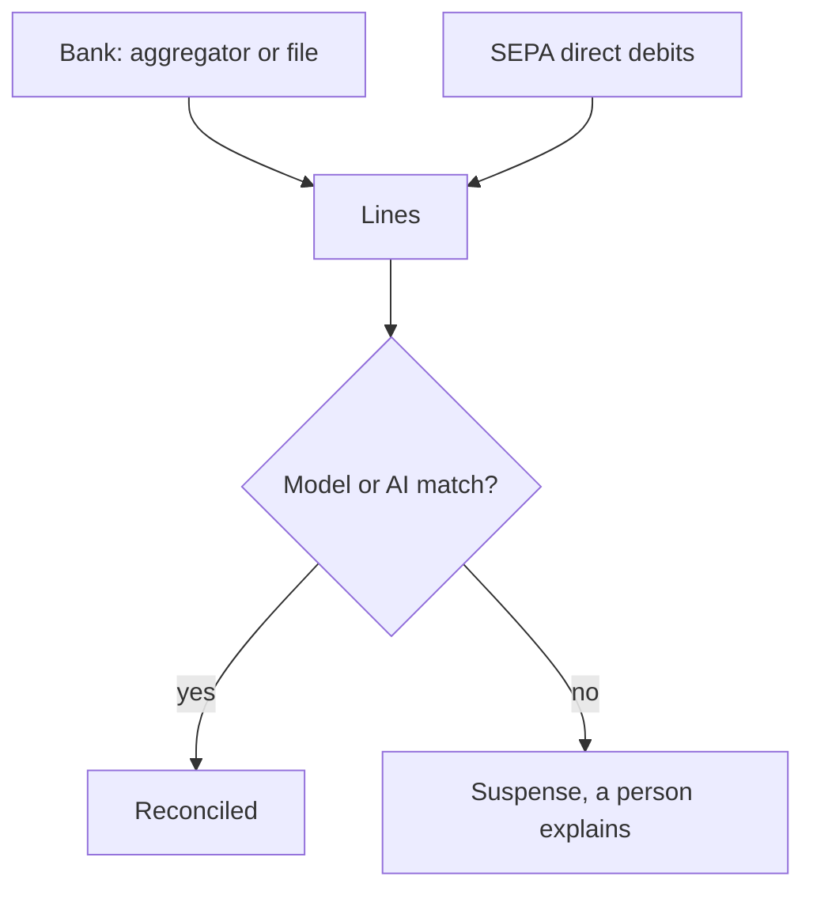

🏠 [Specs](../../../README.md) › 🧩 [Functional capabilities](../../README.md) › 📒 [F8 Accounting](../README.md) ›
🔀 [Flows](README.md) › 🔀 FL-F8-03 Bank and collect

# 🔀 FL-F8-03 Bank and collect

**Status:** ✅ specified

## Summary

Covers UC-F8-05, UC-F8-06.

## Personas

- [U05 Accounting](../../../01-users/personas/u05-accounting.md)

## Flowchart

## Sequence diagram

See each use case.

## Steps

| Step | Persona | Screen | Use case | What happens |
|---|---|---|---|---|
| 1 | U05 | [S-F8-05](../screens/03-bank-and-collect/s-f08-05-customer-payments.md) | [UC-F8-05](../use-cases/03-bank-and-collect/uc-f08-05-collect-customer-payments.md) | Collect customer payments |
| 2 | U05 | [S-F8-06](../screens/03-bank-and-collect/s-f08-06-bank-reconciliation.md) | [UC-F8-06](../use-cases/03-bank-and-collect/uc-f08-06-connect-banks-and-reconcile.md) | Connect banks and reconcile |

### Entities and screens

| Entity | States in this flow | Shown at step and screen | Aggregated view |
|---|---|---|---|
| [E-F24-02 Tool connection](../../f24-integrations-hub/data/e-f24-02-tool-connection.md) | Proposed, Active, Revoked | Shown elsewhere: [S-F21-10 Connections](../../f21-onboarding-and-modules/screens/03-team-and-data/s-f21-10-connections.md) | Tool connections |
| [E-F8-04 Bank line](../data/e-f08-04-bank-line.md) | To reconcile, Reconciled | 1 [S-F8-05](../screens/03-bank-and-collect/s-f08-05-customer-payments.md); 2 [S-F8-06](../screens/03-bank-and-collect/s-f08-06-bank-reconciliation.md) | Bank lines |
| [E-F8-05 Reconciliation model](../data/e-f08-05-reconciliation-model.md) | Active | 2 [S-F8-06](../screens/03-bank-and-collect/s-f08-06-bank-reconciliation.md) | Reconciliation models |
| [E-F3-15 Agent](../../f03-assistant/data/e-f03-15-agent.md) | Paid, Paused | Shown elsewhere: [S-F3-14 Agents](../../f03-assistant/screens/10-benchmark-additions/s-f03-14-agents.md) | Agents |
| [E-F8-01 Account](../data/e-f08-01-account.md) | Active | Shown elsewhere: [S-F8-01 Books setup](../screens/01-set-up-and-post/s-f08-01-books-setup.md) | Accounts |
| [E-F6-06 Customer payment](../../f06-customers-and-sales/data/e-f06-06-customer-payment.md) | Matched, Refused | Shown elsewhere: [S-F6-07 Payments and reconciliation](../../f06-customers-and-sales/screens/03-invoice-and-get-paid/s-f06-07-payments-and-reconciliation.md) | Customer payments |

## Errors

As each use case.

## Images

Every step and error, for each persona taking part, in light and dark mode (D120). Steps are numbered as in the Steps
table; E rows are the error cases.

| Step | Persona | Device | Light | Dark |
|---|---|---|---|---|
| 1 | U05 | desktop | [light](../images/03-bank-and-collect/u05-accounting/1-collect-payments-desktop-light.png) | [dark](../images/03-bank-and-collect/u05-accounting/1-collect-payments-desktop-dark.png) |
| 2 | U05 | desktop | [light](../images/03-bank-and-collect/u05-accounting/2-reconcile-desktop-light.png) | [dark](../images/03-bank-and-collect/u05-accounting/2-reconcile-desktop-dark.png) |
| E1 | U05 | desktop | [light](../images/03-bank-and-collect/u05-accounting/e1-consent-expired-desktop-light.png) | [dark](../images/03-bank-and-collect/u05-accounting/e1-consent-expired-desktop-dark.png) |

## Open questions

None.

---

⬅️ [FL-F8-02 Purchase to pay](fl-f08-02-purchase-to-pay.md) · ⬆️ [Up](README.md) ·
➡️ [FL-F8-04 Tax, assets and analytics](fl-f08-04-tax-assets-and-analytics.md)
