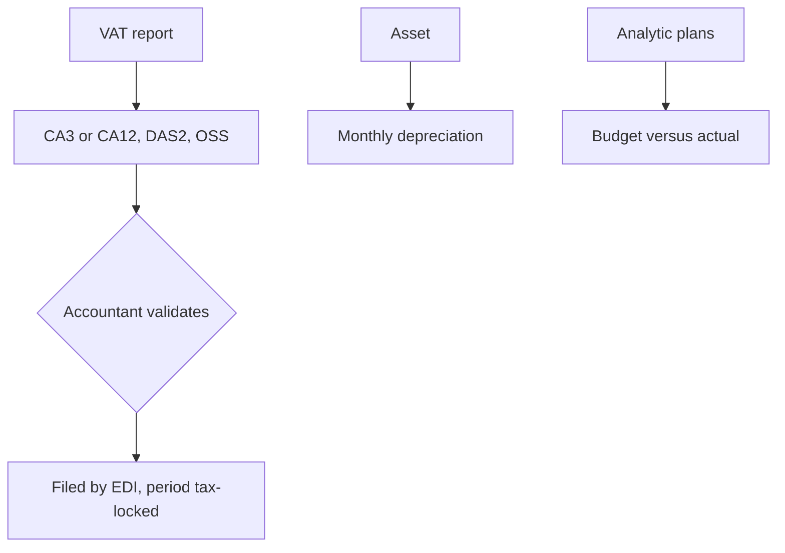

🏠 [Specs](../../../README.md) › 🧩 [Functional capabilities](../../README.md) › 📒 [F8 Accounting](../README.md) ›
🔀 [Flows](README.md) › 🔀 FL-F8-04 Tax, assets and analytics

# 🔀 FL-F8-04 Tax, assets and analytics

**Status:** ✅ specified

## Summary

Covers UC-F8-07, UC-F8-08, UC-F8-09.

## Personas

- [U02 Manager](../../../01-users/personas/u02-manager.md)
- [U05 Accounting](../../../01-users/personas/u05-accounting.md)
- [U08 External accountant](../../../01-users/personas/u08-external-accountant.md)
- [U13 Owner](../../../01-users/personas/u13-owner.md)

## Flowchart

## Sequence diagram

See each use case.

## Steps

| Step | Persona | Screen | Use case | What happens |
|---|---|---|---|---|
| 1 | U05, U08 | [S-F8-07](../screens/04-tax-assets-and-analytics/s-f08-07-vat-returns.md) | [UC-F8-07](../use-cases/04-tax-assets-and-analytics/uc-f08-07-manage-vat-and-file-returns.md) | Manage VAT and file returns |
| 2 | U05 | [S-F8-08](../screens/04-tax-assets-and-analytics/s-f08-08-fixed-assets.md) | [UC-F8-08](../use-cases/04-tax-assets-and-analytics/uc-f08-08-manage-fixed-assets-and-deferrals.md) | Manage fixed assets and deferrals |
| 3 | U02, U13, U05 | [S-F8-09](../screens/04-tax-assets-and-analytics/s-f08-09-analytics-and-budgets.md) | [UC-F8-09](../use-cases/04-tax-assets-and-analytics/uc-f08-09-track-analytics-and-budgets.md) | Track analytics and budgets |

### Entities and screens

| Entity | States in this flow | Shown at step and screen | Aggregated view |
|---|---|---|---|
| [E-F8-06 Tax return](../data/e-f08-06-tax-return.md) | Prepared, Validated, Filed | 1 [S-F8-07](../screens/04-tax-assets-and-analytics/s-f08-07-vat-returns.md) | Tax returns |
| [E-F8-12 Filing partner](../data/e-f08-12-filing-partner.md) | Active | 1 [S-F8-07](../screens/04-tax-assets-and-analytics/s-f08-07-vat-returns.md) | Filing partners |
| [E-F8-10 Fiscal period](../data/e-f08-10-fiscal-period.md) | Active | Shown elsewhere: [S-F8-01 Books setup](../screens/01-set-up-and-post/s-f08-01-books-setup.md) | Fiscal periods |
| [E-F8-07 Fixed asset](../data/e-f08-07-fixed-asset.md) | Running, Disposed, Sold | 2 [S-F8-08](../screens/04-tax-assets-and-analytics/s-f08-08-fixed-assets.md) | Fixed assets |
| [E-F8-30 Analytic plan](../data/e-f08-30-analytic-plan.md) | Active | 3 [S-F8-09](../screens/04-tax-assets-and-analytics/s-f08-09-analytics-and-budgets.md) | Analytic plans |
| [E-F8-08 Accounting budget](../data/e-f08-08-accounting-budget.md) | Active | 3 [S-F8-09](../screens/04-tax-assets-and-analytics/s-f08-09-analytics-and-budgets.md) | Accounting budgets |

## Errors

As each use case.

## Images

Every step and error, for each persona taking part, in light and dark mode (D120). Steps are numbered as in the Steps
table; E rows are the error cases.

| Step | Persona | Device | Light | Dark |
|---|---|---|---|---|
| 1 | U08 | desktop | [light](../images/04-tax-assets-and-analytics/u08-external-accountant/1-vat-return-desktop-light.png) | [dark](../images/04-tax-assets-and-analytics/u08-external-accountant/1-vat-return-desktop-dark.png) |
| 1 | U05 | desktop | [light](../images/04-tax-assets-and-analytics/u05-accounting/1-vat-return-desktop-light.png) | [dark](../images/04-tax-assets-and-analytics/u05-accounting/1-vat-return-desktop-dark.png) |
| 2 | U05 | desktop | [light](../images/04-tax-assets-and-analytics/u05-accounting/2-fixed-assets-desktop-light.png) | [dark](../images/04-tax-assets-and-analytics/u05-accounting/2-fixed-assets-desktop-dark.png) |
| 3 | U02 | desktop | [light](../images/04-tax-assets-and-analytics/u02-manager/3-analytics-and-budgets-desktop-light.png) | [dark](../images/04-tax-assets-and-analytics/u02-manager/3-analytics-and-budgets-desktop-dark.png) |
| 3 | U02 | phone | [light](../images/04-tax-assets-and-analytics/u02-manager/3-analytics-and-budgets-phone-light.png) | [dark](../images/04-tax-assets-and-analytics/u02-manager/3-analytics-and-budgets-phone-dark.png) |
| 3 | U05 | desktop | [light](../images/04-tax-assets-and-analytics/u05-accounting/3-analytics-and-budgets-desktop-light.png) | [dark](../images/04-tax-assets-and-analytics/u05-accounting/3-analytics-and-budgets-desktop-dark.png) |
| 3 | U13 | desktop | [light](../images/04-tax-assets-and-analytics/u13-owner/3-analytics-and-budgets-desktop-light.png) | [dark](../images/04-tax-assets-and-analytics/u13-owner/3-analytics-and-budgets-desktop-dark.png) |
| 3 | U13 | phone | [light](../images/04-tax-assets-and-analytics/u13-owner/3-analytics-and-budgets-phone-light.png) | [dark](../images/04-tax-assets-and-analytics/u13-owner/3-analytics-and-budgets-phone-dark.png) |
| E1 | U08 | desktop | [light](../images/04-tax-assets-and-analytics/u08-external-accountant/e1-edi-rejected-desktop-light.png) | [dark](../images/04-tax-assets-and-analytics/u08-external-accountant/e1-edi-rejected-desktop-dark.png) |

## Open questions

None.

---

⬅️ [FL-F8-03 Bank and collect](fl-f08-03-bank-and-collect.md) · ⬆️ [Up](README.md) ·
➡️ [FL-F8-05 Close, report and consolidate](fl-f08-05-close-report-and-consolidate.md)
