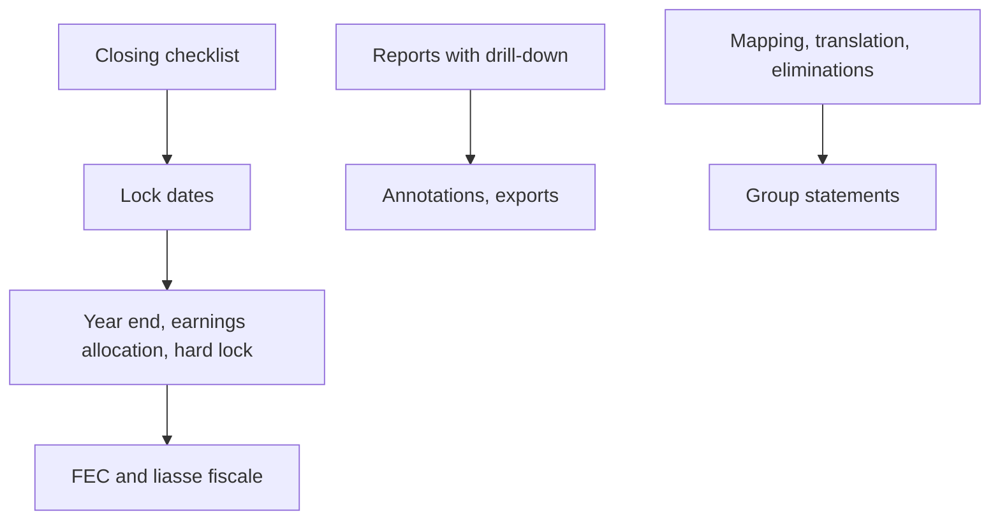

🏠 [Specs](../../../README.md) › 🧩 [Functional capabilities](../../README.md) › 📒 [F8 Accounting](../README.md) ›
🔀 [Flows](README.md) › 🔀 FL-F8-05 Close, report and consolidate

# 🔀 FL-F8-05 Close, report and consolidate

**Status:** ✅ specified

## Summary

Covers UC-F8-10, UC-F8-11, UC-F8-13.

## Personas

- [U05 Accounting](../../../01-users/personas/u05-accounting.md)
- [U08 External accountant](../../../01-users/personas/u08-external-accountant.md)
- [U13 Owner](../../../01-users/personas/u13-owner.md)

## Flowchart

## Sequence diagram

See each use case.

## Steps

| Step | Persona | Screen | Use case | What happens |
|---|---|---|---|---|
| 1 | U08, U05 | [S-F8-10](../screens/05-close-report-and-consolidate/s-f08-10-closing.md) | [UC-F8-10](../use-cases/05-close-report-and-consolidate/uc-f08-10-close-the-period-and-the-year.md) | Close the period and the year |
| 2 | U13, U05, U08 | [S-F8-11](../screens/05-close-report-and-consolidate/s-f08-11-financial-reports.md) | [UC-F8-11](../use-cases/05-close-report-and-consolidate/uc-f08-11-read-financial-reports.md) | Read financial reports |
| 3 | U08, U13 | [S-F8-13](../screens/05-close-report-and-consolidate/s-f08-13-consolidation.md) | [UC-F8-13](../use-cases/05-close-report-and-consolidate/uc-f08-13-consolidate-the-group.md) | Consolidate the group |

### Entities and screens

| Entity | States in this flow | Shown at step and screen | Aggregated view |
|---|---|---|---|
| [E-F8-31 Closing checklist](../data/e-f08-31-closing-checklist.md) | Active | 1 [S-F8-10](../screens/05-close-report-and-consolidate/s-f08-10-closing.md) | Closing checklists |
| [E-F8-10 Fiscal period](../data/e-f08-10-fiscal-period.md) | Active | 1 [S-F8-10](../screens/05-close-report-and-consolidate/s-f08-10-closing.md) | Fiscal periods |
| [E-F8-03 Journal entry](../data/e-f08-03-journal-entry.md) | Draft, Posted, Reversed | 2 [S-F8-11](../screens/05-close-report-and-consolidate/s-f08-11-financial-reports.md) | Journal entries |
| [E-F8-27 FEC file](../data/e-f08-27-fec-file.md) | Active | 1 [S-F8-10](../screens/05-close-report-and-consolidate/s-f08-10-closing.md) | FEC files |
| [E-F8-06 Tax return](../data/e-f08-06-tax-return.md) | Prepared, Validated, Rejected, Filed | Shown elsewhere: [S-F8-07 VAT returns](../screens/04-tax-assets-and-analytics/s-f08-07-vat-returns.md) | Tax returns |
| [E-F8-29 Entry annotation](../data/e-f08-29-entry-annotation.md) | Active | 1 [S-F8-10](../screens/05-close-report-and-consolidate/s-f08-10-closing.md) | Entry annotations |
| [E-F8-11 Consolidation group](../data/e-f08-11-consolidation-group.md) | Active | 3 [S-F8-13](../screens/05-close-report-and-consolidate/s-f08-13-consolidation.md) | Consolidation groups |

## Errors

As each use case.

## Images

Every step and error, for each persona taking part, in light and dark mode (D120). Steps are numbered as in the Steps
table; E rows are the error cases.

| Step | Persona | Device | Light | Dark |
|---|---|---|---|---|
| 1 | U08 | desktop | [light](../images/05-close-report-and-consolidate/u08-external-accountant/1-close-desktop-light.png) | [dark](../images/05-close-report-and-consolidate/u08-external-accountant/1-close-desktop-dark.png) |
| 1 | U05 | desktop | [light](../images/05-close-report-and-consolidate/u05-accounting/1-close-desktop-light.png) | [dark](../images/05-close-report-and-consolidate/u05-accounting/1-close-desktop-dark.png) |
| 2 | U13 | desktop | [light](../images/05-close-report-and-consolidate/u13-owner/2-reports-desktop-light.png) | [dark](../images/05-close-report-and-consolidate/u13-owner/2-reports-desktop-dark.png) |
| 2 | U13 | phone | [light](../images/05-close-report-and-consolidate/u13-owner/2-reports-phone-light.png) | [dark](../images/05-close-report-and-consolidate/u13-owner/2-reports-phone-dark.png) |
| 2 | U05 | desktop | [light](../images/05-close-report-and-consolidate/u05-accounting/2-reports-desktop-light.png) | [dark](../images/05-close-report-and-consolidate/u05-accounting/2-reports-desktop-dark.png) |
| 2 | U08 | desktop | [light](../images/05-close-report-and-consolidate/u08-external-accountant/2-reports-desktop-light.png) | [dark](../images/05-close-report-and-consolidate/u08-external-accountant/2-reports-desktop-dark.png) |
| 3 | U08 | desktop | [light](../images/05-close-report-and-consolidate/u08-external-accountant/3-consolidate-desktop-light.png) | [dark](../images/05-close-report-and-consolidate/u08-external-accountant/3-consolidate-desktop-dark.png) |
| 3 | U13 | desktop | [light](../images/05-close-report-and-consolidate/u13-owner/3-consolidate-desktop-light.png) | [dark](../images/05-close-report-and-consolidate/u13-owner/3-consolidate-desktop-dark.png) |
| 3 | U13 | phone | [light](../images/05-close-report-and-consolidate/u13-owner/3-consolidate-phone-light.png) | [dark](../images/05-close-report-and-consolidate/u13-owner/3-consolidate-phone-dark.png) |
| E1 | U08 | desktop | [light](../images/05-close-report-and-consolidate/u08-external-accountant/e1-unreconciled-blocks-close-desktop-light.png) | [dark](../images/05-close-report-and-consolidate/u08-external-accountant/e1-unreconciled-blocks-close-desktop-dark.png) |

## Open questions

None.

---

⬅️ [FL-F8-04 Tax, assets and analytics](fl-f08-04-tax-assets-and-analytics.md) · ⬆️ [Up](README.md) ·
➡️ [FL-F8-06 Benchmark additions](fl-f08-06-benchmark-additions.md)
