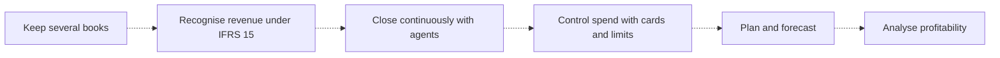

🏠 [Specs](../../../README.md) › 🧩 [Functional capabilities](../../README.md) › 📒 [F8 Accounting](../README.md) ›
🔀 [Flows](README.md) › 🔀 FL-F8-06 Benchmark additions

# 🔀 FL-F8-06 Benchmark additions

**Status:** ✅ specified

## Summary

The benchmark additions of D306: UC-F8-15, UC-F8-16, UC-F8-17, UC-F8-18, UC-F8-19, UC-F8-20. Each step stands on its
own.

## Personas

- [U01 Employee](../../../01-users/personas/u01-employee.md)
- [U02 Manager](../../../01-users/personas/u02-manager.md)
- [U05 Accounting](../../../01-users/personas/u05-accounting.md)
- [U08 External accountant](../../../01-users/personas/u08-external-accountant.md)
- [U13 Owner](../../../01-users/personas/u13-owner.md)

## Flowchart

## Sequence diagram

See each use case.

## Steps

| Step | Persona | Screen | Use case | What happens |
|---|---|---|---|---|
| 1 | U05, U08 | [S-F8-15](../screens/06-benchmark-additions/s-f08-15-books.md) | [UC-F8-15](../use-cases/06-benchmark-additions/uc-f08-15-keep-several-books.md) | Keep several books |
| 2 | U05 | [S-F8-16](../screens/06-benchmark-additions/s-f08-16-revenue-schedules.md) | [UC-F8-16](../use-cases/06-benchmark-additions/uc-f08-16-recognise-revenue-under-ifrs-15.md) | Recognise revenue under IFRS 15 |
| 3 | U05, U13 | [S-F8-17](../screens/06-benchmark-additions/s-f08-17-continuous-close.md) | [UC-F8-17](../use-cases/06-benchmark-additions/uc-f08-17-close-continuously-with-agents.md) | Close continuously with agents |
| 4 | U05, U01 | [S-F8-18](../screens/06-benchmark-additions/s-f08-18-cards-and-spend.md) | [UC-F8-18](../use-cases/06-benchmark-additions/uc-f08-18-control-spend-with-cards-and-limits.md) | Control spend with cards and limits |
| 5 | U05, U13, U02 | [S-F8-19](../screens/06-benchmark-additions/s-f08-19-planning.md) | [UC-F8-19](../use-cases/06-benchmark-additions/uc-f08-19-plan-and-forecast.md) | Plan and forecast |
| 6 | U13, U05, U02 | [S-F8-20](../screens/06-benchmark-additions/s-f08-20-profitability.md) | [UC-F8-20](../use-cases/06-benchmark-additions/uc-f08-20-analyse-profitability.md) | Analyse profitability |

### Entities and screens

| Entity | States in this flow | Shown at step and screen | Aggregated view |
|---|---|---|---|
| [E-F8-13 Book](../data/e-f08-13-book.md) | Closed, Refused | 1 [S-F8-15](../screens/06-benchmark-additions/s-f08-15-books.md) | Books |
| [E-F8-14 Revenue schedule](../data/e-f08-14-revenue-schedule.md) | Active | 2 [S-F8-16](../screens/06-benchmark-additions/s-f08-16-revenue-schedules.md) | Revenue schedules |
| [E-F3-15 Agent](../../f03-assistant/data/e-f03-15-agent.md) | Paid, Paused | Shown elsewhere: [S-F3-14 Agents](../../f03-assistant/screens/10-benchmark-additions/s-f03-14-agents.md) | Agents |
| [E-F8-15 Company card](../data/e-f08-15-company-card.md) | Active | 4 [S-F8-18](../screens/06-benchmark-additions/s-f08-18-cards-and-spend.md) | Company cards |

## Errors

As each use case; E1 shows one of them.

## Images

Every step and error, for each persona taking part, in light and dark mode (D120). Steps are numbered as in the Steps
table; E rows are the error cases.

| Step | Persona | Device | Light | Dark |
|---|---|---|---|---|
| 1 | U05 | desktop | [light](../images/06-benchmark-additions/u05-accounting/1-books-desktop-light.png) | [dark](../images/06-benchmark-additions/u05-accounting/1-books-desktop-dark.png) |
| 1 | U08 | desktop | [light](../images/06-benchmark-additions/u08-external-accountant/1-books-desktop-light.png) | [dark](../images/06-benchmark-additions/u08-external-accountant/1-books-desktop-dark.png) |
| 2 | U05 | desktop | [light](../images/06-benchmark-additions/u05-accounting/2-revenue-desktop-light.png) | [dark](../images/06-benchmark-additions/u05-accounting/2-revenue-desktop-dark.png) |
| 3 | U05 | desktop | [light](../images/06-benchmark-additions/u05-accounting/3-continuous-close-desktop-light.png) | [dark](../images/06-benchmark-additions/u05-accounting/3-continuous-close-desktop-dark.png) |
| 3 | U13 | desktop | [light](../images/06-benchmark-additions/u13-owner/3-continuous-close-desktop-light.png) | [dark](../images/06-benchmark-additions/u13-owner/3-continuous-close-desktop-dark.png) |
| 3 | U13 | phone | [light](../images/06-benchmark-additions/u13-owner/3-continuous-close-phone-light.png) | [dark](../images/06-benchmark-additions/u13-owner/3-continuous-close-phone-dark.png) |
| 4 | U05 | desktop | [light](../images/06-benchmark-additions/u05-accounting/4-cards-desktop-light.png) | [dark](../images/06-benchmark-additions/u05-accounting/4-cards-desktop-dark.png) |
| 4 | U01 | desktop | [light](../images/06-benchmark-additions/u01-employee/4-cards-desktop-light.png) | [dark](../images/06-benchmark-additions/u01-employee/4-cards-desktop-dark.png) |
| 4 | U01 | phone | [light](../images/06-benchmark-additions/u01-employee/4-cards-phone-light.png) | [dark](../images/06-benchmark-additions/u01-employee/4-cards-phone-dark.png) |
| 5 | U05 | desktop | [light](../images/06-benchmark-additions/u05-accounting/5-planning-desktop-light.png) | [dark](../images/06-benchmark-additions/u05-accounting/5-planning-desktop-dark.png) |
| 5 | U02 | desktop | [light](../images/06-benchmark-additions/u02-manager/5-planning-desktop-light.png) | [dark](../images/06-benchmark-additions/u02-manager/5-planning-desktop-dark.png) |
| 5 | U02 | phone | [light](../images/06-benchmark-additions/u02-manager/5-planning-phone-light.png) | [dark](../images/06-benchmark-additions/u02-manager/5-planning-phone-dark.png) |
| 5 | U13 | desktop | [light](../images/06-benchmark-additions/u13-owner/5-planning-desktop-light.png) | [dark](../images/06-benchmark-additions/u13-owner/5-planning-desktop-dark.png) |
| 5 | U13 | phone | [light](../images/06-benchmark-additions/u13-owner/5-planning-phone-light.png) | [dark](../images/06-benchmark-additions/u13-owner/5-planning-phone-dark.png) |
| 6 | U13 | desktop | [light](../images/06-benchmark-additions/u13-owner/6-profitability-desktop-light.png) | [dark](../images/06-benchmark-additions/u13-owner/6-profitability-desktop-dark.png) |
| 6 | U13 | phone | [light](../images/06-benchmark-additions/u13-owner/6-profitability-phone-light.png) | [dark](../images/06-benchmark-additions/u13-owner/6-profitability-phone-dark.png) |
| 6 | U02 | desktop | [light](../images/06-benchmark-additions/u02-manager/6-profitability-desktop-light.png) | [dark](../images/06-benchmark-additions/u02-manager/6-profitability-desktop-dark.png) |
| 6 | U02 | phone | [light](../images/06-benchmark-additions/u02-manager/6-profitability-phone-light.png) | [dark](../images/06-benchmark-additions/u02-manager/6-profitability-phone-dark.png) |
| 6 | U05 | desktop | [light](../images/06-benchmark-additions/u05-accounting/6-profitability-desktop-light.png) | [dark](../images/06-benchmark-additions/u05-accounting/6-profitability-desktop-dark.png) |
| E1 | U05 | desktop | [light](../images/06-benchmark-additions/u05-accounting/e1-card-limit-desktop-light.png) | [dark](../images/06-benchmark-additions/u05-accounting/e1-card-limit-desktop-dark.png) |

## Open questions

None.

---

⬅️ [FL-F8-05 Close, report and consolidate](fl-f08-05-close-report-and-consolidate.md) · ⬆️ [Up](README.md) ·
➡️ [FL-F8-07 Client money, grants and non-profits](fl-f08-07-client-money-grants-and-non-profits.md)
