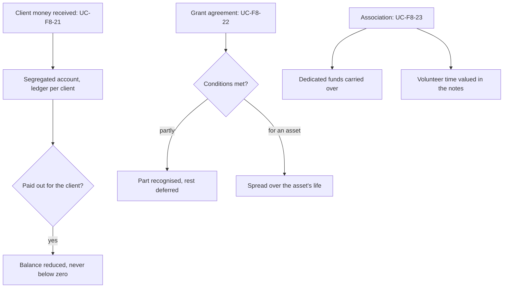

🏠 [Specs](../../../README.md) › 🧩 [Functional capabilities](../../README.md) › 📒 [F8 Accounting](../README.md) ›
🔀 [Flows](README.md) › 🔀 FL-F8-07 Client money, grants and non-profits

# 🔀 FL-F8-07 Client money, grants and non-profits

**Status:** ✅ specified

## Summary

Money held for clients on segregated accounts, grants recognised as their conditions are met, and the accounts of
associations with dedicated funds and volunteers.

## Personas

- [U05 Accounting](../../../01-users/personas/u05-accounting.md)
- [U31 Treasurer](../../../01-users/personas/u31-treasurer.md)
- [U34 Property manager](../../../01-users/personas/u34-property-manager.md)

## Flowchart

## Sequence diagram

- [UC-F8-21 Keep third-party client money](../use-cases/07-client-money-grants-and-non-profits/uc-f08-21-keep-third-party-client-money.md#sequence-diagram)

## Steps

| Step | Persona | Screen | Use case | What happens |
|---|---|---|---|---|
| 1 | [U34](../../../01-users/personas/u34-property-manager.md) | [S-F8-21](../screens/07-client-money-grants-and-non-profits/s-f08-21-client-money.md) | [UC-F8-21](../use-cases/07-client-money-grants-and-non-profits/uc-f08-21-keep-third-party-client-money.md) | Receive a tenant's rent for a landlord on the client account |
| 2 | [U05](../../../01-users/personas/u05-accounting.md) | [S-F8-21](../screens/07-client-money-grants-and-non-profits/s-f08-21-client-money.md) | [UC-F8-21](../use-cases/07-client-money-grants-and-non-profits/uc-f08-21-keep-third-party-client-money.md) | Pay the landlord and check the client balances |
| 3 | [U31](../../../01-users/personas/u31-treasurer.md) | [S-F8-22](../screens/07-client-money-grants-and-non-profits/s-f08-22-grants.md) | [UC-F8-22](../use-cases/07-client-money-grants-and-non-profits/uc-f08-22-account-for-a-grant.md) | Record a grant and recognise it |
| 4 | [U31](../../../01-users/personas/u31-treasurer.md) | [S-F8-23](../screens/07-client-money-grants-and-non-profits/s-f08-23-non-profit-accounts.md) | [UC-F8-23](../use-cases/07-client-money-grants-and-non-profits/uc-f08-23-keep-non-profit-accounts.md) | Close the association's year with its funds and volunteers |

### Entities and screens

| Entity | States in this flow | Shown at step and screen | Aggregated view |
|---|---|---|---|
| [E-F8-17 Client money ledger](../data/e-f08-17-client-money-ledger.md) | Open, Closed | 1, 2 [S-F8-21](../screens/07-client-money-grants-and-non-profits/s-f08-21-client-money.md) | Client money ledgers |
| [E-F8-18 Grant](../data/e-f08-18-grant.md) | Granted, Received | 3 [S-F8-22](../screens/07-client-money-grants-and-non-profits/s-f08-22-grants.md) | Grants |
| [E-F8-07 Fixed asset](../data/e-f08-07-fixed-asset.md) | Running, Disposed, Sold | 3 [S-F8-22](../screens/07-client-money-grants-and-non-profits/s-f08-22-grants.md) | Fixed assets |
| [E-F1-01 Company](../../f01-administration/data/e-f01-01-company.md) | In setup, Active | Shown elsewhere: [S-F1-10 Client companies](../../f01-administration/screens/08-provider-and-client-companies/s-f01-10-client-companies.md) | Companies |
| [E-F8-19 Dedicated fund](../data/e-f08-19-dedicated-fund.md) | Open, Closed | 4 [S-F8-23](../screens/07-client-money-grants-and-non-profits/s-f08-23-non-profit-accounts.md) | Dedicated funds |
| [E-F8-20 Volunteer contribution](../data/e-f08-20-volunteer-contribution.md) | Active | 4 [S-F8-23](../screens/07-client-money-grants-and-non-profits/s-f08-23-non-profit-accounts.md) | Volunteer contributions |
| [E-F8-22 Annual accounts file](../data/e-f08-22-annual-accounts-file.md) | Draft, Approved, Filed | Shown elsewhere: [S-F8-25 Annual accounts](../screens/08-year-end-duties/s-f08-25-annual-accounts.md) | Annual accounts files |

## Errors

A payment beyond a client's balance, grant conditions not met, a fund spent on another purpose (BR-F8-13 to BR-F8-15).

## Images

Every step and error, for each persona taking part, in light and dark mode (D120). Steps are numbered as in the Steps
table; E rows are the error cases.

| Step | Persona | Device | Light | Dark |
|---|---|---|---|---|
| 1 | U34 | desktop | [light](../images/07-client-money-grants-and-non-profits/u34-property-manager/1-client-money-desktop-light.png) | [dark](../images/07-client-money-grants-and-non-profits/u34-property-manager/1-client-money-desktop-dark.png) |
| 1 | U34 | tablet | [light](../images/07-client-money-grants-and-non-profits/u34-property-manager/1-client-money-tablet-light.png) | [dark](../images/07-client-money-grants-and-non-profits/u34-property-manager/1-client-money-tablet-dark.png) |
| 2 | U05 | desktop | [light](../images/07-client-money-grants-and-non-profits/u05-accounting/2-client-money-desktop-light.png) | [dark](../images/07-client-money-grants-and-non-profits/u05-accounting/2-client-money-desktop-dark.png) |
| 3 | U31 | desktop | [light](../images/07-client-money-grants-and-non-profits/u31-treasurer/3-grants-desktop-light.png) | [dark](../images/07-client-money-grants-and-non-profits/u31-treasurer/3-grants-desktop-dark.png) |
| 3 | U31 | phone | [light](../images/07-client-money-grants-and-non-profits/u31-treasurer/3-grants-phone-light.png) | [dark](../images/07-client-money-grants-and-non-profits/u31-treasurer/3-grants-phone-dark.png) |
| 4 | U31 | desktop | [light](../images/07-client-money-grants-and-non-profits/u31-treasurer/4-non-profit-accounts-desktop-light.png) | [dark](../images/07-client-money-grants-and-non-profits/u31-treasurer/4-non-profit-accounts-desktop-dark.png) |
| 4 | U31 | phone | [light](../images/07-client-money-grants-and-non-profits/u31-treasurer/4-non-profit-accounts-phone-light.png) | [dark](../images/07-client-money-grants-and-non-profits/u31-treasurer/4-non-profit-accounts-phone-dark.png) |
| E1 | U34 | desktop | [light](../images/07-client-money-grants-and-non-profits/u34-property-manager/e1-client-money-refused-desktop-light.png) | [dark](../images/07-client-money-grants-and-non-profits/u34-property-manager/e1-client-money-refused-desktop-dark.png) |
| E1 | U34 | tablet | [light](../images/07-client-money-grants-and-non-profits/u34-property-manager/e1-client-money-refused-tablet-light.png) | [dark](../images/07-client-money-grants-and-non-profits/u34-property-manager/e1-client-money-refused-tablet-dark.png) |

## Open questions

None.

---

⬅️ [FL-F8-06 Benchmark additions](fl-f08-06-benchmark-additions.md) · ⬆️ [Up](README.md) ·
➡️ [FL-F8-08 Year-end duties](fl-f08-08-year-end-duties.md)
