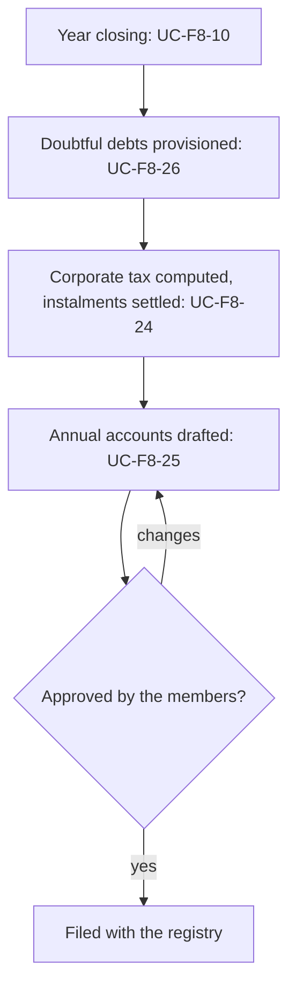

🏠 [Specs](../../../README.md) › 🧩 [Functional capabilities](../../README.md) › 📒 [F8 Accounting](../README.md) ›
🔀 [Flows](README.md) › 🔀 FL-F8-08 Year-end duties

# 🔀 FL-F8-08 Year-end duties

**Status:** ✅ specified

## Summary

At the year's end: doubtful debts provisioned, corporate tax and local business taxes computed and paid, the annual
accounts approved and filed.

## Personas

- [U05 Accounting](../../../01-users/personas/u05-accounting.md)
- [U08 External accountant](../../../01-users/personas/u08-external-accountant.md)
- [U13 Owner](../../../01-users/personas/u13-owner.md)

## Flowchart

## Sequence diagram

- [UC-F8-25 Approve and file the annual accounts](../use-cases/08-year-end-duties/uc-f08-25-approve-and-file-the-annual-accounts.md#sequence-diagram)

## Steps

| Step | Persona | Screen | Use case | What happens |
|---|---|---|---|---|
| 1 | [U05](../../../01-users/personas/u05-accounting.md) | [S-F8-26](../screens/08-year-end-duties/s-f08-26-doubtful-debts.md) | [UC-F8-26](../use-cases/08-year-end-duties/uc-f08-26-provision-doubtful-debts.md) | Provision the doubtful debts by age and risk |
| 2 | [U08](../../../01-users/personas/u08-external-accountant.md) | [S-F8-24](../screens/08-year-end-duties/s-f08-24-corporate-tax.md) | [UC-F8-24](../use-cases/08-year-end-duties/uc-f08-24-compute-and-pay-corporate-tax-and-local-business-taxes.md) | Compute corporate tax and settle the instalments |
| 3 | [U08](../../../01-users/personas/u08-external-accountant.md) | [S-F8-25](../screens/08-year-end-duties/s-f08-25-annual-accounts.md) | [UC-F8-25](../use-cases/08-year-end-duties/uc-f08-25-approve-and-file-the-annual-accounts.md) | Draft the annual accounts |
| 4 | [U13](../../../01-users/personas/u13-owner.md) | [S-F8-25](../screens/08-year-end-duties/s-f08-25-annual-accounts.md) | [UC-F8-25](../use-cases/08-year-end-duties/uc-f08-25-approve-and-file-the-annual-accounts.md) | Approve and file them |

### Entities and screens

| Entity | States in this flow | Shown at step and screen | Aggregated view |
|---|---|---|---|
| [E-F8-10 Fiscal period](../data/e-f08-10-fiscal-period.md) | Active | 3, 4 [S-F8-25](../screens/08-year-end-duties/s-f08-25-annual-accounts.md) | Fiscal periods |
| [E-F8-23 Doubtful debt provision](../data/e-f08-23-doubtful-debt-provision.md) | Set, Reversed, Written off | 1 [S-F8-26](../screens/08-year-end-duties/s-f08-26-doubtful-debts.md) | Doubtful debt provisions |
| [E-F8-21 Corporate tax computation](../data/e-f08-21-corporate-tax-computation.md) | Draft, Filed, Paid | 2 [S-F8-24](../screens/08-year-end-duties/s-f08-24-corporate-tax.md) | Corporate tax computations |
| [E-F8-22 Annual accounts file](../data/e-f08-22-annual-accounts-file.md) | Draft, Approved, Filed | 3, 4 [S-F8-25](../screens/08-year-end-duties/s-f08-25-annual-accounts.md) | Annual accounts files |

## Errors

A provision on a paid invoice, an instalment date missed, accounts not approved within six months (BR-F8-16 to
BR-F8-18).

## Images

Every step and error, for each persona taking part, in light and dark mode (D120). Steps are numbered as in the Steps
table; E rows are the error cases.

| Step | Persona | Device | Light | Dark |
|---|---|---|---|---|
| 1 | U05 | desktop | [light](../images/08-year-end-duties/u05-accounting/1-doubtful-debts-desktop-light.png) | [dark](../images/08-year-end-duties/u05-accounting/1-doubtful-debts-desktop-dark.png) |
| 2 | U08 | desktop | [light](../images/08-year-end-duties/u08-external-accountant/2-corporate-tax-desktop-light.png) | [dark](../images/08-year-end-duties/u08-external-accountant/2-corporate-tax-desktop-dark.png) |
| 3 | U08 | desktop | [light](../images/08-year-end-duties/u08-external-accountant/3-annual-accounts-desktop-light.png) | [dark](../images/08-year-end-duties/u08-external-accountant/3-annual-accounts-desktop-dark.png) |
| 4 | U13 | desktop | [light](../images/08-year-end-duties/u13-owner/4-annual-accounts-desktop-light.png) | [dark](../images/08-year-end-duties/u13-owner/4-annual-accounts-desktop-dark.png) |
| 4 | U13 | phone | [light](../images/08-year-end-duties/u13-owner/4-annual-accounts-phone-light.png) | [dark](../images/08-year-end-duties/u13-owner/4-annual-accounts-phone-dark.png) |
| E1 | U05 | desktop | [light](../images/08-year-end-duties/u05-accounting/e1-doubtful-debts-refused-desktop-light.png) | [dark](../images/08-year-end-duties/u05-accounting/e1-doubtful-debts-refused-desktop-dark.png) |

## Open questions

None.

---

⬅️ [FL-F8-07 Client money, grants and non-profits](fl-f08-07-client-money-grants-and-non-profits.md) ·
⬆️ [Up](README.md) · ➡️ [FL-F8-09 Pay, analyse and report](fl-f08-09-pay-analyse-and-report.md)
