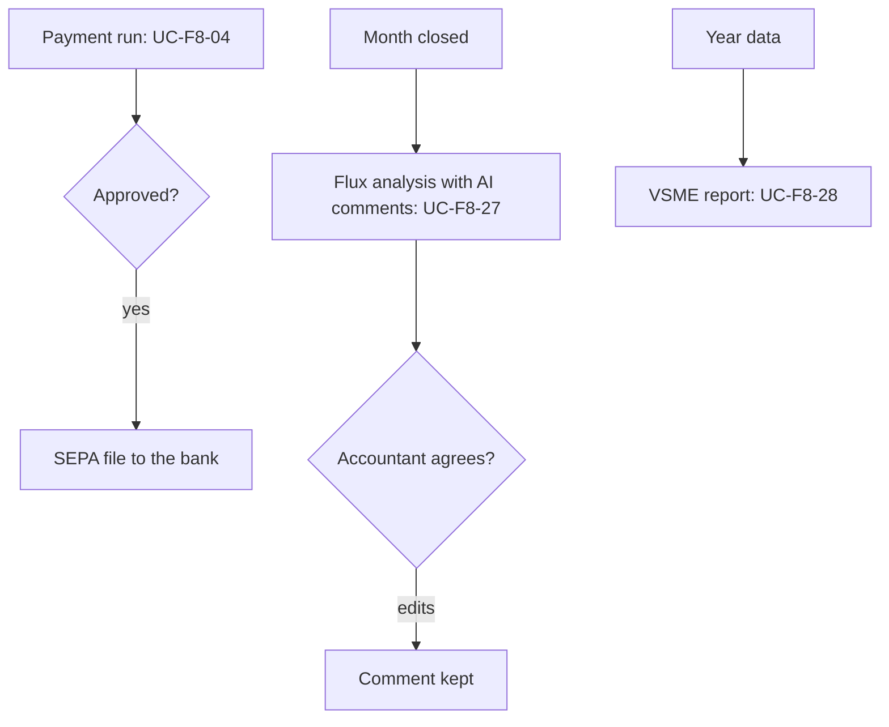

🏠 [Specs](../../../README.md) › 🧩 [Functional capabilities](../../README.md) › 📒 [F8 Accounting](../README.md) ›
🔀 [Flows](README.md) › 🔀 FL-F8-09 Pay, analyse and report

# 🔀 FL-F8-09 Pay, analyse and report

**Status:** ✅ specified

## Summary

Suppliers paid in a controlled run, the month's flux explained with AI comments, and the sustainability report that
banks and customers ask for.

## Personas

- [U05 Accounting](../../../01-users/personas/u05-accounting.md)
- [U13 Owner](../../../01-users/personas/u13-owner.md)

## Flowchart

## Sequence diagram

- [UC-F8-27 Analyse the month's flux with AI comments](../use-cases/09-pay-analyse-and-report/uc-f08-27-analyse-the-months-flux-with-ai-comments.md#sequence-diagram)

## Steps

| Step | Persona | Screen | Use case | What happens |
|---|---|---|---|---|
| 1 | [U05](../../../01-users/personas/u05-accounting.md) | [S-F8-04](../screens/02-purchase-to-pay/s-f08-04-supplier-payments.md) | [UC-F8-04](../use-cases/02-purchase-to-pay/uc-f08-04-pay-suppliers.md) | Prepare, approve and send a payment run |
| 2 | [U05](../../../01-users/personas/u05-accounting.md) | [S-F8-27](../screens/09-pay-analyse-and-report/s-f08-27-flux-analysis.md) | [UC-F8-27](../use-cases/09-pay-analyse-and-report/uc-f08-27-analyse-the-months-flux-with-ai-comments.md) | Read the month's flux with AI comments |
| 3 | [U13](../../../01-users/personas/u13-owner.md) | [S-F8-28](../screens/09-pay-analyse-and-report/s-f08-28-sustainability-report.md) | [UC-F8-28](../use-cases/09-pay-analyse-and-report/uc-f08-28-prepare-the-sustainability-report.md) | Prepare the sustainability report |

### Entities and screens

| Entity | States in this flow | Shown at step and screen | Aggregated view |
|---|---|---|---|
| [E-F8-28 Payment run](../data/e-f08-28-payment-run.md) | Active | 1 [S-F8-04](../screens/02-purchase-to-pay/s-f08-04-supplier-payments.md) | Payment runs |
| [E-F8-10 Fiscal period](../data/e-f08-10-fiscal-period.md) | Active | Shown elsewhere: [S-F8-01 Books setup](../screens/01-set-up-and-post/s-f08-01-books-setup.md) | Fiscal periods |
| [E-F8-24 Variance comment](../data/e-f08-24-variance-comment.md) | Draft, Confirmed | 2 [S-F8-27](../screens/09-pay-analyse-and-report/s-f08-27-flux-analysis.md) | Variance comments |
| [E-F8-25 Sustainability report](../data/e-f08-25-sustainability-report.md) | Draft, Exported | 3 [S-F8-28](../screens/09-pay-analyse-and-report/s-f08-28-sustainability-report.md) | Sustainability reports |

## Errors

A changed supplier IBAN in the run, a comment on a figure the AI could not explain, missing sustainability data
(BR-F8-08, BR-F8-19, BR-F8-20).

## Images

Every step and error, for each persona taking part, in light and dark mode (D120). Steps are numbered as in the Steps
table; E rows are the error cases.

| Step | Persona | Device | Light | Dark |
|---|---|---|---|---|
| 1 | U05 | desktop | [light](../images/09-pay-analyse-and-report/u05-accounting/1-supplier-payments-desktop-light.png) | [dark](../images/09-pay-analyse-and-report/u05-accounting/1-supplier-payments-desktop-dark.png) |
| 2 | U05 | desktop | [light](../images/09-pay-analyse-and-report/u05-accounting/2-flux-analysis-desktop-light.png) | [dark](../images/09-pay-analyse-and-report/u05-accounting/2-flux-analysis-desktop-dark.png) |
| 3 | U13 | desktop | [light](../images/09-pay-analyse-and-report/u13-owner/3-sustainability-report-desktop-light.png) | [dark](../images/09-pay-analyse-and-report/u13-owner/3-sustainability-report-desktop-dark.png) |
| 3 | U13 | phone | [light](../images/09-pay-analyse-and-report/u13-owner/3-sustainability-report-phone-light.png) | [dark](../images/09-pay-analyse-and-report/u13-owner/3-sustainability-report-phone-dark.png) |
| E1 | U05 | desktop | [light](../images/09-pay-analyse-and-report/u05-accounting/e1-supplier-payments-refused-desktop-light.png) | [dark](../images/09-pay-analyse-and-report/u05-accounting/e1-supplier-payments-refused-desktop-dark.png) |

## Open questions

None.

---

⬅️ [FL-F8-08 Year-end duties](fl-f08-08-year-end-duties.md) · ⬆️ [Up](README.md) ·
➡️ [FL-F8-10 Accountant collaboration](fl-f08-10-accountant-collaboration.md)
