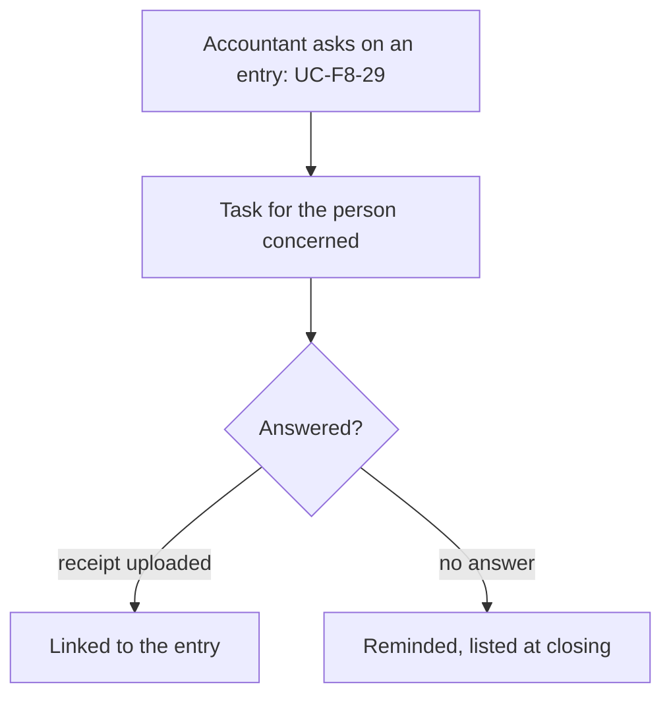

🏠 [Specs](../../../README.md) › 🧩 [Functional capabilities](../../README.md) › 📒 [F8 Accounting](../README.md) ›
🔀 [Flows](README.md) › 🔀 FL-F8-10 Accountant collaboration

# 🔀 FL-F8-10 Accountant collaboration

**Status:** ✅ specified

## Summary

The external accountant asks questions on entries and requests missing receipts; the company answers in SimpleERP,
where each answer stays with its entry.

## Personas

- [U01 Employee](../../../01-users/personas/u01-employee.md)
- [U05 Accounting](../../../01-users/personas/u05-accounting.md)
- [U08 External accountant](../../../01-users/personas/u08-external-accountant.md)

## Flowchart

## Sequence diagram

- [UC-F8-29 Answer the accountant's questions and requests](../use-cases/10-accountant-collaboration/uc-f08-29-answer-the-accountants-questions-and-requests.md#sequence-diagram)

## Steps

| Step | Persona | Screen | Use case | What happens |
|---|---|---|---|---|
| 1 | [U08](../../../01-users/personas/u08-external-accountant.md) | [S-F8-14](../screens/01-set-up-and-post/s-f08-14-accountant-workspace.md) | [UC-F8-29](../use-cases/10-accountant-collaboration/uc-f08-29-answer-the-accountants-questions-and-requests.md) | Ask a question and request missing receipts |
| 2 | [U01](../../../01-users/personas/u01-employee.md) | [S-F8-14](../screens/01-set-up-and-post/s-f08-14-accountant-workspace.md) | [UC-F8-29](../use-cases/10-accountant-collaboration/uc-f08-29-answer-the-accountants-questions-and-requests.md) | The employee uploads the missing receipt |
| 3 | [U05](../../../01-users/personas/u05-accounting.md) | [S-F8-14](../screens/01-set-up-and-post/s-f08-14-accountant-workspace.md) | [UC-F8-29](../use-cases/10-accountant-collaboration/uc-f08-29-answer-the-accountants-questions-and-requests.md) | Accounting answers the question |

### Entities and screens

| Entity | States in this flow | Shown at step and screen | Aggregated view |
|---|---|---|---|
| [E-F8-03 Journal entry](../data/e-f08-03-journal-entry.md) | Draft, Posted, Reversed | 1, 2, 3 [S-F8-14](../screens/01-set-up-and-post/s-f08-14-accountant-workspace.md) | Journal entries |
| [E-F8-26 Accountant request](../data/e-f08-26-accountant-request.md) | Open, Answered | 1, 2, 3 [S-F8-14](../screens/01-set-up-and-post/s-f08-14-accountant-workspace.md) | Accountant requests |
| [E-F2-13 Document](../../f02-no-code-configuration/data/e-f02-13-document.md) | To sort, To validate, Done | Shown elsewhere: [S-F2-13 Documents workspace](../../f02-no-code-configuration/screens/07-benchmark-additions/s-f02-13-documents-workspace.md) | Documents |

## Errors

A request on an entry of a locked period, no answer before the closing (BR-F8-21).

## Images

Every step and error, for each persona taking part, in light and dark mode (D120). Steps are numbered as in the Steps
table; E rows are the error cases.

| Step | Persona | Device | Light | Dark |
|---|---|---|---|---|
| 1 | U08 | desktop | [light](../images/10-accountant-collaboration/u08-external-accountant/1-accountant-workspace-desktop-light.png) | [dark](../images/10-accountant-collaboration/u08-external-accountant/1-accountant-workspace-desktop-dark.png) |
| 2 | U01 | desktop | [light](../images/10-accountant-collaboration/u01-employee/2-accountant-workspace-desktop-light.png) | [dark](../images/10-accountant-collaboration/u01-employee/2-accountant-workspace-desktop-dark.png) |
| 2 | U01 | phone | [light](../images/10-accountant-collaboration/u01-employee/2-accountant-workspace-phone-light.png) | [dark](../images/10-accountant-collaboration/u01-employee/2-accountant-workspace-phone-dark.png) |
| 3 | U05 | desktop | [light](../images/10-accountant-collaboration/u05-accounting/3-accountant-workspace-desktop-light.png) | [dark](../images/10-accountant-collaboration/u05-accounting/3-accountant-workspace-desktop-dark.png) |
| E1 | U08 | desktop | [light](../images/10-accountant-collaboration/u08-external-accountant/e1-accountant-workspace-refused-desktop-light.png) | [dark](../images/10-accountant-collaboration/u08-external-accountant/e1-accountant-workspace-refused-desktop-dark.png) |

## Open questions

None.

---

⬅️ [FL-F8-09 Pay, analyse and report](fl-f08-09-pay-analyse-and-report.md) · ⬆️ [Up](README.md) ·
➡️ [FL-F8-11 Treasury and payment means](fl-f08-11-treasury-and-payment-means.md)
