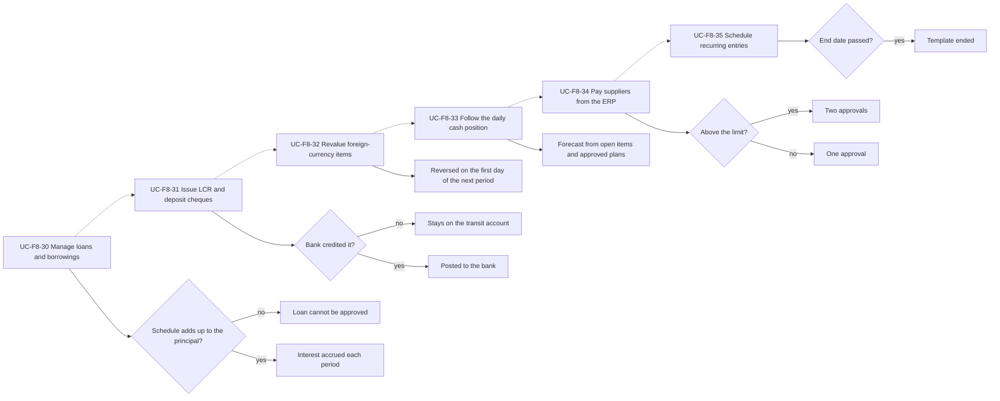
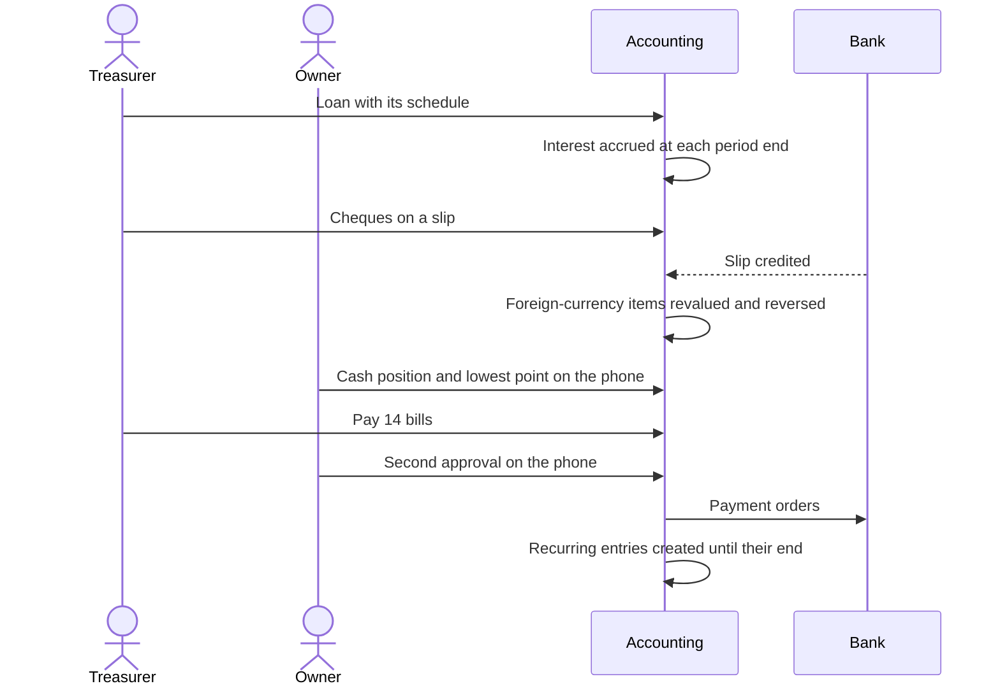

🏠 [Specs](../../../README.md) › 🧩 [Functional capabilities](../../README.md) › 📒 [F8 Accounting](../README.md) ›
🔀 [Flows](README.md) › 🔀 FL-F8-11 Treasury and payment means

# 🔀 FL-F8-11 Treasury and payment means

**Status:** 🔄 waiting for the owner

## Summary

The treasurer records loans and accrues their interest each period, accounting remits cheques and LCR and posts them
only when the bank credits them, revalues foreign-currency items at the closing rate and reverses the difference next
period, and schedules recurring entries that stop at their end date. The treasurer and the owner follow the daily cash
position on a phone, built only from open items and approved plans, and pay suppliers from simple-ERP with two approvals
above the limit ([D527](../../../06-decisions/f08-accounting/d527-benchmark-gaps-f08-accounting.md)).

## Personas

- [U31 Treasurer](../../../01-users/personas/u31-treasurer.md), who manages loans, remittances and payments
- [U05 Accounting](../../../01-users/personas/u05-accounting.md)
- [U13 Owner](../../../01-users/personas/u13-owner.md), who reads the cash position and approves large payments on a
  phone

## Flowchart

## Sequence diagram

## Steps

| Step | Persona | Screen | Use case | What happens |
|---|---|---|---|---|
| 1 | [U31](../../../01-users/personas/u31-treasurer.md) | [S-F8-29](../screens/11-treasury-and-payment-means/s-f08-29-loans.md) | [UC-F8-30](../use-cases/11-treasury-and-payment-means/uc-f08-30-manage-loans-and-borrowings.md) | The treasurer records a loan; its schedule adds up to the principal and the interest is accrued each period |
| 2 | [U05](../../../01-users/personas/u05-accounting.md) | [S-F8-30](../screens/11-treasury-and-payment-means/s-f08-30-payment-means.md) | [UC-F8-31](../use-cases/11-treasury-and-payment-means/uc-f08-31-issue-lcr-and-deposit-cheques.md) | Accounting remits cheques and LCR on a slip; they are posted to the bank when the bank credits them |
| 3 | [U05](../../../01-users/personas/u05-accounting.md) | [S-F8-31](../screens/11-treasury-and-payment-means/s-f08-31-fx-revaluation.md) | [UC-F8-32](../use-cases/11-treasury-and-payment-means/uc-f08-32-revalue-foreign-currency-items.md) | Accounting revalues foreign-currency items at the closing rate; the difference is reversed next period |
| 4 | [U31](../../../01-users/personas/u31-treasurer.md) | [S-F8-32](../screens/11-treasury-and-payment-means/s-f08-32-cash-position.md) | [UC-F8-33](../use-cases/11-treasury-and-payment-means/uc-f08-33-follow-the-daily-cash-position.md) | The treasurer and the owner read the cash position and the forecast on a phone |
| 5 | [U31](../../../01-users/personas/u31-treasurer.md) | [S-F8-33](../screens/11-treasury-and-payment-means/s-f08-33-payment-initiation.md) | [UC-F8-34](../use-cases/11-treasury-and-payment-means/uc-f08-34-pay-suppliers-from-the-erp.md) | The treasurer pays approved bills from simple-ERP; payments above the limit need two approvals |
| 6 | [U05](../../../01-users/personas/u05-accounting.md) | [S-F8-34](../screens/11-treasury-and-payment-means/s-f08-34-recurring-entries.md) | [UC-F8-35](../use-cases/11-treasury-and-payment-means/uc-f08-35-schedule-recurring-entries.md) | Accounting schedules recurring entries that stop at their end date |

### Entities and screens

| Entity | States in this flow | Shown at step and screen | Aggregated view |
|---|---|---|---|
| [E-F8-34 Loan](../data/e-f08-34-loan.md) | Draft, Active, Cancelled, Repaid | 1 [S-F8-29](../screens/11-treasury-and-payment-means/s-f08-29-loans.md) | Loans |
| [E-F8-35 Remittance slip](../data/e-f08-35-remittance-slip.md) | Draft, Remitted, Credited, Partly credited, Closed | 2 [S-F8-30](../screens/11-treasury-and-payment-means/s-f08-30-payment-means.md) | Remittance slips |
| [E-F8-36 Revaluation run](../data/e-f08-36-revaluation-run.md) | Computed, Posted, Reversed | 3 [S-F8-31](../screens/11-treasury-and-payment-means/s-f08-31-fx-revaluation.md) | Revaluation runs |
| [E-F8-37 Cash forecast](../data/e-f08-37-cash-forecast.md) | Current, Superseded, Archived | 4 [S-F8-32](../screens/11-treasury-and-payment-means/s-f08-32-cash-position.md) | Cash forecasts |
| [E-F8-38 Payment order](../data/e-f08-38-payment-order.md) | Draft, Awaiting approval, Approved, Sent, Executed, Rejected, Cancelled | 5 [S-F8-33](../screens/11-treasury-and-payment-means/s-f08-33-payment-initiation.md) | Payment orders |
| [E-F8-39 Entry template](../data/e-f08-39-entry-template.md) | Draft, Active, Paused, Ended | 6 [S-F8-34](../screens/11-treasury-and-payment-means/s-f08-34-recurring-entries.md) | Entry templates |

## Errors

- **E1 The repayment schedule does not add up.** The principal repaid over the schedule differs from the amount
  borrowed: the loan cannot be approved and the difference is shown
  ([BR-F8-22](../business-rules/br-f08-22-loan-interest-is-accrued-each-period.md), step 1).

## Images

Every step and error, for each persona taking part, in light and dark mode (D120). Steps are numbered as in the Steps
table; E rows are the error cases.

| Step | Persona | Device | Light | Dark |
|---|---|---|---|---|
| 1 | U31 | desktop | [light](../images/11-treasury-and-payment-means/u31-treasurer/1-loans-desktop-light.png) | [dark](../images/11-treasury-and-payment-means/u31-treasurer/1-loans-desktop-dark.png) |
| 1 | U05 | desktop | [light](../images/11-treasury-and-payment-means/u05-accounting/1-loans-desktop-light.png) | [dark](../images/11-treasury-and-payment-means/u05-accounting/1-loans-desktop-dark.png) |
| 1 | U31 | phone | [light](../images/11-treasury-and-payment-means/u31-treasurer/1-loans-phone-light.png) | [dark](../images/11-treasury-and-payment-means/u31-treasurer/1-loans-phone-dark.png) |
| 2 | U05 | desktop | [light](../images/11-treasury-and-payment-means/u05-accounting/2-payment-means-desktop-light.png) | [dark](../images/11-treasury-and-payment-means/u05-accounting/2-payment-means-desktop-dark.png) |
| 2 | U31 | desktop | [light](../images/11-treasury-and-payment-means/u31-treasurer/2-payment-means-desktop-light.png) | [dark](../images/11-treasury-and-payment-means/u31-treasurer/2-payment-means-desktop-dark.png) |
| 3 | U05 | desktop | [light](../images/11-treasury-and-payment-means/u05-accounting/3-fx-revaluation-desktop-light.png) | [dark](../images/11-treasury-and-payment-means/u05-accounting/3-fx-revaluation-desktop-dark.png) |
| 4 | U31 | phone | [light](../images/11-treasury-and-payment-means/u31-treasurer/4-cash-position-phone-light.png) | [dark](../images/11-treasury-and-payment-means/u31-treasurer/4-cash-position-phone-dark.png) |
| 4 | U13 | phone | [light](../images/11-treasury-and-payment-means/u13-owner/4-cash-position-phone-light.png) | [dark](../images/11-treasury-and-payment-means/u13-owner/4-cash-position-phone-dark.png) |
| 4 | U31 | desktop | [light](../images/11-treasury-and-payment-means/u31-treasurer/4-cash-position-desktop-light.png) | [dark](../images/11-treasury-and-payment-means/u31-treasurer/4-cash-position-desktop-dark.png) |
| 5 | U31 | desktop | [light](../images/11-treasury-and-payment-means/u31-treasurer/5-payment-initiation-desktop-light.png) | [dark](../images/11-treasury-and-payment-means/u31-treasurer/5-payment-initiation-desktop-dark.png) |
| 5 | U13 | phone | [light](../images/11-treasury-and-payment-means/u13-owner/5-payment-initiation-phone-light.png) | [dark](../images/11-treasury-and-payment-means/u13-owner/5-payment-initiation-phone-dark.png) |
| 5 | U31 | phone | [light](../images/11-treasury-and-payment-means/u31-treasurer/5-payment-initiation-phone-light.png) | [dark](../images/11-treasury-and-payment-means/u31-treasurer/5-payment-initiation-phone-dark.png) |
| 6 | U05 | desktop | [light](../images/11-treasury-and-payment-means/u05-accounting/6-recurring-entries-desktop-light.png) | [dark](../images/11-treasury-and-payment-means/u05-accounting/6-recurring-entries-desktop-dark.png) |
| E1 | U31 | desktop | [light](../images/11-treasury-and-payment-means/u31-treasurer/e1-the-repayment-schedule-does-not-add-up-desktop-light.png) | [dark](../images/11-treasury-and-payment-means/u31-treasurer/e1-the-repayment-schedule-does-not-add-up-desktop-dark.png) |
| E1 | U31 | phone | [light](../images/11-treasury-and-payment-means/u31-treasurer/e1-the-repayment-schedule-does-not-add-up-phone-light.png) | [dark](../images/11-treasury-and-payment-means/u31-treasurer/e1-the-repayment-schedule-does-not-add-up-phone-dark.png) |

## Open questions

None.

---

⬅️ [FL-F8-10 Accountant collaboration](fl-f08-10-accountant-collaboration.md) · ⬆️ [Up](README.md) ·
➡️ [FL-F8-12 Audit, leases and special books](fl-f08-12-audit-leases-and-special-books.md)
