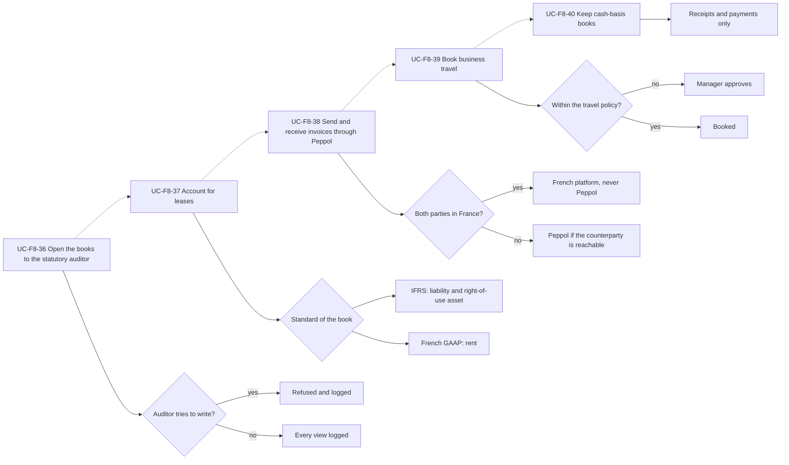
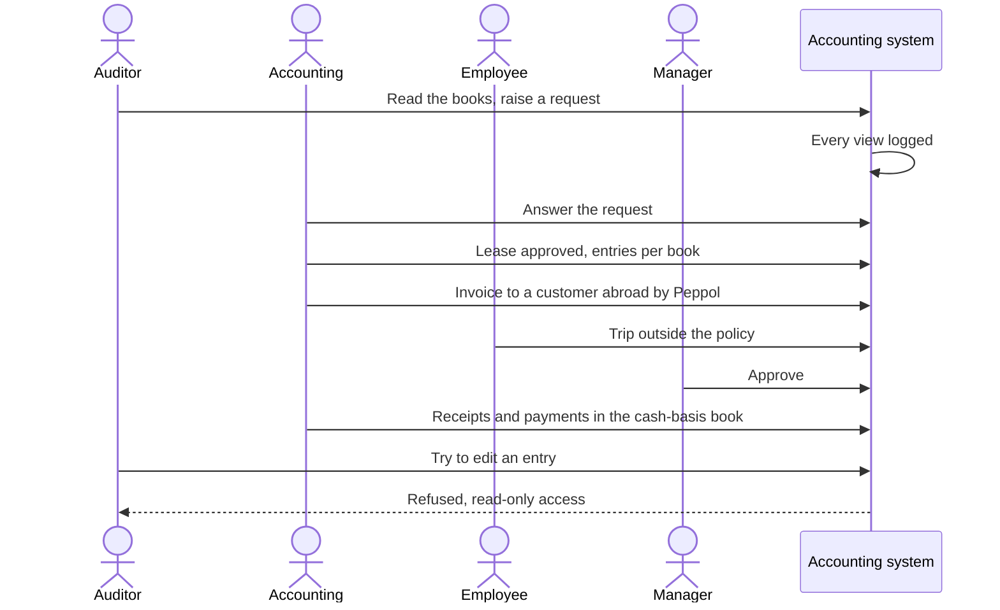

🏠 [Specs](../../../README.md) › 🧩 [Functional capabilities](../../README.md) › 📒 [F8 Accounting](../README.md) ›
🔀 [Flows](README.md) › 🔀 FL-F8-12 Audit, leases and special books

# 🔀 FL-F8-12 Audit, leases and special books

**Status:** 🔄 waiting for the owner

## Summary

The statutory auditor reads the books in a read-only workspace and raises requests that accounting answers, with every
view logged. Leases are accounted for in each book by its standard, invoices to companies abroad can go through Peppol
while French exchanges stay on the approved platforms, employees book business travel within a policy with exceptions
approved by their manager, and a small professional keeps a cash-basis book of receipts and payments
([D527](../../../06-decisions/f08-accounting/d527-benchmark-gaps-f08-accounting.md)).

## Personas

- [U49 Statutory auditor](../../../01-users/personas/u49-statutory-auditor.md), who reads the books and raises requests,
  read-only
- [U05 Accounting](../../../01-users/personas/u05-accounting.md)
- [U08 External accountant](../../../01-users/personas/u08-external-accountant.md), who reads the leases and their
  treatment
- [U01 Employee](../../../01-users/personas/u01-employee.md), who books a trip from a phone
- [U02 Manager](../../../01-users/personas/u02-manager.md), who approves trips outside the policy
- [U36 Professional](../../../01-users/personas/u36-professional.md), who keeps a cash-basis book

## Flowchart

## Sequence diagram

## Steps

| Step | Persona | Screen | Use case | What happens |
|---|---|---|---|---|
| 1 | [U49](../../../01-users/personas/u49-statutory-auditor.md) | [S-F8-35](../screens/12-audit-leases-and-special-books/s-f08-35-auditor-workspace.md) | [UC-F8-36](../use-cases/12-audit-leases-and-special-books/uc-f08-36-open-the-books-to-the-statutory-auditor.md) | Accounting invites the statutory auditor to the read-only workspace; the auditor reads the books and raises requests that accounting answers |
| 2 | [U05](../../../01-users/personas/u05-accounting.md) | [S-F8-36](../screens/12-audit-leases-and-special-books/s-f08-36-leases.md) | [UC-F8-37](../use-cases/12-audit-leases-and-special-books/uc-f08-37-account-for-leases.md) | Accounting records a lease; each book accounts for it by its standard |
| 3 | [U05](../../../01-users/personas/u05-accounting.md) | [S-F8-37](../screens/12-audit-leases-and-special-books/s-f08-37-peppol.md) | [UC-F8-38](../use-cases/12-audit-leases-and-special-books/uc-f08-38-send-and-receive-invoices-through-peppol.md) | Accounting registers on Peppol and sends invoices to companies abroad; French exchanges stay on the approved platforms |
| 4 | [U01](../../../01-users/personas/u01-employee.md) | [S-F8-38](../screens/12-audit-leases-and-special-books/s-f08-38-business-travel.md) | [UC-F8-39](../use-cases/12-audit-leases-and-special-books/uc-f08-39-book-business-travel.md) | An employee books a trip on a phone; a trip outside the policy waits for the manager |
| 5 | [U05](../../../01-users/personas/u05-accounting.md) | [S-F8-39](../screens/12-audit-leases-and-special-books/s-f08-39-cash-basis-books.md) | [UC-F8-40](../use-cases/12-audit-leases-and-special-books/uc-f08-40-keep-cash-basis-books.md) | A small professional keeps a cash-basis book of receipts and payments only |

### Entities and screens

| Entity | States in this flow | Shown at step and screen | Aggregated view |
|---|---|---|---|
| [E-F8-40 Audit request](../data/e-f08-40-audit-request.md) | Open, Provided, Queried, Closed | 1 [S-F8-35](../screens/12-audit-leases-and-special-books/s-f08-35-auditor-workspace.md) | Audit requests |
| [E-F8-41 Lease](../data/e-f08-41-lease.md) | Draft, Active, Modified, Ended | 2 [S-F8-36](../screens/12-audit-leases-and-special-books/s-f08-36-leases.md) | Leases |
| [E-F8-42 Peppol participant](../data/e-f08-42-peppol-participant.md) | Pending, Active, Refused, Suspended, Deregistered | 3 [S-F8-37](../screens/12-audit-leases-and-special-books/s-f08-37-peppol.md) | Peppol participants |
| [E-F8-43 Trip](../data/e-f08-43-trip.md) | Draft, Booked, Awaiting approval, Approved, Rejected, Completed, Cancelled | 4 [S-F8-38](../screens/12-audit-leases-and-special-books/s-f08-38-business-travel.md) | Trips |

## Errors

- **E1 The auditor tries to change the books.** Any attempt to edit, post, upload or delete is refused with "read-only
  access" and logged ([BR-F8-28](../business-rules/br-f08-28-the-auditor-reads-only-and-every-view-is-logged.md), step
  1).

## Images

Every step and error, for each persona taking part, in light and dark mode (D120). Steps are numbered as in the Steps
table; E rows are the error cases.

| Step | Persona | Device | Light | Dark |
|---|---|---|---|---|
| 1 | U49 | desktop | [light](../images/12-audit-leases-and-special-books/u49-statutory-auditor/1-auditor-workspace-desktop-light.png) | [dark](../images/12-audit-leases-and-special-books/u49-statutory-auditor/1-auditor-workspace-desktop-dark.png) |
| 1 | U05 | desktop | [light](../images/12-audit-leases-and-special-books/u05-accounting/1-auditor-workspace-desktop-light.png) | [dark](../images/12-audit-leases-and-special-books/u05-accounting/1-auditor-workspace-desktop-dark.png) |
| 2 | U05 | desktop | [light](../images/12-audit-leases-and-special-books/u05-accounting/2-leases-desktop-light.png) | [dark](../images/12-audit-leases-and-special-books/u05-accounting/2-leases-desktop-dark.png) |
| 2 | U08 | desktop | [light](../images/12-audit-leases-and-special-books/u08-external-accountant/2-leases-desktop-light.png) | [dark](../images/12-audit-leases-and-special-books/u08-external-accountant/2-leases-desktop-dark.png) |
| 3 | U05 | desktop | [light](../images/12-audit-leases-and-special-books/u05-accounting/3-peppol-desktop-light.png) | [dark](../images/12-audit-leases-and-special-books/u05-accounting/3-peppol-desktop-dark.png) |
| 4 | U01 | phone | [light](../images/12-audit-leases-and-special-books/u01-employee/4-business-travel-phone-light.png) | [dark](../images/12-audit-leases-and-special-books/u01-employee/4-business-travel-phone-dark.png) |
| 4 | U02 | desktop | [light](../images/12-audit-leases-and-special-books/u02-manager/4-business-travel-desktop-light.png) | [dark](../images/12-audit-leases-and-special-books/u02-manager/4-business-travel-desktop-dark.png) |
| 4 | U01 | desktop | [light](../images/12-audit-leases-and-special-books/u01-employee/4-business-travel-desktop-light.png) | [dark](../images/12-audit-leases-and-special-books/u01-employee/4-business-travel-desktop-dark.png) |
| 5 | U05 | desktop | [light](../images/12-audit-leases-and-special-books/u05-accounting/5-cash-basis-books-desktop-light.png) | [dark](../images/12-audit-leases-and-special-books/u05-accounting/5-cash-basis-books-desktop-dark.png) |
| 5 | U36 | desktop | [light](../images/12-audit-leases-and-special-books/u36-professional/5-cash-basis-books-desktop-light.png) | [dark](../images/12-audit-leases-and-special-books/u36-professional/5-cash-basis-books-desktop-dark.png) |
| E1 | U49 | desktop | [light](../images/12-audit-leases-and-special-books/u49-statutory-auditor/e1-the-auditor-tries-to-change-the-books-desktop-light.png) | [dark](../images/12-audit-leases-and-special-books/u49-statutory-auditor/e1-the-auditor-tries-to-change-the-books-desktop-dark.png) |

## Open questions

None.

---

⬅️ [FL-F8-11 Treasury and payment means](fl-f08-11-treasury-and-payment-means.md) · ⬆️ [Up](README.md)
