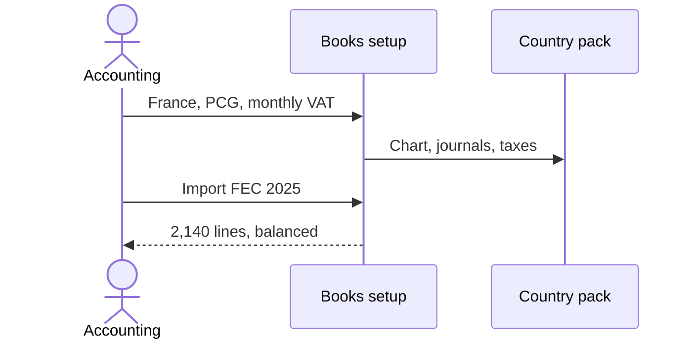

🏠 [Specs](../../../../README.md) › 🧩 [Functional capabilities](../../../README.md) ›
📒 [F8 Accounting](../../README.md) › 📝 [Use cases](../README.md) › 📝 [Use cases: FL-F8-01 Set up and post](README.md) ›
📝 UC-F8-01 Set up the books

# 📝 UC-F8-01 Set up the books

**Status:** ✅ specified

## Summary

The chart of accounts (PCG for France), journals, fiscal years, currencies, taxes (D260), fiscal positions and analytic
plans are set.

## Personas

- [U05 Accounting](../../../../01-users/personas/u05-accounting.md)
- [U08 External accountant](../../../../01-users/personas/u08-external-accountant.md)
- [U07 Administrator](../../../../01-users/personas/u07-administrator.md)

## Goal

Books ready to post, matching the country's rules.

## Trigger

Setting up accounting.

## Frequency

Once; then yearly for new fiscal years.

## Preconditions

F8 set up for the company.

## Postconditions

- **Succeeded:** the chart, journals, taxes and opening balances are set.
- **Failed:** an unbalanced opening is refused.

## Main flow

1. Accounting opens books setup ([S-F8-01](../../screens/01-set-up-and-post/s-f08-01-books-setup.md)); the country pack
   sets the chart, journals, taxes and reports (France: PCG, French VAT, FEC,
   [CR-FR-006](../../../../10-country-packs/france/accounting/cr-fr-006-chart-of-accounts.md)).
2. The accountant adjusts accounts, journals, fiscal years, currencies and fiscal positions.
3. Opening balances are imported from an FEC or a spreadsheet.
4. The import checks the balance and reports what it created.

## Alternative flows

- 3a. Import from other software through its FEC.

## Error flows

- 3e. An opening balance that does not balance: refused with the difference.

## Business rules

- [BR-F8-06 Balanced entries, continuous numbers](../../business-rules/br-f08-06-balanced-entries-continuous-numbers.md)

## Entities

- [E-F8-01 Account](../../data/e-f08-01-account.md)
- [E-F8-02 Journal](../../data/e-f08-02-journal.md)
- [E-F8-10 Fiscal period](../../data/e-f08-10-fiscal-period.md)
- [E-F8-27 FEC file](../../data/e-f08-27-fec-file.md)
- [E-F8-29 Entry annotation](../../data/e-f08-29-entry-annotation.md)
- [E-F8-33 Tax rate](../../data/e-f08-33-tax-rate.md)

## Permissions

Accounting and the accountant; administrators read.

## Notifications

None.

## Audit events

Settings and imports.

## AI involvement

The AI proposes, people post ([BR-F8-09](../../business-rules/br-f08-09-the-ai-proposes-people-post.md)); figures come
from queries ([BR-F3-03](../../../f03-assistant/business-rules/br-f03-03-figures-come-from-queries.md)).

## API, MCP and A2A exposure

T5 operations of F8 with the caller's rights; the MCP tool of F8; no A2A skill.

## Screens

- [S-F8-01](../../screens/01-set-up-and-post/s-f08-01-books-setup.md)

## Flowchart

See [FL-F8-01 Set up and post](../../flows/fl-f08-01-set-up-and-post.md#flowchart).

## Sequence diagram

## Acceptance criteria

1. **Given** a French company **when** the books are set up **then** the PCG, French VAT rates and FEC export are ready.
2. **Given** an FEC of 2,140 lines **when** it is imported **then** the opening balances are created and balanced.
3. **Given** an opening balance short by 120 EUR **when** it is imported **then** it is refused with the difference.

## Non-functional notes

None.

## Regulatory references

[CR-FR-006](../../../../10-country-packs/france/accounting/cr-fr-006-chart-of-accounts.md);
[CR-FR-005](../../../../10-country-packs/france/accounting/cr-fr-005-fec-export.md).

## Related use cases

See the flows.

## Open questions

None.

---

⬆️ [Up](README.md) · ➡️ [UC-F8-02 Post and review entries](uc-f08-02-post-and-review-entries.md)
