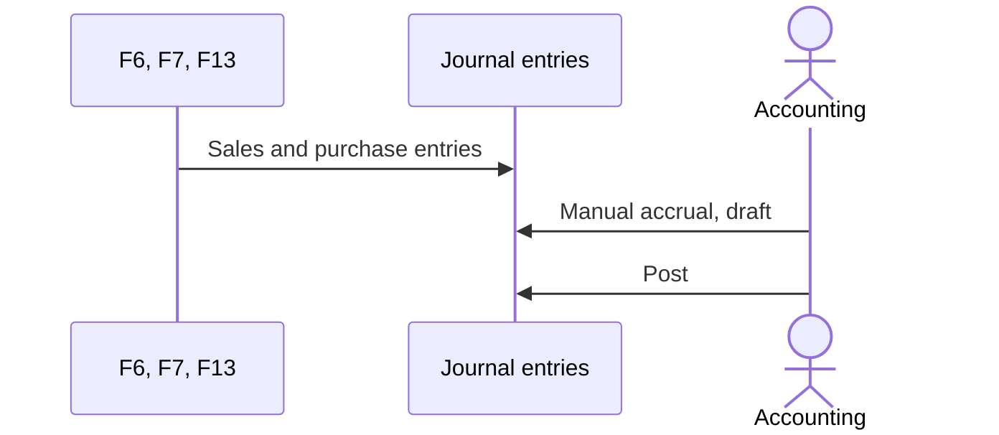

🏠 [Specs](../../../../README.md) › 🧩 [Functional capabilities](../../../README.md) ›
📒 [F8 Accounting](../../README.md) › 📝 [Use cases](../README.md) › 📝 [Use cases: FL-F8-01 Set up and post](README.md) ›
📝 UC-F8-02 Post and review entries

# 📝 UC-F8-02 Post and review entries

**Status:** ✅ specified

## Summary

Entries come from sales, purchases, banks, payroll and stock; accountants add, review and annotate.

## Personas

- [U05 Accounting](../../../../01-users/personas/u05-accounting.md)
- [U08 External accountant](../../../../01-users/personas/u08-external-accountant.md)

## Goal

Every operation in the books, reviewed.

## Trigger

Operations from other capabilities or manual entries.

## Frequency

Continuous.

## Preconditions

F8 set up for the company.

## Postconditions

- **Succeeded:** entries posted and inalterable
  ([BR-F8-01](../../business-rules/br-f08-01-posted-entries-never-change.md)).
- **Failed:** unbalanced entries refused.

## Main flow

1. Most entries are posted from F6, F7, F9, F13 and the banks.
2. Accountants post manual and recurring entries on journal entries
   ([S-F8-02](../../screens/01-set-up-and-post/s-f08-02-journal-entries.md)).
3. Draft entries are checked before posting; posted ones never change,
   [CR-FR-003](../../../../10-country-packs/france/accounting/cr-fr-003-posted-entries-are-inalterable.md).
4. The external accountant reviews and asks questions
   ([UC-F8-29](../10-accountant-collaboration/uc-f08-29-answer-the-accountants-questions-and-requests.md)).

## Alternative flows

- 3a. Recurring entries post on their schedule.

## Error flows

- 2e. An unbalanced entry is refused
  ([BR-F8-06](../../business-rules/br-f08-06-balanced-entries-continuous-numbers.md)).
- 2e. An entry in a locked period is refused.

## Business rules

- [BR-F8-01 Posted entries never change](../../business-rules/br-f08-01-posted-entries-never-change.md)
- [BR-F8-06 Balanced entries, continuous numbers](../../business-rules/br-f08-06-balanced-entries-continuous-numbers.md)

## Entities

- [E-F8-03 Journal entry](../../data/e-f08-03-journal-entry.md)

## Permissions

Accounting and the external accountant; the owner reads; lock dates apply
([BR-F8-02](../../business-rules/br-f08-02-lock-dates.md)).

## Notifications

None.

## Audit events

Posted entries with their source.

## AI involvement

The AI proposes, people post ([BR-F8-09](../../business-rules/br-f08-09-the-ai-proposes-people-post.md)); figures come
from queries ([BR-F3-03](../../../f03-assistant/business-rules/br-f03-03-figures-come-from-queries.md)).

## API, MCP and A2A exposure

T5 operations of F8 with the caller's rights; the MCP tool of F8; no A2A skill.

## Screens

- [S-F8-02](../../screens/01-set-up-and-post/s-f08-02-journal-entries.md)

## Flowchart

See [FL-F8-01 Set up and post](../../flows/fl-f08-01-set-up-and-post.md#flowchart).

## Sequence diagram

## Acceptance criteria

1. **Given** a manual entry of 1,000 debit and 990 credit **when** it is posted **then** it is refused.
2. **Given** a posted entry **when** a change is asked **then** only a reversing entry is allowed.
3. **Given** a monthly rent entry **when** the 1st comes **then** it posts by itself.

## Non-functional notes

None.

## Regulatory references

[CR-FR-003](../../../../10-country-packs/france/accounting/cr-fr-003-posted-entries-are-inalterable.md);
[CR-FR-004](../../../../10-country-packs/france/accounting/cr-fr-004-balanced-entries-continuous-numbers.md).

## Related use cases

See the flows.

## Open questions

None.

---

⬅️ [UC-F8-01 Set up the books](uc-f08-01-set-up-the-books.md) · ⬆️ [Up](README.md) ·
➡️ [UC-F8-03 Process supplier bills](../02-purchase-to-pay/uc-f08-03-process-supplier-bills.md)
