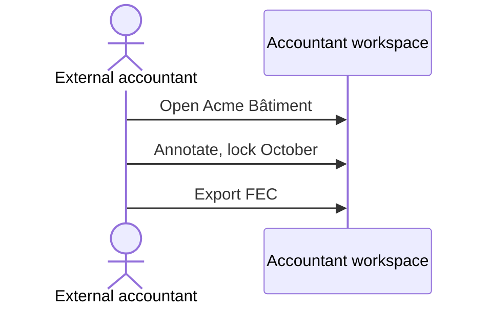

🏠 [Specs](../../../../README.md) › 🧩 [Functional capabilities](../../../README.md) ›
📒 [F8 Accounting](../../README.md) › 📝 [Use cases](../README.md) › 📝 [Use cases: FL-F8-01 Set up and post](README.md) ›
📝 UC-F8-14 Work with the external accountant

# 📝 UC-F8-14 Work with the external accountant

**Status:** ✅ specified

## Summary

The external accountant works in simple-ERP or in their own software.

## Personas

- [U08 External accountant](../../../../01-users/personas/u08-external-accountant.md)
- [U05 Accounting](../../../../01-users/personas/u05-accounting.md)

## Goal

The accountant works in simple-ERP or their own software, without exports by email.

## Trigger

The accountant reviews or closes.

## Frequency

Monthly.

## Preconditions

F8 set up for the company.

## Postconditions

- **Succeeded:** reviewed, annotated, exported or adjusted.
- **Failed:** an export refused shows why.

## Main flow

1. The accountant gets their own access ([D11](../../../../06-decisions/foundations/d11-outside-users.md)) to one or
   several client companies in the accountant workspace
   ([S-F8-14](../../screens/01-set-up-and-post/s-f08-14-accountant-workspace.md)).
2. They review, annotate, ask questions
   ([UC-F8-29](../10-accountant-collaboration/uc-f08-29-answer-the-accountants-questions-and-requests.md)) and lock
   periods.
3. They export the FEC or entries to their software, or import their adjustments.
4. An accounting firm moves between its clients from one account.

## Alternative flows

- 3a. Adjustments imported back as entries.

## Error flows

- 3e. Their software rejects the export: the FEC checker shows why.

## Business rules

- [BR-F8-02 Lock dates](../../business-rules/br-f08-02-lock-dates.md)
- [BR-F8-01 Posted entries never change](../../business-rules/br-f08-01-posted-entries-never-change.md)

## Entities

- [E-F8-02 Journal](../../data/e-f08-02-journal.md)
- [E-F8-03 Journal entry](../../data/e-f08-03-journal-entry.md)

## Permissions

The external accountant for the companies granted.

## Notifications

The company: questions.

## Audit events

Accountant sessions and actions.

## AI involvement

The AI proposes, people post ([BR-F8-09](../../business-rules/br-f08-09-the-ai-proposes-people-post.md)); figures come
from queries ([BR-F3-03](../../../f03-assistant/business-rules/br-f03-03-figures-come-from-queries.md)).

## API, MCP and A2A exposure

T5 operations of F8 with the caller's rights; the MCP tool of F8; no A2A skill.

## Screens

- [S-F8-14](../../screens/01-set-up-and-post/s-f08-14-accountant-workspace.md)

## Flowchart

See [FL-F8-01 Set up and post](../../flows/fl-f08-01-set-up-and-post.md#flowchart).

## Sequence diagram

## Acceptance criteria

1. **Given** Delorme Conseil's accountant with 250 client companies **when** she signs in **then** she switches between
   them from one account.
2. **Given** an FEC export **when** her software rejects it **then** the FEC checker shows the line at fault.
3. **Given** adjustments imported **when** they are posted **then** they appear as entries signed by her.

## Non-functional notes

None.

## Regulatory references

[CR-FR-005](../../../../10-country-packs/france/accounting/cr-fr-005-fec-export.md);
[CR-FR-152](../../../../10-country-packs/france/professional-firms/cr-fr-152-accountant-engagement-letter.md).

## Related use cases

See the flows.

- [UC-F8-29 Answer the accountant's questions and requests](../10-accountant-collaboration/uc-f08-29-answer-the-accountants-questions-and-requests.md)

## Open questions

None.

---

⬅️ [UC-F8-13 Consolidate the group](../05-close-report-and-consolidate/uc-f08-13-consolidate-the-group.md) ·
⬆️ [Up](README.md) · ➡️ [UC-F8-15 Keep several books](../06-benchmark-additions/uc-f08-15-keep-several-books.md)
