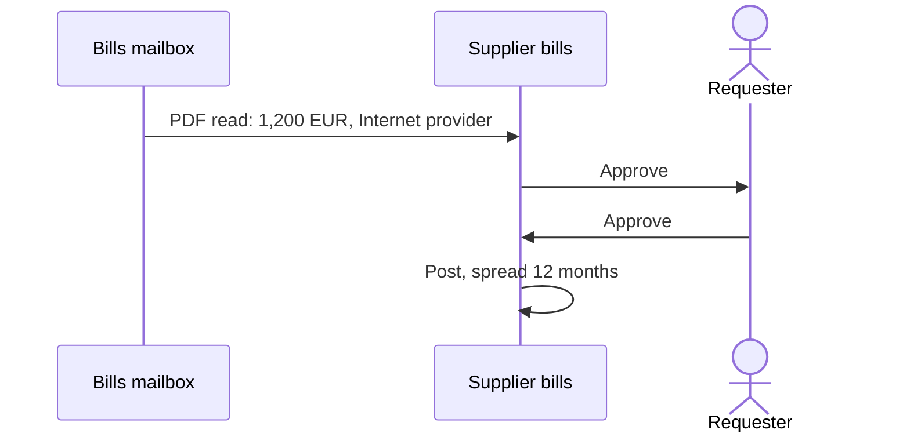

🏠 [Specs](../../../../README.md) › 🧩 [Functional capabilities](../../../README.md) ›
📒 [F8 Accounting](../../README.md) › 📝 [Use cases](../README.md) › 📝 [Use cases: FL-F8-02 Purchase to pay](README.md) ›
📝 UC-F8-03 Process supplier bills

# 📝 UC-F8-03 Process supplier bills

**Status:** ✅ specified

## Summary

Bills arrive from F7 or by email, are read by the AI, approved and posted, with deferred expenses where needed.

## Personas

- [U05 Accounting](../../../../01-users/personas/u05-accounting.md)

## Goal

Bills posted right, once, approved.

## Trigger

A bill arrives.

## Frequency

Daily.

## Preconditions

F8 set up for the company.

## Postconditions

- **Succeeded:** the bill is posted, matched or approved.
- **Failed:** a duplicate is flagged.

## Main flow

1. A bill arrives (e-invoice, PDF, email to a dedicated address); the AI reads it on supplier bills
   ([S-F8-03](../../screens/02-purchase-to-pay/s-f08-03-supplier-bills.md)).
2. It is matched to its order and receipt,
   [UC-F7-04](../../../f07-purchasing-and-stock/use-cases/01-procure/uc-f07-04-capture-and-match-supplier-invoices.md),
   or approved by its requester.
3. It is posted; a deferred expense is spread over its months
   ([UC-F8-08](../04-tax-assets-and-analytics/uc-f08-08-manage-fixed-assets-and-deferrals.md)).
4. It joins the next payment run ([UC-F8-04](uc-f08-04-pay-suppliers.md)).

## Alternative flows

- 3a. Reverse charge applied by the supplier's fiscal position.

## Error flows

- 1e. A duplicate (same supplier, number, amount): flagged.

## Business rules

- [BR-F8-01 Posted entries never change](../../business-rules/br-f08-01-posted-entries-never-change.md)
- [BR-F8-09 The AI proposes, people post](../../business-rules/br-f08-09-the-ai-proposes-people-post.md)

## Entities

- [E-F8-03 Journal entry](../../data/e-f08-03-journal-entry.md)
- [E-F8-06 Tax return](../../data/e-f08-06-tax-return.md)
- [E-F8-28 Payment run](../../data/e-f08-28-payment-run.md)

## Permissions

Accounting and the external accountant; the owner reads; lock dates apply
([BR-F8-02](../../business-rules/br-f08-02-lock-dates.md)).

## Notifications

Requesters: bills to approve.

## Audit events

Captured, approved, posted.

## AI involvement

The AI proposes, people post ([BR-F8-09](../../business-rules/br-f08-09-the-ai-proposes-people-post.md)); figures come
from queries ([BR-F3-03](../../../f03-assistant/business-rules/br-f03-03-figures-come-from-queries.md)).

## API, MCP and A2A exposure

T5 operations of F8 with the caller's rights; the MCP tool of F8; no A2A skill.

## Screens

- [S-F8-03](../../screens/02-purchase-to-pay/s-f08-03-supplier-bills.md)

## Flowchart

See [FL-F8-02 Purchase to pay](../../flows/fl-f08-02-purchase-to-pay.md#flowchart).

## Sequence diagram

## Acceptance criteria

1. **Given** a yearly subscription bill of 1,200 EUR **when** it is posted **then** 100 EUR is charged per month.
2. **Given** the same bill number again **when** it arrives **then** it is flagged as a duplicate.
3. **Given** a bill of an EU supplier **when** it is posted **then** reverse charge VAT is applied.

## Non-functional notes

None.

## Regulatory references

[CR-FR-009](../../../../10-country-packs/france/tax-and-vat/cr-fr-009-vat-mentions.md);
[CR-FR-016](../../../../10-country-packs/france/invoicing/cr-fr-016-electronic-invoicing.md).

## Related use cases

See the flows.

## Open questions

None.

---

⬅️ [UC-F8-02 Post and review entries](../01-set-up-and-post/uc-f08-02-post-and-review-entries.md) · ⬆️ [Up](README.md) ·
➡️ [UC-F8-04 Pay suppliers](uc-f08-04-pay-suppliers.md)
