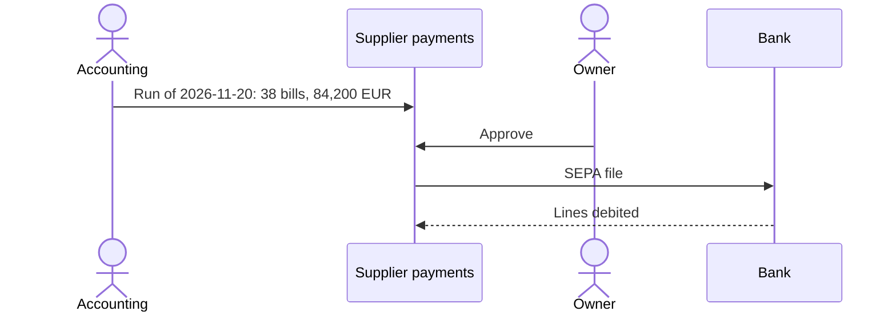

🏠 [Specs](../../../../README.md) › 🧩 [Functional capabilities](../../../README.md) ›
📒 [F8 Accounting](../../README.md) › 📝 [Use cases](../README.md) › 📝 [Use cases: FL-F8-02 Purchase to pay](README.md) ›
📝 UC-F8-04 Pay suppliers

# 📝 UC-F8-04 Pay suppliers

**Status:** ✅ specified

## Summary

A payment run proposes the bills due, the owner approves the batch, and the SEPA file goes to the bank; changed IBANs
are checked first.

## Personas

- [U05 Accounting](../../../../01-users/personas/u05-accounting.md)
- [U13 Owner](../../../../01-users/personas/u13-owner.md)

## Goal

Suppliers paid on time, nothing paid twice or to a fraudster.

## Trigger

The run's day (weekly or by due date).

## Frequency

Weekly.

## Preconditions

F8 set up for the company.

## Postconditions

- **Succeeded:** the batch is paid and the bills marked paid when the bank confirms.
- **Failed:** a batch with a changed IBAN waits.

## Main flow

1. Accounting opens supplier payments ([S-F8-04](../../screens/02-purchase-to-pay/s-f08-04-supplier-payments.md)); bills
   due by the run's date are proposed, early-payment discounts first.
2. They remove or split bills; tax instalments due are included
   ([UC-F8-24](../08-year-end-duties/uc-f08-24-compute-and-pay-corporate-tax-and-local-business-taxes.md)).
3. The owner, or a delegate,
   [UC-F1-16](../../../f01-administration/use-cases/11-team-delegation-and-access-review/uc-f01-16-delegate-approvals-during-an-absence.md),
   approves the batch.
4. A SEPA credit transfer file is sent to the bank
   ([CR-FR-023](../../../../10-country-packs/france/payments/cr-fr-023-sepa-formats.md)), or cheques printed.
5. When the bank lines arrive, the bills are marked paid
   ([UC-F8-06](../03-bank-and-collect/uc-f08-06-connect-banks-and-reconcile.md)).

## Alternative flows

- 4a. Payment through the bank's API where the aggregator allows it.

## Error flows

- 3e. A supplier IBAN changed recently: the batch waits for a second check
  ([BR-F8-08](../../business-rules/br-f08-08-new-ibans-are-checked.md)).
- 4e. The bank refuses the file: its reason shown.

## Business rules

- [BR-F8-03 Every bank line is reconciled](../../business-rules/br-f08-03-every-bank-line-is-reconciled.md)
- [BR-F8-08 New IBANs are checked](../../business-rules/br-f08-08-new-ibans-are-checked.md)

## Entities

- [E-F8-04 Bank line](../../data/e-f08-04-bank-line.md)
- [E-F8-28 Payment run](../../data/e-f08-28-payment-run.md)

## Permissions

Accounting prepares; the owner approves.

## Notifications

The owner: batch to approve.

## Audit events

Run proposed, approved, sent, confirmed.

## AI involvement

The AI proposes, people post ([BR-F8-09](../../business-rules/br-f08-09-the-ai-proposes-people-post.md)); figures come
from queries ([BR-F3-03](../../../f03-assistant/business-rules/br-f03-03-figures-come-from-queries.md)).

## API, MCP and A2A exposure

T5 operations of F8 with the caller's rights; the MCP tool of F8; no A2A skill.

## Screens

- [S-F8-04](../../screens/02-purchase-to-pay/s-f08-04-supplier-payments.md)

## Flowchart

See [FL-F8-02 Purchase to pay](../../flows/fl-f08-02-purchase-to-pay.md#flowchart).

## Sequence diagram

## Acceptance criteria

1. **Given** 38 bills due by 2026-11-20 for 84,200 EUR **when** the run is prepared **then** the 38 bills are proposed.
2. **Given** a supplier whose IBAN changed 3 days ago **when** the batch is approved **then** it waits for the second
   check.
3. **Given** the bank lines debited **when** they arrive **then** the bills are marked paid.

## Non-functional notes

None.

## Regulatory references

[CR-FR-023](../../../../10-country-packs/france/payments/cr-fr-023-sepa-formats.md);
[CR-FR-018](../../../../10-country-packs/france/invoicing/cr-fr-018-payment-terms-cap.md).

## Related use cases

See the flows.

## Open questions

None.

---

⬅️ [UC-F8-03 Process supplier bills](uc-f08-03-process-supplier-bills.md) · ⬆️ [Up](README.md) ·
➡️ [UC-F8-05 Collect customer payments](../03-bank-and-collect/uc-f08-05-collect-customer-payments.md)
