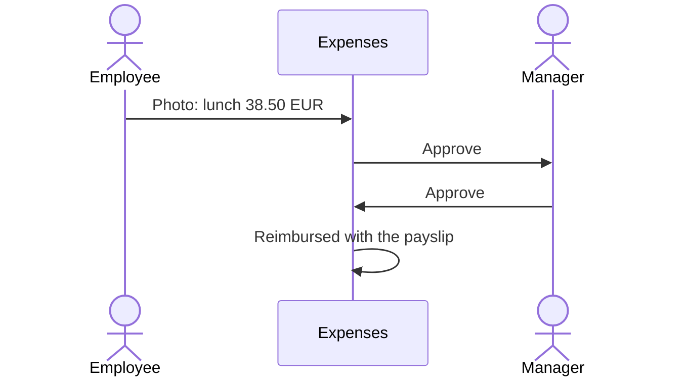

🏠 [Specs](../../../../README.md) › 🧩 [Functional capabilities](../../../README.md) ›
📒 [F8 Accounting](../../README.md) › 📝 [Use cases](../README.md) › 📝 [Use cases: FL-F8-02 Purchase to pay](README.md) ›
📝 UC-F8-12 Submit and approve expenses

# 📝 UC-F8-12 Submit and approve expenses

**Status:** ✅ specified

## Summary

Employees submit expenses by photo; managers approve; accounting reimburses.

## Personas

- [U01 Employee](../../../../01-users/personas/u01-employee.md)
- [U02 Manager](../../../../01-users/personas/u02-manager.md)
- [U05 Accounting](../../../../01-users/personas/u05-accounting.md)

## Goal

Expenses reimbursed fast, with receipts and approval.

## Trigger

An employee spends.

## Frequency

Weekly.

## Preconditions

F8 set up for the company.

## Postconditions

- **Succeeded:** approved and reimbursed or posted.
- **Failed:** refused without a receipt.

## Main flow

1. The employee photographs a receipt on expenses ([S-F8-12](../../screens/02-purchase-to-pay/s-f08-12-expenses.md));
   the AI reads it, or they enter mileage
   ([CR-FR-012](../../../../10-country-packs/france/tax-and-vat/cr-fr-012-mileage-scale.md)).
2. The manager approves ([BR-F8-05](../../business-rules/br-f08-05-expenses-need-a-receipt-and-an-approval.md)).
3. Accounting reimburses by transfer or payslip (F13), or posts the card spend.
4. Re-invoiceable expenses go to the customer's invoice (F6).

## Alternative flows

- 1a. Company cards: card lines matched to receipts
  ([UC-F8-18](../06-benchmark-additions/uc-f08-18-control-spend-with-cards-and-limits.md)).

## Error flows

- 1e. No receipt: refused unless the category allows it.

## Business rules

- [BR-F8-05 Expenses need a receipt and an approval](../../business-rules/br-f08-05-expenses-need-a-receipt-and-an-approval.md)

## Entities

- [E-F8-09 Expense claim](../../data/e-f08-09-expense-claim.md)

## Permissions

Employees; managers approve; accounting pays.

## Notifications

Manager: to approve; employee: paid.

## Audit events

Submitted, approved, paid.

## AI involvement

The AI proposes, people post ([BR-F8-09](../../business-rules/br-f08-09-the-ai-proposes-people-post.md)); figures come
from queries ([BR-F3-03](../../../f03-assistant/business-rules/br-f03-03-figures-come-from-queries.md)).

## API, MCP and A2A exposure

T5 operations of F8 with the caller's rights; the MCP tool of F8; no A2A skill.

## Screens

- [S-F8-12](../../screens/02-purchase-to-pay/s-f08-12-expenses.md)

## Flowchart

See [FL-F8-02 Purchase to pay](../../flows/fl-f08-02-purchase-to-pay.md#flowchart).

## Sequence diagram

## Acceptance criteria

1. **Given** a receipt of 38.50 EUR **when** it is photographed **then** the amount, VAT and date are read.
2. **Given** 320 km with a 5 CV car **when** mileage is entered **then** the allowance follows the scale.
3. **Given** an expense without a receipt **when** it is submitted **then** it is refused.

## Non-functional notes

Works on a phone.

## Regulatory references

[CR-FR-012](../../../../10-country-packs/france/tax-and-vat/cr-fr-012-mileage-scale.md).

## Related use cases

See the flows.

- [UC-F2-29 Set up an approval chain](../../../f02-no-code-configuration/use-cases/11-rights-translations-and-approvals/uc-f02-29-set-up-an-approval-chain.md)

- [UC-F8-29 Answer the accountant's questions and requests](../10-accountant-collaboration/uc-f08-29-answer-the-accountants-questions-and-requests.md)

## Open questions

None.

---

⬅️ [UC-F8-11 Read financial reports](../05-close-report-and-consolidate/uc-f08-11-read-financial-reports.md) ·
⬆️ [Up](README.md) ·
➡️ [UC-F8-13 Consolidate the group](../05-close-report-and-consolidate/uc-f08-13-consolidate-the-group.md)
