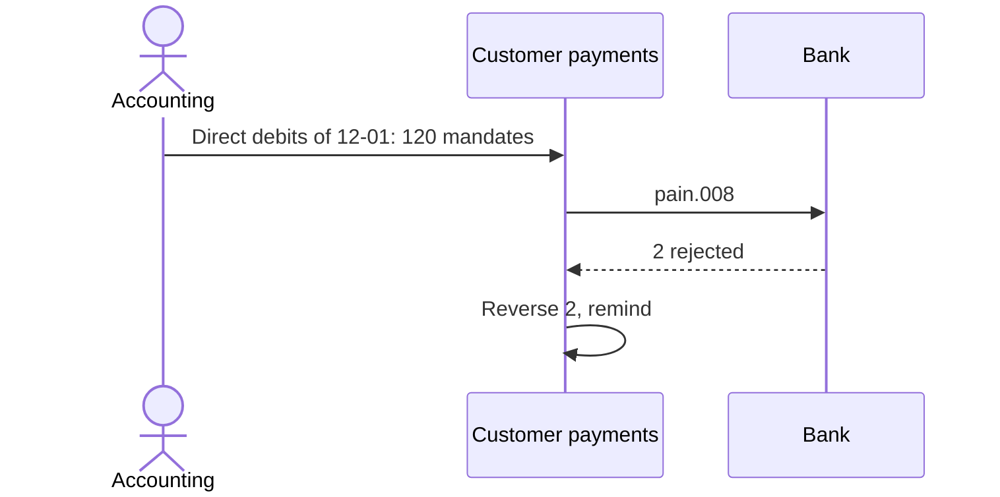

🏠 [Specs](../../../../README.md) › 🧩 [Functional capabilities](../../../README.md) ›
📒 [F8 Accounting](../../README.md) › 📝 [Use cases](../README.md) › 📝 [Use cases: FL-F8-03 Bank and collect](README.md) ›
📝 UC-F8-05 Collect customer payments

# 📝 UC-F8-05 Collect customer payments

**Status:** ✅ specified

## Summary

Customer payments, SEPA direct debits and follow-up, from F6's invoices.

## Personas

- [U05 Accounting](../../../../01-users/personas/u05-accounting.md)

## Goal

Customer payments collected and matched.

## Trigger

Payments arrive or debits are due.

## Frequency

Daily.

## Preconditions

F8 set up for the company.

## Postconditions

- **Succeeded:** invoices paid; rejected debits reversed.
- **Failed:** unmatched payments listed.

## Main flow

1. Payments arrive by provider, transfer or SEPA direct debit (pain.008, mandates) on customer payments
   ([S-F8-05](../../screens/03-bank-and-collect/s-f08-05-customer-payments.md)).
2. They are matched to invoices ([BR-F8-03](../../business-rules/br-f08-03-every-bank-line-is-reconciled.md)).
3. Late invoices follow F6's reminders,
   [UC-F6-08](../../../f06-customers-and-sales/use-cases/03-invoice-and-get-paid/uc-f06-08-remind-late-payers.md).
4. Cash-basis VAT on services follows the payment date
   ([CR-FR-010](../../../../10-country-packs/france/tax-and-vat/cr-fr-010-vat-due-date.md)).

## Alternative flows

- 1a. Direct debits collected on their due date.

## Error flows

- 1e. A rejected direct debit: reversed and the customer reminded.

## Business rules

- [BR-F8-03 Every bank line is reconciled](../../business-rules/br-f08-03-every-bank-line-is-reconciled.md)

## Entities

- [E-F8-04 Bank line](../../data/e-f08-04-bank-line.md)

## Permissions

Accounting and the external accountant; the owner reads; lock dates apply
([BR-F8-02](../../business-rules/br-f08-02-lock-dates.md)).

## Notifications

Accounting: rejected debits.

## Audit events

Collected, matched, reversed.

## AI involvement

The AI proposes, people post ([BR-F8-09](../../business-rules/br-f08-09-the-ai-proposes-people-post.md)); figures come
from queries ([BR-F3-03](../../../f03-assistant/business-rules/br-f03-03-figures-come-from-queries.md)).

## API, MCP and A2A exposure

T5 operations of F8 with the caller's rights; the MCP tool of F8; no A2A skill.

## Screens

- [S-F8-05](../../screens/03-bank-and-collect/s-f08-05-customer-payments.md)

## Flowchart

See [FL-F8-03 Bank and collect](../../flows/fl-f08-03-bank-and-collect.md#flowchart).

## Sequence diagram

## Acceptance criteria

1. **Given** 120 debits on 2026-12-01 **when** 2 are rejected **then** the 2 are reversed and the customers reminded.
2. **Given** a transfer with the invoice reference **when** it arrives **then** the invoice is paid.
3. **Given** a service paid on 2026-12-03 **when** VAT is computed **then** it is due for December.

## Non-functional notes

None.

## Regulatory references

[CR-FR-023](../../../../10-country-packs/france/payments/cr-fr-023-sepa-formats.md);
[CR-FR-010](../../../../10-country-packs/france/tax-and-vat/cr-fr-010-vat-due-date.md).

## Related use cases

See the flows.

## Open questions

None.

---

⬅️ [UC-F8-04 Pay suppliers](../02-purchase-to-pay/uc-f08-04-pay-suppliers.md) · ⬆️ [Up](README.md) ·
➡️ [UC-F8-06 Connect banks and reconcile](uc-f08-06-connect-banks-and-reconcile.md)
