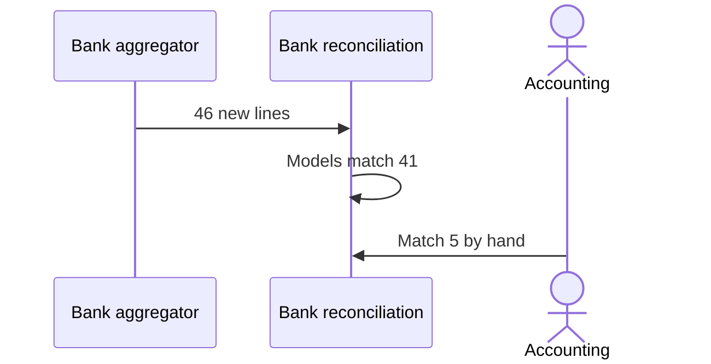

🏠 [Specs](../../../../README.md) › 🧩 [Functional capabilities](../../../README.md) ›
📒 [F8 Accounting](../../README.md) › 📝 [Use cases](../README.md) › 📝 [Use cases: FL-F8-03 Bank and collect](README.md) ›
📝 UC-F8-06 Connect banks and reconcile

# 📝 UC-F8-06 Connect banks and reconcile

**Status:** 🔄 waiting for the owner

## Summary

Banks connected through aggregators or files; lines matched by models and the AI.

## Personas

- [U05 Accounting](../../../../01-users/personas/u05-accounting.md)

## Goal

Bank lines arrive by themselves and are matched daily.

## Trigger

New bank lines.

## Frequency

Daily.

## Preconditions

F8 set up for the company.

## Postconditions

- **Succeeded:** every line reconciled or explained.
- **Failed:** consent expiry asks a renewal.

## Main flow

1. The accountant connects each bank on bank reconciliation
   ([S-F8-06](../../screens/03-bank-and-collect/s-f08-06-bank-reconciliation.md)) through the bank aggregator, which
   covers the main French banks (Proposed: one named aggregator chosen at T12, with its list of French banks published),
   or imports statement files.
2. New lines arrive daily; models and the AI match them
   ([BR-F8-03](../../business-rules/br-f08-03-every-bank-line-is-reconciled.md)).
3. Remaining lines are matched or explained by hand.
4. Client money accounts are reconciled with client ledgers
   ([UC-F8-21](../07-client-money-grants-and-non-profits/uc-f08-21-keep-third-party-client-money.md)).

## Alternative flows

- 1a. A bank the aggregator does not cover: statement files (CAMT.053, OFX).
- 3a. Internal transfers and foreign currency accounts.

## Error flows

- 1e. The aggregator's consent expires (90 or 180 days): the user is asked to renew.

## Business rules

- [BR-F8-03 Every bank line is reconciled](../../business-rules/br-f08-03-every-bank-line-is-reconciled.md)
- [BR-F8-09 The AI proposes, people post](../../business-rules/br-f08-09-the-ai-proposes-people-post.md)

## Entities

- [E-F8-04 Bank line](../../data/e-f08-04-bank-line.md)
- [E-F8-05 Reconciliation model](../../data/e-f08-05-reconciliation-model.md)

## Permissions

Accounting and the external accountant; the owner reads; lock dates apply
([BR-F8-02](../../business-rules/br-f08-02-lock-dates.md)).

## Notifications

Accounting: consent expiring.

## Audit events

Connected, matched, explained.

## AI involvement

The AI proposes, people post ([BR-F8-09](../../business-rules/br-f08-09-the-ai-proposes-people-post.md)); figures come
from queries ([BR-F3-03](../../../f03-assistant/business-rules/br-f03-03-figures-come-from-queries.md)).

## API, MCP and A2A exposure

T5 operations of F8 with the caller's rights; the MCP tool of F8; no A2A skill.

## Screens

- [S-F8-06](../../screens/03-bank-and-collect/s-f08-06-bank-reconciliation.md)

## Flowchart

See [FL-F8-03 Bank and collect](../../flows/fl-f08-03-bank-and-collect.md#flowchart).

## Sequence diagram

## Acceptance criteria

1. **Given** 46 new lines **when** they arrive **then** 41 are matched by models.
2. **Given** a consent expiring in 7 days **when** the check runs **then** the user is asked to renew.
3. **Given** a bank not covered **when** a CAMT.053 file is imported **then** its lines arrive.

## Non-functional notes

None.

## Regulatory references

(Proposed) to read: PSD2 rules on account access.

## Related use cases

See the flows.

- [UC-F8-21 Keep third-party client money](../07-client-money-grants-and-non-profits/uc-f08-21-keep-third-party-client-money.md)

- [UC-F10-23 Manage the safe, bank deposits and cash collection](../../../f10-point-of-sale/use-cases/09-cash-and-settlements/uc-f10-23-manage-the-safe-bank-deposits-and-cash-collection.md)

- [UC-F10-24 Match card-terminal settlements net of fees](../../../f10-point-of-sale/use-cases/09-cash-and-settlements/uc-f10-24-match-card-terminal-settlements-net-of-fees.md)

## Open questions

None.

---

⬅️ [UC-F8-05 Collect customer payments](uc-f08-05-collect-customer-payments.md) · ⬆️ [Up](README.md) ·
➡️ [UC-F8-07 Manage VAT and file returns](../04-tax-assets-and-analytics/uc-f08-07-manage-vat-and-file-returns.md)
