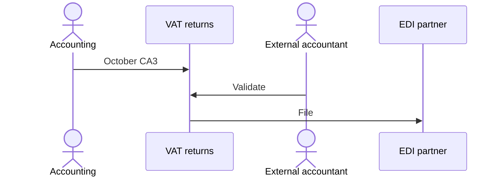

🏠 [Specs](../../../../README.md) › 🧩 [Functional capabilities](../../../README.md) ›
📒 [F8 Accounting](../../README.md) › 📝 [Use cases](../README.md) ›
📝 [Use cases: FL-F8-04 Tax, assets and analytics](README.md) › 📝 UC-F8-07 Manage VAT and file returns

# 📝 UC-F8-07 Manage VAT and file returns

**Status:** ✅ specified

## Summary

VAT is computed as D260 configures it, returns prepared and filed after validation.

## Personas

- [U05 Accounting](../../../../01-users/personas/u05-accounting.md)
- [U08 External accountant](../../../../01-users/personas/u08-external-accountant.md)

## Goal

VAT computed right and filed on time.

## Trigger

The VAT period's end.

## Frequency

Monthly or quarterly.

## Preconditions

F8 set up for the company.

## Postconditions

- **Succeeded:** the return is filed after validation.
- **Failed:** a rejection shows its reason.

## Main flow

1. The VAT report computes collected and deductible VAT per rate and regime on VAT returns
   ([S-F8-07](../../screens/04-tax-assets-and-analytics/s-f08-07-vat-returns.md)).
2. The CA3 or CA12 is prepared, with DAS2, Intrastat and OSS where due
   ([CR-FR-011](../../../../10-country-packs/france/tax-and-vat/cr-fr-011-vat-returns-and-filings.md)).
3. The accountant validates ([BR-F8-04](../../business-rules/br-f08-04-filings-need-an-accountant.md)).
4. It is filed through the EDI partner and the payment joins the run
   ([UC-F8-04](../02-purchase-to-pay/uc-f08-04-pay-suppliers.md)).

## Alternative flows

- 1a. E-reporting to the e-invoicing platform
  ([CR-FR-017](../../../../10-country-packs/france/invoicing/cr-fr-017-e-reporting.md)).

## Error flows

- 4e. The EDI partner rejects the return: its reason shown.

## Business rules

- [BR-F8-04 Filings need an accountant](../../business-rules/br-f08-04-filings-need-an-accountant.md)
- [BR-F8-02 Lock dates](../../business-rules/br-f08-02-lock-dates.md)

## Entities

- [E-F8-06 Tax return](../../data/e-f08-06-tax-return.md)
- [E-F8-12 Filing partner](../../data/e-f08-12-filing-partner.md)

## Permissions

Accounting and the external accountant; the owner reads; lock dates apply
([BR-F8-02](../../business-rules/br-f08-02-lock-dates.md)).

## Notifications

Accounting: return due.

## Audit events

Prepared, validated, filed.

## AI involvement

The AI proposes, people post ([BR-F8-09](../../business-rules/br-f08-09-the-ai-proposes-people-post.md)); figures come
from queries ([BR-F3-03](../../../f03-assistant/business-rules/br-f03-03-figures-come-from-queries.md)).

## API, MCP and A2A exposure

T5 operations of F8 with the caller's rights; the MCP tool of F8; no A2A skill.

## Screens

- [S-F8-07](../../screens/04-tax-assets-and-analytics/s-f08-07-vat-returns.md)

## Flowchart

See [FL-F8-04 Tax, assets and analytics](../../flows/fl-f08-04-tax-assets-and-analytics.md#flowchart).

## Sequence diagram

## Acceptance criteria

1. **Given** October 2026 with collected VAT of 18,400 EUR and deductible 9,100 EUR **when** the CA3 is prepared
   **then** it shows 9,300 EUR to pay.
2. **Given** a return not validated **when** filing is asked **then** it is refused.
3. **Given** the EDI partner's rejection **when** it arrives **then** its reason shows.

## Non-functional notes

None.

## Regulatory references

[CR-FR-011](../../../../10-country-packs/france/tax-and-vat/cr-fr-011-vat-returns-and-filings.md);
[CR-FR-008](../../../../10-country-packs/france/tax-and-vat/cr-fr-008-vat-rates.md).

## Related use cases

See the flows.

## Open questions

None.

---

⬅️ [UC-F8-06 Connect banks and reconcile](../03-bank-and-collect/uc-f08-06-connect-banks-and-reconcile.md) ·
⬆️ [Up](README.md) · ➡️ [UC-F8-08 Manage fixed assets and deferrals](uc-f08-08-manage-fixed-assets-and-deferrals.md)
