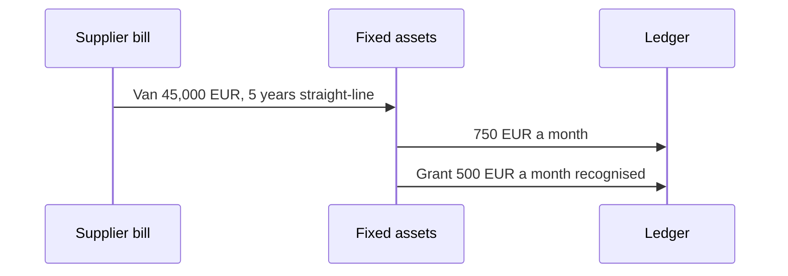

🏠 [Specs](../../../../README.md) › 🧩 [Functional capabilities](../../../README.md) ›
📒 [F8 Accounting](../../README.md) › 📝 [Use cases](../README.md) ›
📝 [Use cases: FL-F8-04 Tax, assets and analytics](README.md) › 📝 UC-F8-08 Manage fixed assets and deferrals

# 📝 UC-F8-08 Manage fixed assets and deferrals

**Status:** ✅ specified

## Summary

Assets depreciated, disposed of; revenues and expenses deferred; accruals and cut-off at period end.

## Personas

- [U05 Accounting](../../../../01-users/personas/u05-accounting.md)

## Goal

Assets and deferrals in the right periods.

## Trigger

An asset bill, a deferral, the period's end.

## Frequency

Monthly.

## Preconditions

F8 set up for the company.

## Postconditions

- **Succeeded:** depreciation and deferrals posted.
- **Failed:** a disposal in a locked period refused.

## Main flow

1. A bill for an asset creates it from its model on fixed assets
   ([S-F8-08](../../screens/04-tax-assets-and-analytics/s-f08-08-fixed-assets.md)).
2. Depreciation posts monthly; a grant financing it is recognised alongside
   ([UC-F8-22](../07-client-money-grants-and-non-profits/uc-f08-22-account-for-a-grant.md)).
3. A disposal computes the gain or loss.
4. Deferred revenues and expenses spread over their months; accruals at period end.

## Alternative flows

- 1a. Loans with their schedule.

## Error flows

- 3e. A disposal in a locked period: refused.

## Business rules

- [BR-F8-02 Lock dates](../../business-rules/br-f08-02-lock-dates.md)

## Entities

- [E-F8-07 Fixed asset](../../data/e-f08-07-fixed-asset.md)

## Permissions

Accounting and the external accountant; the owner reads; lock dates apply
([BR-F8-02](../../business-rules/br-f08-02-lock-dates.md)).

## Notifications

None.

## Audit events

Assets created, depreciated, disposed.

## AI involvement

The AI proposes, people post ([BR-F8-09](../../business-rules/br-f08-09-the-ai-proposes-people-post.md)); figures come
from queries ([BR-F3-03](../../../f03-assistant/business-rules/br-f03-03-figures-come-from-queries.md)).

## API, MCP and A2A exposure

T5 operations of F8 with the caller's rights; the MCP tool of F8; no A2A skill.

## Screens

- [S-F8-08](../../screens/04-tax-assets-and-analytics/s-f08-08-fixed-assets.md)

## Flowchart

See [FL-F8-04 Tax, assets and analytics](../../flows/fl-f08-04-tax-assets-and-analytics.md#flowchart).

## Sequence diagram

## Acceptance criteria

1. **Given** a van of 45,000 EUR over 5 years **when** it is created **then** 750 EUR is depreciated each month.
2. **Given** the van sold for 30,000 EUR after 2 years **when** the disposal is posted **then** a gain of 3,000 EUR is
   computed.
3. **Given** a locked period **when** a disposal is dated in it **then** it is refused.

## Non-functional notes

None.

## Regulatory references

None.

## Related use cases

See the flows.

- [UC-F8-22 Account for a grant](../07-client-money-grants-and-non-profits/uc-f08-22-account-for-a-grant.md)

## Open questions

None.

---

⬅️ [UC-F8-07 Manage VAT and file returns](uc-f08-07-manage-vat-and-file-returns.md) · ⬆️ [Up](README.md) ·
➡️ [UC-F8-09 Track analytics and budgets](uc-f08-09-track-analytics-and-budgets.md)
