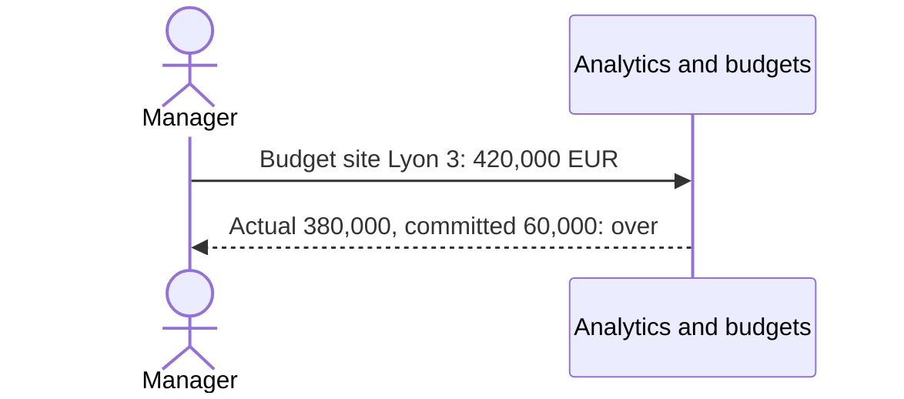

🏠 [Specs](../../../../README.md) › 🧩 [Functional capabilities](../../../README.md) ›
📒 [F8 Accounting](../../README.md) › 📝 [Use cases](../README.md) ›
📝 [Use cases: FL-F8-04 Tax, assets and analytics](README.md) › 📝 UC-F8-09 Track analytics and budgets

# 📝 UC-F8-09 Track analytics and budgets

**Status:** ✅ specified

## Summary

Analytic plans and budgets per project, site or department, with budget versus actual.

## Personas

- [U02 Manager](../../../../01-users/personas/u02-manager.md)
- [U13 Owner](../../../../01-users/personas/u13-owner.md)
- [U05 Accounting](../../../../01-users/personas/u05-accounting.md)

## Goal

Know where money goes by project, site or department.

## Trigger

Posting and budgeting.

## Frequency

Monthly.

## Preconditions

F8 set up for the company.

## Postconditions

- **Succeeded:** lines distributed; budget versus actual shown.
- **Failed:** a missing mandatory plan is refused.

## Main flow

1. Analytic plans distribute each line by hand or by models on analytics and budgets
   ([S-F8-09](../../screens/04-tax-assets-and-analytics/s-f08-09-analytics-and-budgets.md)).
2. Budgets per plan and account, with revisions.
3. Budget versus actual shows achieved, committed and forecast; overspends alert.
4. Grants are tagged on what they finance
   ([UC-F8-22](../07-client-money-grants-and-non-profits/uc-f08-22-account-for-a-grant.md)).

## Alternative flows

- 1a. Purchase requests check the budget,
  [BR-F7-01](../../../f07-purchasing-and-stock/business-rules/br-f07-01-purchases-approved-by-amount-and-budget.md).

## Error flows

- 1e. A mandatory plan missing: refused.

## Business rules

- See F8's rules.

## Entities

- [E-F8-08 Accounting budget](../../data/e-f08-08-accounting-budget.md)
- [E-F8-30 Analytic plan](../../data/e-f08-30-analytic-plan.md)

## Permissions

Managers for their plans; accounting; the owner.

## Notifications

Managers: overspends.

## Audit events

Budgets and distributions.

## AI involvement

The AI proposes, people post ([BR-F8-09](../../business-rules/br-f08-09-the-ai-proposes-people-post.md)); figures come
from queries ([BR-F3-03](../../../f03-assistant/business-rules/br-f03-03-figures-come-from-queries.md)).

## API, MCP and A2A exposure

T5 operations of F8 with the caller's rights; the MCP tool of F8; no A2A skill.

## Screens

- [S-F8-09](../../screens/04-tax-assets-and-analytics/s-f08-09-analytics-and-budgets.md)

## Flowchart

See [FL-F8-04 Tax, assets and analytics](../../flows/fl-f08-04-tax-assets-and-analytics.md#flowchart).

## Sequence diagram

## Acceptance criteria

1. **Given** a budget of 420,000 EUR for site Lyon 3 **when** actual and committed reach 440,000 EUR **then** an
   overspend alert is sent.
2. **Given** a line without the mandatory project plan **when** it is posted **then** it is refused.
3. **Given** a distribution model 60/40 **when** a shared bill is posted **then** it splits 60/40.

## Non-functional notes

None.

## Regulatory references

None.

## Related use cases

See the flows.

## Open questions

None.

---

⬅️ [UC-F8-08 Manage fixed assets and deferrals](uc-f08-08-manage-fixed-assets-and-deferrals.md) · ⬆️ [Up](README.md) ·
➡️ [UC-F8-10](../05-close-report-and-consolidate/uc-f08-10-close-the-period-and-the-year.md)
