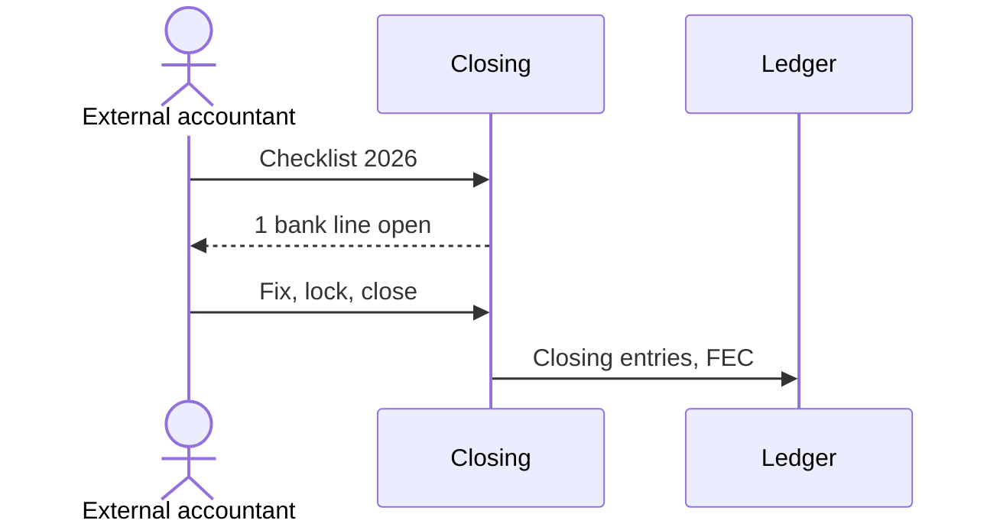

🏠 [Specs](../../../../README.md) › 🧩 [Functional capabilities](../../../README.md) ›
📒 [F8 Accounting](../../README.md) › 📝 [Use cases](../README.md) ›
📝 [Use cases: FL-F8-05 Close, report and consolidate](README.md) › 📝 UC-F8-10 Close the period and the year

# 📝 UC-F8-10 Close the period and the year

**Status:** ✅ specified

## Summary

Periods locked, year-end closed, earnings allocated, filings and the FEC produced.

## Personas

- [U08 External accountant](../../../../01-users/personas/u08-external-accountant.md)
- [U05 Accounting](../../../../01-users/personas/u05-accounting.md)

## Goal

Periods closed on time, the year closed and filed.

## Trigger

The period's or year's end.

## Frequency

Monthly; yearly.

## Preconditions

F8 set up for the company.

## Postconditions

- **Succeeded:** periods locked, year closed, filings produced.
- **Failed:** a checklist item blocks.

## Main flow

1. The accountant opens closing ([S-F8-10](../../screens/05-close-report-and-consolidate/s-f08-10-closing.md)): the
   checklist (banks reconciled, accruals, depreciation, stock, VAT, doubtful debts
   [UC-F8-26](../08-year-end-duties/uc-f08-26-provision-doubtful-debts.md), open questions
   [UC-F8-29](../10-accountant-collaboration/uc-f08-29-answer-the-accountants-questions-and-requests.md)).
2. Lock dates are set ([BR-F8-02](../../business-rules/br-f08-02-lock-dates.md)).
3. Year end: closing entries, corporate tax
   ([UC-F8-24](../08-year-end-duties/uc-f08-24-compute-and-pay-corporate-tax-and-local-business-taxes.md)), the hard
   lock.
4. The FEC and the tax return are produced and filed; the annual accounts follow
   ([UC-F8-25](../08-year-end-duties/uc-f08-25-approve-and-file-the-annual-accounts.md)).

## Alternative flows

- 1a. The external accountant runs the closing.

## Error flows

- 1e. An unreconciled bank line blocks the checklist: listed.

## Business rules

- [BR-F8-02 Lock dates](../../business-rules/br-f08-02-lock-dates.md)
- [BR-F8-04 Filings need an accountant](../../business-rules/br-f08-04-filings-need-an-accountant.md)

## Entities

- [E-F8-10 Fiscal period](../../data/e-f08-10-fiscal-period.md)
- [E-F8-27 FEC file](../../data/e-f08-27-fec-file.md)
- [E-F8-29 Entry annotation](../../data/e-f08-29-entry-annotation.md)
- [E-F8-31 Closing checklist](../../data/e-f08-31-closing-checklist.md)

## Permissions

Accounting and the external accountant; the owner reads; lock dates apply
([BR-F8-02](../../business-rules/br-f08-02-lock-dates.md)).

## Notifications

The owner: year closed.

## Audit events

Locks, closing entries, filings.

## AI involvement

The AI proposes, people post ([BR-F8-09](../../business-rules/br-f08-09-the-ai-proposes-people-post.md)); figures come
from queries ([BR-F3-03](../../../f03-assistant/business-rules/br-f03-03-figures-come-from-queries.md)).

## API, MCP and A2A exposure

T5 operations of F8 with the caller's rights; the MCP tool of F8; no A2A skill.

## Screens

- [S-F8-10](../../screens/05-close-report-and-consolidate/s-f08-10-closing.md)

## Flowchart

See [FL-F8-05 Close, report and consolidate](../../flows/fl-f08-05-close-report-and-consolidate.md#flowchart).

## Sequence diagram

## Acceptance criteria

1. **Given** one unreconciled bank line **when** the checklist runs **then** it is listed and blocks.
2. **Given** a lock date of 2026-11-30 **when** an entry dated 11-28 is posted **then** it is refused.
3. **Given** the year closed **when** the FEC is produced **then** it passes the FEC checker.

## Non-functional notes

None.

## Regulatory references

[CR-FR-005](../../../../10-country-packs/france/accounting/cr-fr-005-fec-export.md);
[CR-FR-002](../../../../10-country-packs/france/accounting/cr-fr-002-accounting-records-kept-ten-years.md).

## Related use cases

See the flows.

- [UC-F8-24 Compute and pay corporate tax and local business taxes](../08-year-end-duties/uc-f08-24-compute-and-pay-corporate-tax-and-local-business-taxes.md)

- [UC-F8-25 Approve and file the annual accounts](../08-year-end-duties/uc-f08-25-approve-and-file-the-annual-accounts.md)

- [UC-F8-26 Provision doubtful debts](../08-year-end-duties/uc-f08-26-provision-doubtful-debts.md)

- [UC-F12-27 Value work in progress at month end](../../../f12-manufacturing/use-cases/05-subcontracting-and-costs/uc-f12-27-value-work-in-progress-at-month-end.md)

## Open questions

None.

---

⬅️ [UC-F8-09 Track analytics and budgets](../04-tax-assets-and-analytics/uc-f08-09-track-analytics-and-budgets.md) ·
⬆️ [Up](README.md) · ➡️ [UC-F8-11 Read financial reports](uc-f08-11-read-financial-reports.md)
