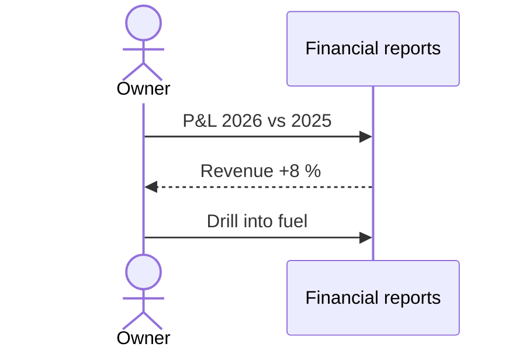

🏠 [Specs](../../../../README.md) › 🧩 [Functional capabilities](../../../README.md) ›
📒 [F8 Accounting](../../README.md) › 📝 [Use cases](../README.md) ›
📝 [Use cases: FL-F8-05 Close, report and consolidate](README.md) › 📝 UC-F8-11 Read financial reports

# 📝 UC-F8-11 Read financial reports

**Status:** 🔄 waiting for the owner

## Summary

Balance sheet, P&L, ledgers, trial balance, aged balances, cash flow, executive summary, cash forecast, custom reports.

## Personas

- [U13 Owner](../../../../01-users/personas/u13-owner.md)
- [U05 Accounting](../../../../01-users/personas/u05-accounting.md)
- [U08 External accountant](../../../../01-users/personas/u08-external-accountant.md)

## Goal

Read the company's figures and drill to the entries.

## Trigger

A question or a review.

## Frequency

Weekly.

## Preconditions

F8 set up for the company.

## Postconditions

- **Succeeded:** the report is read or exported.
- **Failed:** a warning on unposted entries.

## Main flow

1. The owner opens financial reports
   ([S-F8-11](../../screens/05-close-report-and-consolidate/s-f08-11-financial-reports.md)): balance sheet, P&L,
   ledgers, trial balance, aged balances, cash flow.
2. They compare by period, budget or company.
3. They drill a figure down to its entries.
4. They annotate and export (PDF, spreadsheet); flux comments come from
   [UC-F8-27](../09-pay-analyse-and-report/uc-f08-27-analyse-the-months-flux-with-ai-comments.md).

## Alternative flows

- 1a. A cash forecast from open invoices, orders and subscriptions.

## Error flows

- 1e. A period with unposted entries: shown with a warning.

## Business rules

- See F8's rules.

## Entities

- [E-F8-01 Account](../../data/e-f08-01-account.md)
- [E-F8-03 Journal entry](../../data/e-f08-03-journal-entry.md)

## Permissions

The owner, accounting, the accountant.

## Notifications

Scheduled reports.

## Audit events

Exports.

## AI involvement

The AI proposes, people post ([BR-F8-09](../../business-rules/br-f08-09-the-ai-proposes-people-post.md)); figures come
from queries ([BR-F3-03](../../../f03-assistant/business-rules/br-f03-03-figures-come-from-queries.md)).

## API, MCP and A2A exposure

T5 operations of F8 with the caller's rights; the MCP tool of F8; no A2A skill.

## Screens

- [S-F8-11](../../screens/05-close-report-and-consolidate/s-f08-11-financial-reports.md)

## Flowchart

See [FL-F8-05 Close, report and consolidate](../../flows/fl-f08-05-close-report-and-consolidate.md#flowchart).

## Sequence diagram

## Acceptance criteria

1. **Given** the 2026 P&L **when** the owner compares with 2025 **then** each line shows both years and the change.
2. **Given** the fuel line **when** she drills in **then** the entries behind it show.
3. **Given** draft entries in November **when** the report opens **then** a warning shows.

## Non-functional notes

Reports within 3 seconds (Proposed).

## Regulatory references

None.

## Related use cases

See the flows.

- [UC-F8-27 Analyse the month's flux with AI comments](../09-pay-analyse-and-report/uc-f08-27-analyse-the-months-flux-with-ai-comments.md)

## Open questions

None.

---

⬅️ [UC-F8-10 Close the period and the year](uc-f08-10-close-the-period-and-the-year.md) · ⬆️ [Up](README.md) ·
➡️ [UC-F8-12 Submit and approve expenses](../02-purchase-to-pay/uc-f08-12-submit-and-approve-expenses.md)
