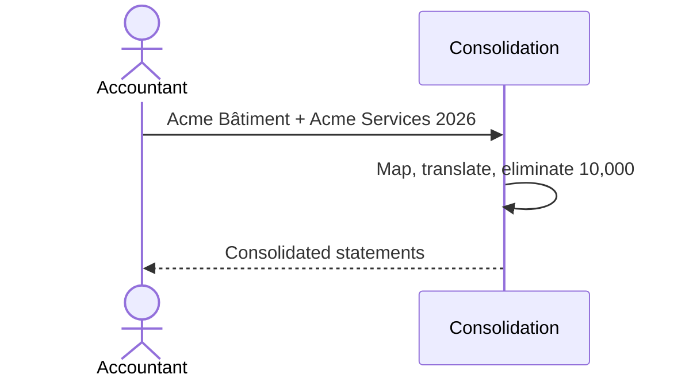

🏠 [Specs](../../../../README.md) › 🧩 [Functional capabilities](../../../README.md) ›
📒 [F8 Accounting](../../README.md) › 📝 [Use cases](../README.md) ›
📝 [Use cases: FL-F8-05 Close, report and consolidate](README.md) › 📝 UC-F8-13 Consolidate the group

# 📝 UC-F8-13 Consolidate the group

**Status:** ✅ specified

## Summary

Group accounts consolidated with mapping, currency translation and eliminations.

## Personas

- [U08 External accountant](../../../../01-users/personas/u08-external-accountant.md)
- [U13 Owner](../../../../01-users/personas/u13-owner.md)

## Goal

Group accounts consolidated without spreadsheets.

## Trigger

The group's closing.

## Frequency

Yearly or quarterly.

## Preconditions

F8 set up for the company.

## Postconditions

- **Succeeded:** consolidated statements produced.
- **Failed:** unmatched intercompany balances listed.

## Main flow

1. Each company's accounts are mapped to the group chart on consolidation
   ([S-F8-13](../../screens/05-close-report-and-consolidate/s-f08-13-consolidation.md)).
2. Foreign currencies are translated.
3. Intercompany balances are eliminated
   ([BR-F8-07](../../business-rules/br-f08-07-intercompany-mirrored-and-eliminated.md)).
4. Consolidated statements are produced.

## Alternative flows

- 1a. Several consolidation levels.

## Error flows

- 3e. An unmatched intercompany balance: listed for correction.

## Business rules

- [BR-F8-07 Intercompany mirrored and eliminated](../../business-rules/br-f08-07-intercompany-mirrored-and-eliminated.md)

## Entities

- [E-F8-11 Consolidation group](../../data/e-f08-11-consolidation-group.md)

## Permissions

The accountant and the owner.

## Notifications

None.

## Audit events

Runs.

## AI involvement

The AI proposes, people post ([BR-F8-09](../../business-rules/br-f08-09-the-ai-proposes-people-post.md)); figures come
from queries ([BR-F3-03](../../../f03-assistant/business-rules/br-f03-03-figures-come-from-queries.md)).

## API, MCP and A2A exposure

T5 operations of F8 with the caller's rights; the MCP tool of F8; no A2A skill.

## Screens

- [S-F8-13](../../screens/05-close-report-and-consolidate/s-f08-13-consolidation.md)

## Flowchart

See [FL-F8-05 Close, report and consolidate](../../flows/fl-f08-05-close-report-and-consolidate.md#flowchart).

## Sequence diagram

## Acceptance criteria

1. **Given** Acme Bâtiment invoicing Acme Services 10,000 EUR **when** the group is consolidated **then** the 10,000 EUR
   is eliminated.
2. **Given** an intercompany balance of 9,800 against 10,000 **when** it is consolidated **then** the 200 EUR gap is
   listed.
3. **Given** a subsidiary in CHF **when** it is consolidated **then** it is translated at the closing rate.

## Non-functional notes

None.

## Regulatory references

None.

## Related use cases

See the flows.

## Open questions

None.

---

⬅️ [UC-F8-12 Submit and approve expenses](../02-purchase-to-pay/uc-f08-12-submit-and-approve-expenses.md) ·
⬆️ [Up](README.md) ·
➡️ [UC-F8-14 Work with the external accountant](../01-set-up-and-post/uc-f08-14-work-with-the-external-accountant.md)
