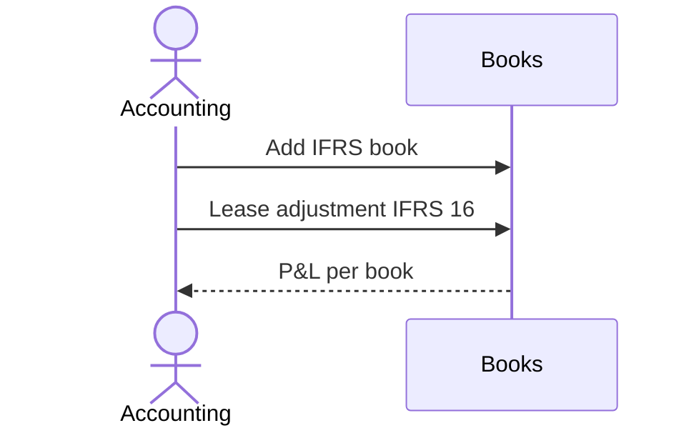

🏠 [Specs](../../../../README.md) › 🧩 [Functional capabilities](../../../README.md) ›
📒 [F8 Accounting](../../README.md) › 📝 [Use cases](../README.md) ›
📝 [Use cases: FL-F8-06 Benchmark additions](README.md) › 📝 UC-F8-15 Keep several books

# 📝 UC-F8-15 Keep several books

**Status:** ✅ specified

## Summary

French GAAP, IFRS and management books from the same entries, with adjustments per book.

## Personas

- [U05 Accounting](../../../../01-users/personas/u05-accounting.md)
- [U08 External accountant](../../../../01-users/personas/u08-external-accountant.md)

## Goal

Several views of the same accounts without double entry.

## Trigger

The group needs IFRS or a management book.

## Frequency

At setup; adjustments at closing.

## Preconditions

F8 set up for the company.

## Postconditions

- **Succeeded:** each book reports with its adjustments.
- **Failed:** an entry in a closed book is refused.

## Main flow

1. Accounting adds a book with its framework on books
   ([S-F8-15](../../screens/06-benchmark-additions/s-f08-15-books.md)).
2. Shared entries flow to every book ([BR-F8-10](../../business-rules/br-f08-10-books-share-one-source.md)).
3. Adjustments are posted to one book only.
4. Reports run per book.

## Alternative flows

- 1a. IFRS for the group's consolidation.

## Error flows

- 3e. An entry in a closed book: refused.

## Business rules

- [BR-F8-10 Several books share one source](../../business-rules/br-f08-10-books-share-one-source.md)

## Entities

- [E-F8-13 Book](../../data/e-f08-13-book.md)

## Permissions

Accounting and the external accountant; the owner reads; lock dates apply
([BR-F8-02](../../business-rules/br-f08-02-lock-dates.md)).

## Notifications

None.

## Audit events

Books and adjustments.

## AI involvement

The AI proposes, people post ([BR-F8-09](../../business-rules/br-f08-09-the-ai-proposes-people-post.md)); figures come
from queries ([BR-F3-03](../../../f03-assistant/business-rules/br-f03-03-figures-come-from-queries.md)).

## API, MCP and A2A exposure

T5 operations of F8 with the caller's rights; the MCP tool of F8; no A2A skill.

## Screens

- [S-F8-15](../../screens/06-benchmark-additions/s-f08-15-books.md)

## Flowchart

See [FL-F8-06 Benchmark additions](../../flows/fl-f08-06-benchmark-additions.md#flowchart).

## Sequence diagram

## Acceptance criteria

1. **Given** an IFRS book **when** a lease adjustment is posted to it **then** only the IFRS book shows it.
2. **Given** a sales entry **when** it is posted **then** every book shows it.
3. **Given** a closed management book **when** an entry is posted to it **then** it is refused.

## Non-functional notes

None.

## Regulatory references

[CR-FR-064](../../../../10-country-packs/france/accounting/cr-fr-064-accounting-frameworks.md).

## Related use cases

See [FL-F8-06](../../flows/fl-f08-06-benchmark-additions.md).

## Open questions

None.

---

⬅️ [UC-F8-14 Work with the external accountant](../01-set-up-and-post/uc-f08-14-work-with-the-external-accountant.md) ·
⬆️ [Up](README.md) · ➡️ [UC-F8-16 Recognise revenue under IFRS 15](uc-f08-16-recognise-revenue-under-ifrs-15.md)
