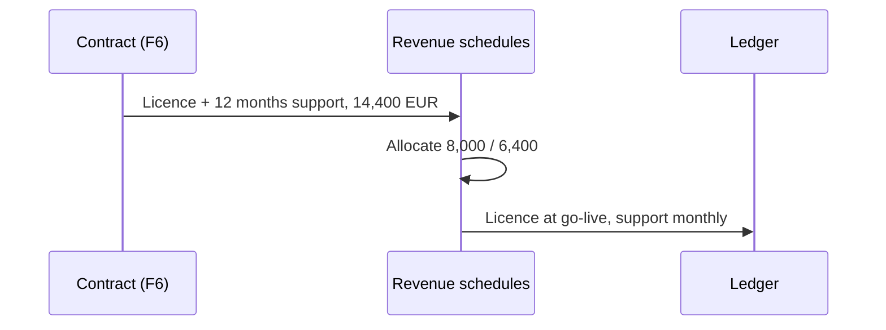

🏠 [Specs](../../../../README.md) › 🧩 [Functional capabilities](../../../README.md) ›
📒 [F8 Accounting](../../README.md) › 📝 [Use cases](../README.md) ›
📝 [Use cases: FL-F8-06 Benchmark additions](README.md) › 📝 UC-F8-16 Recognise revenue under IFRS 15

# 📝 UC-F8-16 Recognise revenue under IFRS 15

**Status:** 🔄 waiting for the owner

## Summary

Contracts split into performance obligations, price allocated, revenue scheduled and contract changes handled.

## Personas

- [U05 Accounting](../../../../01-users/personas/u05-accounting.md)

## Goal

Revenue in the periods it is earned.

## Trigger

A contract signed in F6.

## Frequency

Per contract.

## Preconditions

F8 set up for the company.

## Postconditions

- **Succeeded:** revenue scheduled and posted each period.
- **Failed:** a missing stand-alone price is asked.

## Main flow

1. A contract is signed (F6); accounting opens its revenue schedule
   ([S-F8-16](../../screens/06-benchmark-additions/s-f08-16-revenue-schedules.md)).
2. It is split into performance obligations with their stand-alone prices
   ([BR-F8-11](../../business-rules/br-f08-11-revenue-follows-performance-obligations.md)).
3. The price is allocated and the schedule built.
4. Revenue posts each period; changes to the contract update the schedule.

## Alternative flows

- 4a. Usage and milestones from
  [UC-F6-16](../../../f06-customers-and-sales/use-cases/05-benchmark-additions/uc-f06-16-bill-usage-commitments-and-milestones.md).

## Error flows

- 2e. A missing stand-alone price: asked.

## Business rules

- [BR-F8-11 Revenue follows performance obligations](../../business-rules/br-f08-11-revenue-follows-performance-obligations.md)

## Entities

- [E-F8-14 Revenue schedule](../../data/e-f08-14-revenue-schedule.md)

## Permissions

Accounting and the external accountant; the owner reads; lock dates apply
([BR-F8-02](../../business-rules/br-f08-02-lock-dates.md)).

## Notifications

None.

## Audit events

Schedules and changes.

## AI involvement

The AI proposes, people post ([BR-F8-09](../../business-rules/br-f08-09-the-ai-proposes-people-post.md)); figures come
from queries ([BR-F3-03](../../../f03-assistant/business-rules/br-f03-03-figures-come-from-queries.md)).

## API, MCP and A2A exposure

T5 operations of F8 with the caller's rights; the MCP tool of F8; no A2A skill.

## Screens

- [S-F8-16](../../screens/06-benchmark-additions/s-f08-16-revenue-schedules.md)

## Flowchart

See [FL-F8-06 Benchmark additions](../../flows/fl-f08-06-benchmark-additions.md#flowchart).

## Sequence diagram

## Acceptance criteria

1. **Given** Nuvola Logiciels' contract of 14,400 EUR for a licence and 12 months of support **when** it is scheduled
   **then** the licence is recognised at go-live and support monthly.
2. **Given** a support line without a stand-alone price **when** the schedule is built **then** the price is asked.
3. **Given** an upgrade in month 6 **when** the contract changes **then** the remaining schedule is updated.

## Non-functional notes

None.

## Regulatory references

(Proposed) to read: IFRS 15.

## Related use cases

See [FL-F8-06](../../flows/fl-f08-06-benchmark-additions.md).

## Open questions

None.

---

⬅️ [UC-F8-15 Keep several books](uc-f08-15-keep-several-books.md) · ⬆️ [Up](README.md) ·
➡️ [UC-F8-17 Close continuously with agents](uc-f08-17-close-continuously-with-agents.md)
