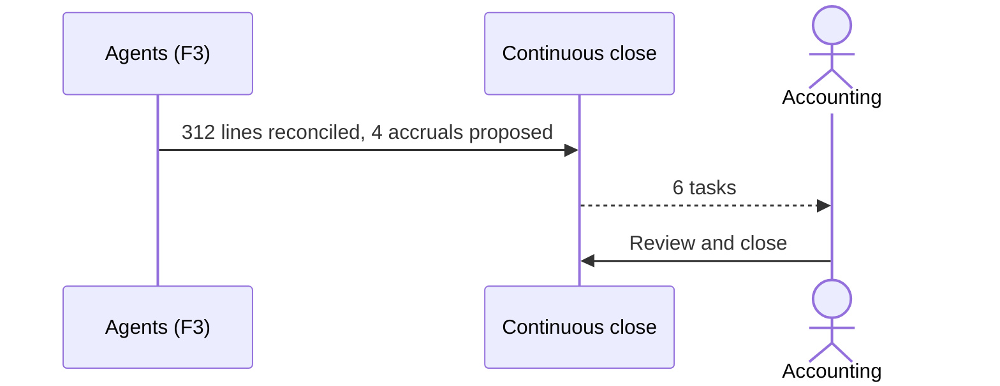

🏠 [Specs](../../../../README.md) › 🧩 [Functional capabilities](../../../README.md) ›
📒 [F8 Accounting](../../README.md) › 📝 [Use cases](../README.md) ›
📝 [Use cases: FL-F8-06 Benchmark additions](README.md) › 📝 UC-F8-17 Close continuously with agents

# 📝 UC-F8-17 Close continuously with agents

**Status:** ✅ specified

## Summary

Agents keep reconciliations, accruals and flux analysis current all month, so that the close is a review.

## Personas

- [U05 Accounting](../../../../01-users/personas/u05-accounting.md)
- [U13 Owner](../../../../01-users/personas/u13-owner.md)

## Goal

A close in days, not weeks.

## Trigger

Daily runs of the agents.

## Frequency

Continuous.

## Preconditions

F8 set up for the company.

## Postconditions

- **Succeeded:** the checklist shows what is left; the accountant reviews and closes.
- **Failed:** tasks for items the agents could not settle.

## Main flow

1. Agents, [UC-F3-10](../../../f03-assistant/use-cases/10-benchmark-additions/uc-f03-10-create-and-run-ai-agents.md),
   reconcile bank lines, propose accruals and draft flux comments
   ([UC-F8-27](../09-pay-analyse-and-report/uc-f08-27-analyse-the-months-flux-with-ai-comments.md)).
2. The continuous close screen ([S-F8-17](../../screens/06-benchmark-additions/s-f08-17-continuous-close.md)) shows what
   is done and left.
3. Items below the agents' confidence become tasks
   ([BR-F3-35](../../../f03-assistant/business-rules/br-f03-35-agents-follow-thresholds-and-limits.md)).
4. At month end, the accountant reviews and closes
   ([UC-F8-10](../05-close-report-and-consolidate/uc-f08-10-close-the-period-and-the-year.md)).

## Alternative flows

- 1a. Agents paused during an audit.

## Error flows

- 3e. An agent below its threshold: task created.

## Business rules

- See F8's rules.

## Entities

- Existing entities of the capability.

## Permissions

Accounting and the external accountant; the owner reads; lock dates apply
([BR-F8-02](../../business-rules/br-f08-02-lock-dates.md)).

## Notifications

Accounting: tasks.

## Audit events

Agent actions and reviews.

## AI involvement

Agents act within their thresholds; people post.

## API, MCP and A2A exposure

T5 operations of F8 with the caller's rights; the MCP tool of F8; no A2A skill.

## Screens

- [S-F8-17](../../screens/06-benchmark-additions/s-f08-17-continuous-close.md)

## Flowchart

See [FL-F8-06 Benchmark additions](../../flows/fl-f08-06-benchmark-additions.md#flowchart).

## Sequence diagram

## Acceptance criteria

1. **Given** 312 bank lines in November **when** agents run **then** the matched ones are done and the others are tasks.
2. **Given** an accrual proposed at 62 % confidence **when** it is proposed **then** it becomes a task.
3. **Given** the month reviewed **when** the accountant closes **then** the period is locked.

## Non-functional notes

None.

## Regulatory references

None.

## Related use cases

See [FL-F8-06](../../flows/fl-f08-06-benchmark-additions.md).

- [UC-F8-27 Analyse the month's flux with AI comments](../09-pay-analyse-and-report/uc-f08-27-analyse-the-months-flux-with-ai-comments.md)

## Open questions

None.

---

⬅️ [UC-F8-16 Recognise revenue under IFRS 15](uc-f08-16-recognise-revenue-under-ifrs-15.md) · ⬆️ [Up](README.md) ·
➡️ [UC-F8-18 Control spend with cards and limits](uc-f08-18-control-spend-with-cards-and-limits.md)
