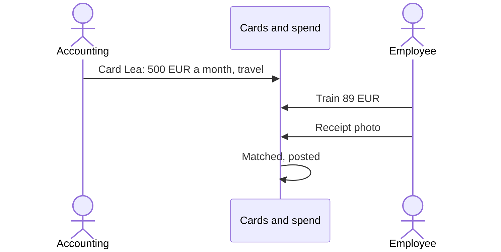

🏠 [Specs](../../../../README.md) › 🧩 [Functional capabilities](../../../README.md) ›
📒 [F8 Accounting](../../README.md) › 📝 [Use cases](../README.md) ›
📝 [Use cases: FL-F8-06 Benchmark additions](README.md) › 📝 UC-F8-18 Control spend with cards and limits

# 📝 UC-F8-18 Control spend with cards and limits

**Status:** ✅ specified

## Summary

Virtual and physical company cards with limits and categories, receipts by photo or chat, and payments to suppliers
abroad.

## Personas

- [U05 Accounting](../../../../01-users/personas/u05-accounting.md)
- [U01 Employee](../../../../01-users/personas/u01-employee.md)

## Goal

Spend under control without expense reports.

## Trigger

An employee needs to spend.

## Frequency

Daily.

## Preconditions

F8 set up for the company.

## Postconditions

- **Succeeded:** spend matched and posted.
- **Failed:** over-limit payments refused.

## Main flow

1. Accounting issues a card with limits and categories on cards and spend
   ([S-F8-18](../../screens/06-benchmark-additions/s-f08-18-cards-and-spend.md)).
2. The employee spends; the card provider sends the line.
3. The employee sends the receipt by photo or chat; it is matched.
4. The spend is posted to its category ([BR-F8-12](../../business-rules/br-f08-12-spend-follows-limits.md)).

## Alternative flows

- 1a. Suppliers paid abroad (T12).

## Error flows

- 2e. Over the limit: refused by the card.

## Business rules

- [BR-F8-12 Spend follows card and approval limits](../../business-rules/br-f08-12-spend-follows-limits.md)

## Entities

- [E-F8-15 Company card](../../data/e-f08-15-company-card.md)

## Permissions

Accounting issues; employees spend.

## Notifications

Employee: receipt missing.

## Audit events

Cards, spend, receipts.

## AI involvement

The AI proposes, people post ([BR-F8-09](../../business-rules/br-f08-09-the-ai-proposes-people-post.md)); figures come
from queries ([BR-F3-03](../../../f03-assistant/business-rules/br-f03-03-figures-come-from-queries.md)).

## API, MCP and A2A exposure

T5 operations of F8 with the caller's rights; the MCP tool of F8; no A2A skill.

## Screens

- [S-F8-18](../../screens/06-benchmark-additions/s-f08-18-cards-and-spend.md)

## Flowchart

See [FL-F8-06 Benchmark additions](../../flows/fl-f08-06-benchmark-additions.md#flowchart).

## Sequence diagram

## Acceptance criteria

1. **Given** a card limited to 500 EUR a month **when** a payment of 520 EUR is tried **then** it is refused.
2. **Given** a train ticket of 89 EUR **when** the receipt photo arrives **then** it is matched and posted to travel.
3. **Given** no receipt after 7 days **when** the check runs **then** the employee is reminded.

## Non-functional notes

None.

## Regulatory references

None.

## Related use cases

See [FL-F8-06](../../flows/fl-f08-06-benchmark-additions.md).

## Open questions

None.

---

⬅️ [UC-F8-17 Close continuously with agents](uc-f08-17-close-continuously-with-agents.md) · ⬆️ [Up](README.md) ·
➡️ [UC-F8-19 Plan and forecast](uc-f08-19-plan-and-forecast.md)
