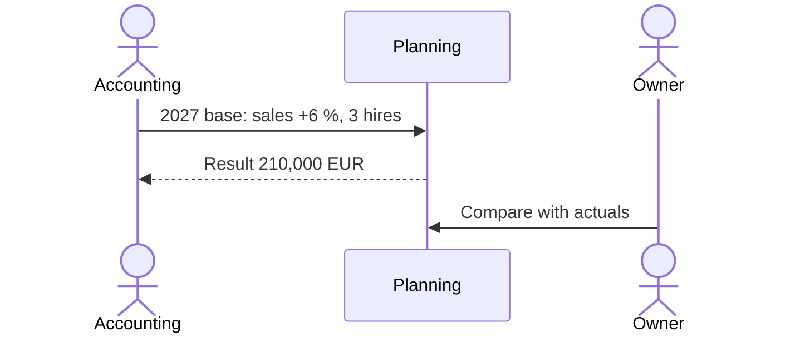

🏠 [Specs](../../../../README.md) › 🧩 [Functional capabilities](../../../README.md) ›
📒 [F8 Accounting](../../README.md) › 📝 [Use cases](../README.md) ›
📝 [Use cases: FL-F8-06 Benchmark additions](README.md) › 📝 UC-F8-19 Plan and forecast

# 📝 UC-F8-19 Plan and forecast

**Status:** ✅ specified

## Summary

Budgets and forecast scenarios built from drivers and compared with actuals.

## Personas

- [U05 Accounting](../../../../01-users/personas/u05-accounting.md)
- [U13 Owner](../../../../01-users/personas/u13-owner.md)
- [U02 Manager](../../../../01-users/personas/u02-manager.md)

## Goal

Know where the year is heading.

## Trigger

Budgeting or a reforecast.

## Frequency

Quarterly.

## Preconditions

F8 set up for the company.

## Postconditions

- **Succeeded:** scenarios shared and compared.
- **Failed:** a locked scenario is read only.

## Main flow

1. Accounting builds a scenario from drivers (sales growth, hires, prices) on planning
   ([S-F8-19](../../screens/06-benchmark-additions/s-f08-19-planning.md)).
2. It compares with actuals each month.
3. The AI assistant explains the variances.
4. The owner shares the chosen scenario; deeper what-if questions go to F23.

## Alternative flows

- 4a. A scenario copied for a what-if.

## Error flows

- 1e. A locked scenario: changes refused.

## Business rules

- See F8's rules.

## Entities

- [E-F8-16 Budget plan](../../data/e-f08-16-budget-plan.md)

## Permissions

Accounting, the owner, managers for their part.

## Notifications

None.

## Audit events

Scenarios.

## AI involvement

The AI proposes, people post ([BR-F8-09](../../business-rules/br-f08-09-the-ai-proposes-people-post.md)); figures come
from queries ([BR-F3-03](../../../f03-assistant/business-rules/br-f03-03-figures-come-from-queries.md)).

## API, MCP and A2A exposure

T5 operations of F8 with the caller's rights; the MCP tool of F8; no A2A skill.

## Screens

- [S-F8-19](../../screens/06-benchmark-additions/s-f08-19-planning.md)

## Flowchart

See [FL-F8-06 Benchmark additions](../../flows/fl-f08-06-benchmark-additions.md#flowchart).

## Sequence diagram

## Acceptance criteria

1. **Given** a scenario with sales +6 % and 3 hires **when** it is computed **then** the 2027 result shows.
2. **Given** actuals of January **when** they are posted **then** the variance shows.
3. **Given** a locked scenario **when** a driver is changed **then** it is refused.

## Non-functional notes

None.

## Regulatory references

None.

## Related use cases

See [FL-F8-06](../../flows/fl-f08-06-benchmark-additions.md).

## Open questions

None.

---

⬅️ [UC-F8-18 Control spend with cards and limits](uc-f08-18-control-spend-with-cards-and-limits.md) ·
⬆️ [Up](README.md) · ➡️ [UC-F8-20 Analyse profitability](uc-f08-20-analyse-profitability.md)
