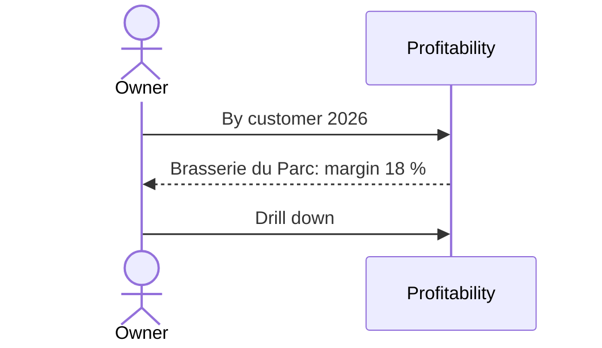

🏠 [Specs](../../../../README.md) › 🧩 [Functional capabilities](../../../README.md) ›
📒 [F8 Accounting](../../README.md) › 📝 [Use cases](../README.md) ›
📝 [Use cases: FL-F8-06 Benchmark additions](README.md) › 📝 UC-F8-20 Analyse profitability

# 📝 UC-F8-20 Analyse profitability

**Status:** ✅ specified

## Summary

Margins by customer, product, project, site and channel, with costs allocated.

## Personas

- [U13 Owner](../../../../01-users/personas/u13-owner.md)
- [U05 Accounting](../../../../01-users/personas/u05-accounting.md)
- [U02 Manager](../../../../01-users/personas/u02-manager.md)

## Goal

Know what makes and loses money.

## Trigger

A review.

## Frequency

Monthly.

## Preconditions

F8 set up for the company.

## Postconditions

- **Succeeded:** margins shown with allocated costs.
- **Failed:** unallocated costs shown apart.

## Main flow

1. The owner opens profitability ([S-F8-20](../../screens/06-benchmark-additions/s-f08-20-profitability.md)) and chooses
   dimensions.
2. Revenues and direct costs show per dimension.
3. Indirect costs are allocated by the company's keys.
4. She drills down to entries.

## Alternative flows

- 3a. Cloud and software costs allocated (F22).

## Error flows

- 3e. Unallocated costs: shown apart.

## Business rules

- See F8's rules.

## Entities

- Existing entities of the capability.

## Permissions

The owner, accounting, managers for their scope.

## Notifications

None.

## Audit events

Exports.

## AI involvement

The AI proposes, people post ([BR-F8-09](../../business-rules/br-f08-09-the-ai-proposes-people-post.md)); figures come
from queries ([BR-F3-03](../../../f03-assistant/business-rules/br-f03-03-figures-come-from-queries.md)).

## API, MCP and A2A exposure

T5 operations of F8 with the caller's rights; the MCP tool of F8; no A2A skill.

## Screens

- [S-F8-20](../../screens/06-benchmark-additions/s-f08-20-profitability.md)

## Flowchart

See [FL-F8-06 Benchmark additions](../../flows/fl-f08-06-benchmark-additions.md#flowchart).

## Sequence diagram

## Acceptance criteria

1. **Given** Distribution Lemoine's 2026 accounts **when** profitability by customer opens **then** each customer shows
   its margin after allocated costs.
2. **Given** costs without a key **when** it is computed **then** they show apart.
3. **Given** a customer's figure **when** she drills down **then** the entries show.

## Non-functional notes

None.

## Regulatory references

None.

## Related use cases

See [FL-F8-06](../../flows/fl-f08-06-benchmark-additions.md).

## Open questions

None.

---

⬅️ [UC-F8-19 Plan and forecast](uc-f08-19-plan-and-forecast.md) · ⬆️ [Up](README.md) ·
➡️ [UC-F8-21](../07-client-money-grants-and-non-profits/uc-f08-21-keep-third-party-client-money.md)
