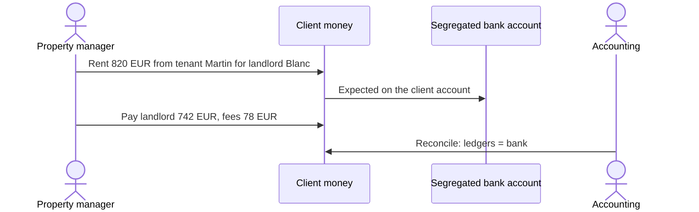

🏠 [Specs](../../../../README.md) › 🧩 [Functional capabilities](../../../README.md) ›
📒 [F8 Accounting](../../README.md) › 📝 [Use cases](../README.md) ›
📝 [Use cases: FL-F8-07 Client money, grants and non-profits](README.md) › 📝 UC-F8-21 Keep third-party client money

# 📝 UC-F8-21 Keep third-party client money

**Status:** ✅ specified

## Summary

Money held for clients (tenants' rents and deposits for landlords, lawyers' client funds through the CARPA) sits on
segregated accounts with a ledger per client that never goes negative; the shared capability of D457.

## Personas

- [U05 Accounting](../../../../01-users/personas/u05-accounting.md)
- [U34 Property manager](../../../../01-users/personas/u34-property-manager.md)
- [U36 Professional](../../../../01-users/personas/u36-professional.md)

## Goal

Prove at any time whose money is held and never use one client's money for another.

## Trigger

Money received or paid out for a client.

## Frequency

Daily for agencies and firms.

## Preconditions

- A segregated bank account declared as client money, with its guarantee
  ([CR-FR-139](../../../../10-country-packs/france/real-estate/cr-fr-139-hoguet-card-and-guarantee.md)) or CARPA account
  ([CR-FR-151](../../../../10-country-packs/france/professional-firms/cr-fr-151-carpa-client-funds.md)).

## Postconditions

- **Succeeded:** each movement is on the client's ledger and the segregated account balances.
- **Failed:** a payment beyond the client's balance is refused.

## Main flow

1. The property manager records a tenant's rent received for a landlord on Client money
   ([S-F8-21](../../screens/07-client-money-grants-and-non-profits/s-f08-21-client-money.md)); it goes to the segregated
   account and the landlord's ledger.
2. Fees due to the agency are moved to its own account, with the landlord's statement.
3. Payments to the landlord or for the client (works, charges) are taken from the client's balance,
   [BR-F8-13](../../business-rules/br-f08-13-client-money-is-segregated-and-never-negative-per-client.md).
4. Each day, the segregated bank account is reconciled with the sum of client balances
   ([UC-F8-06](../03-bank-and-collect/uc-f08-06-connect-banks-and-reconcile.md)).
5. Statements are sent to each client; the register shows every client's balance for the guarantor or the CARPA.

## Alternative flows

- 1a. Lawyers: client funds go through the CARPA account, per matter.
- 1b. A security deposit is held until the lease ends
  ([CR-FR-140](../../../../10-country-packs/france/real-estate/cr-fr-140-security-deposit.md)).

## Error flows

- 3e. A payment beyond the client's balance: refused with the balance.
- 4e. The bank and the ledgers differ: the gap is listed and the closing blocked.

## Business rules

- [BR-F8-13 Client money is segregated and never negative per client](../../business-rules/br-f08-13-client-money-is-segregated-and-never-negative-per-client.md)
- [BR-F8-03 Every bank line is reconciled](../../business-rules/br-f08-03-every-bank-line-is-reconciled.md)

## Entities

- [E-F8-17 Client money ledger](../../data/e-f08-17-client-money-ledger.md)
- [E-F8-04 Bank line](../../data/e-f08-04-bank-line.md)

## Permissions

Accounting and the external accountant; the owner reads; lock dates apply
([BR-F8-02](../../business-rules/br-f08-02-lock-dates.md)). Property managers and professionals record movements of
their clients.

## Notifications

Accounting: a reconciliation gap; clients: statements.

## Audit events

Every movement with client and matter.

## AI involvement

The AI proposes, people post ([BR-F8-09](../../business-rules/br-f08-09-the-ai-proposes-people-post.md)); figures come
from queries ([BR-F3-03](../../../f03-assistant/business-rules/br-f03-03-figures-come-from-queries.md)).

## API, MCP and A2A exposure

T5 operations of F8 with the caller's rights; the MCP tool of F8; no A2A skill.

## Screens

- [S-F8-21 Client money](../../screens/07-client-money-grants-and-non-profits/s-f08-21-client-money.md)
- [S-F8-06 Bank reconciliation](../../screens/03-bank-and-collect/s-f08-06-bank-reconciliation.md)

## Flowchart

See
[FL-F8-07 Client money, grants and non-profits](../../flows/fl-f08-07-client-money-grants-and-non-profits.md#flowchart).

## Sequence diagram

## Acceptance criteria

1. **Given** Rive Sud Immobilier receiving 820 EUR rent for landlord Blanc **when** it is recorded **then** Blanc's
   ledger shows 820 EUR on the segregated account.
2. **Given** Blanc's balance of 742 EUR after fees **when** a payment of 900 EUR to him is asked **then** it is refused
   with the balance.
3. **Given** client ledgers totalling 184,300 EUR and the bank at 184,100 EUR **when** the daily check runs **then** a
   gap of 200 EUR is listed.
4. **Given** Delorme Conseil holding 12,000 EUR for a matter through the CARPA **when** the register is printed **then**
   the matter's balance shows.

## Non-functional notes

None.

## Regulatory references

[CR-FR-139](../../../../10-country-packs/france/real-estate/cr-fr-139-hoguet-card-and-guarantee.md);
[CR-FR-151](../../../../10-country-packs/france/professional-firms/cr-fr-151-carpa-client-funds.md);
[CR-FR-140](../../../../10-country-packs/france/real-estate/cr-fr-140-security-deposit.md).

## Related use cases

- [UC-F8-06 Connect banks and reconcile](../03-bank-and-collect/uc-f08-06-connect-banks-and-reconcile.md)
- [UC-SC10-08 Call rents and issue receipts](../../../../08-sectors/sc10-real-estate/use-cases/04-rents-and-landlords/uc-sc10-08-call-rents-and-issue-receipts.md)

## Open questions

None.

---

⬅️ [UC-F8-20 Analyse profitability](../06-benchmark-additions/uc-f08-20-analyse-profitability.md) · ⬆️ [Up](README.md) ·
➡️ [UC-F8-22 Account for a grant](uc-f08-22-account-for-a-grant.md)
