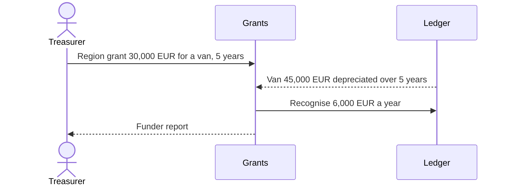

🏠 [Specs](../../../../README.md) › 🧩 [Functional capabilities](../../../README.md) ›
📒 [F8 Accounting](../../README.md) › 📝 [Use cases](../README.md) ›
📝 [Use cases: FL-F8-07 Client money, grants and non-profits](README.md) › 📝 UC-F8-22 Account for a grant

# 📝 UC-F8-22 Account for a grant

**Status:** ✅ specified

## Summary

Accounting records a grant or subsidy with its conditions and amounts; it is recognised as the conditions are met,
spread over the life of the asset it finances, and reported to the funder; the shared capability of D457.

## Personas

- [U05 Accounting](../../../../01-users/personas/u05-accounting.md)
- [U31 Treasurer](../../../../01-users/personas/u31-treasurer.md)
- [U40 Farmer](../../../../01-users/personas/u40-farmer.md)

## Goal

Grants in the right year, and a report the funder accepts.

## Trigger

A grant agreement signed; an expense or asset it finances; the funder's report date.

## Frequency

A few grants a year per organisation.

## Preconditions

- The grant agreement with its conditions.

## Postconditions

- **Succeeded:** the grant is recognised as earned, the rest deferred; the funder's report is ready.
- **Failed:** unmet conditions keep it deferred or repayable.

## Main flow

1. The treasurer records the grant on Grants
   ([S-F8-22](../../screens/07-client-money-grants-and-non-profits/s-f08-22-grants.md)): funder, amount, purpose,
   period, conditions, and whether it finances operations or an asset.
2. Expenses and assets are tagged with the grant (analytic plan,
   [UC-F8-09](../04-tax-assets-and-analytics/uc-f08-09-track-analytics-and-budgets.md)).
3. At each closing, the grant is recognised in proportion to what it financed; for an asset, over its depreciation,
   [BR-F8-14](../../business-rules/br-f08-14-a-grant-is-earned-as-its-conditions-are-met.md),
   [UC-F8-08](../04-tax-assets-and-analytics/uc-f08-08-manage-fixed-assets-and-deferrals.md).
4. Receipts of the grant are matched; the part received but not earned is deferred.
5. The funder's report lists the expenses financed and the outcome
   ([CR-FR-127](../../../../10-country-packs/france/non-profit/cr-fr-127-grant-agreement-and-report.md)).

## Alternative flows

- 1a. Farm aid under the CAP declared and received per campaign
  ([CR-FR-164](../../../../10-country-packs/france/agriculture/cr-fr-164-cap-aid-declaration.md)).
- 1b. A département funding a home-care service's investment.

## Error flows

- 3e. Conditions not met at the period's end: the grant stays deferred, or the repayable part is shown.
- 5e. Expenses tagged beyond the grant: the excess is shown, not charged to it.

## Business rules

- [BR-F8-14 A grant is earned as its conditions are met](../../business-rules/br-f08-14-a-grant-is-earned-as-its-conditions-are-met.md)

## Entities

- [E-F8-18 Grant](../../data/e-f08-18-grant.md)
- [E-F8-07 Fixed asset](../../data/e-f08-07-fixed-asset.md)

## Permissions

Accounting and the external accountant; the owner reads; lock dates apply
([BR-F8-02](../../business-rules/br-f08-02-lock-dates.md)). Treasurers of associations.

## Notifications

Accounting: report dates and conditions due.

## Audit events

Grant recorded, recognised, reported.

## AI involvement

The AI proposes, people post ([BR-F8-09](../../business-rules/br-f08-09-the-ai-proposes-people-post.md)); figures come
from queries ([BR-F3-03](../../../f03-assistant/business-rules/br-f03-03-figures-come-from-queries.md)).

## API, MCP and A2A exposure

T5 operations of F8 with the caller's rights; the MCP tool of F8; no A2A skill.

## Screens

- [S-F8-22 Grants](../../screens/07-client-money-grants-and-non-profits/s-f08-22-grants.md)

## Flowchart

See
[FL-F8-07 Client money, grants and non-profits](../../flows/fl-f08-07-client-money-grants-and-non-profits.md#flowchart).

## Sequence diagram

## Acceptance criteria

1. **Given** a grant of 30,000 EUR financing a van depreciated over 5 years **when** the first year closes **then**
   6,000 EUR is recognised and 24,000 EUR deferred.
2. **Given** an operating grant of 12,000 EUR with 8,000 EUR spent **when** the year closes **then** 8,000 EUR is
   recognised.
3. **Given** Ferme des Trois Chênes' CAP aid for the 2026 campaign **when** it is received **then** it is matched to the
   declaration.
4. **Given** expenses tagged for 14,000 EUR on a 12,000 EUR grant **when** the report is prepared **then** 2,000 EUR
   shows as beyond the grant.

## Non-functional notes

None.

## Regulatory references

[CR-FR-127](../../../../10-country-packs/france/non-profit/cr-fr-127-grant-agreement-and-report.md);
[CR-FR-126](../../../../10-country-packs/france/non-profit/cr-fr-126-accounts-publication.md);
[CR-FR-164](../../../../10-country-packs/france/agriculture/cr-fr-164-cap-aid-declaration.md);
[CR-FR-125](../../../../10-country-packs/france/accounting/cr-fr-125-association-accounting.md).

## Related use cases

- [UC-F8-23 Keep non-profit accounts](uc-f08-23-keep-non-profit-accounts.md)
- [UC-F8-08 Manage fixed assets and deferrals](../04-tax-assets-and-analytics/uc-f08-08-manage-fixed-assets-and-deferrals.md)

## Open questions

None.

---

⬅️ [UC-F8-21 Keep third-party client money](uc-f08-21-keep-third-party-client-money.md) · ⬆️ [Up](README.md) ·
➡️ [UC-F8-23 Keep non-profit accounts](uc-f08-23-keep-non-profit-accounts.md)
