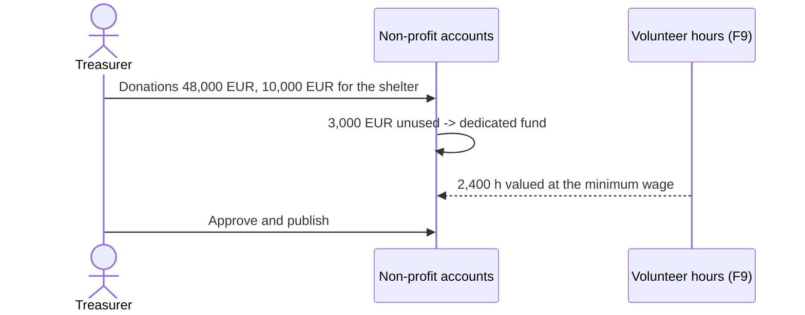

🏠 [Specs](../../../../README.md) › 🧩 [Functional capabilities](../../../README.md) ›
📒 [F8 Accounting](../../README.md) › 📝 [Use cases](../README.md) ›
📝 [Use cases: FL-F8-07 Client money, grants and non-profits](README.md) › 📝 UC-F8-23 Keep non-profit accounts

# 📝 UC-F8-23 Keep non-profit accounts

**Status:** ✅ specified

## Summary

An association's treasurer keeps its accounts under the non-profit rules: dedicated funds carried over, volunteer time
valued, donations with their tax receipts, and the accounts published when required.

## Personas

- [U31 Treasurer](../../../../01-users/personas/u31-treasurer.md)
- [U05 Accounting](../../../../01-users/personas/u05-accounting.md)
- [U08 External accountant](../../../../01-users/personas/u08-external-accountant.md)

## Goal

Accounts a non-profit's members, funders and the public can trust.

## Trigger

Daily entries; the year's end.

## Frequency

Monthly; yearly closing.

## Preconditions

- The non-profit accounting framework is chosen
  ([CR-FR-064](../../../../10-country-packs/france/accounting/cr-fr-064-accounting-frameworks.md)).

## Postconditions

- **Succeeded:** the accounts show dedicated funds and volunteer contributions; published if required.
- **Failed:** the year stays open.

## Main flow

1. The treasurer opens Non-profit accounts
   ([S-F8-23](../../screens/07-client-money-grants-and-non-profits/s-f08-23-non-profit-accounts.md)): donations, grants,
   dues and dedicated funds.
2. Resources received for a purpose and not used are carried to dedicated funds
   ([BR-F8-15](../../business-rules/br-f08-15-dedicated-funds-keep-their-purpose.md)).
3. Volunteer hours (from F9 or sheets) are valued and shown in the notes, not in the result.
4. Donations issue their tax receipts
   ([CR-FR-124](../../../../10-country-packs/france/non-profit/cr-fr-124-gift-tax-receipts.md)).
5. At the year's end, the accounts are approved and published when the grants pass the threshold
   ([CR-FR-126](../../../../10-country-packs/france/non-profit/cr-fr-126-accounts-publication.md)).

## Alternative flows

- 3a. Volunteers' expenses given up as a donation
  ([CR-FR-129](../../../../10-country-packs/france/non-profit/cr-fr-129-volunteer-expenses.md)).

## Error flows

- 2e. A dedicated fund used for another purpose: refused.
- 5e. Publication due and not done: reminded.

## Business rules

- [BR-F8-15 Dedicated funds keep their purpose](../../business-rules/br-f08-15-dedicated-funds-keep-their-purpose.md)
- [BR-F8-14 A grant is earned as its conditions are met](../../business-rules/br-f08-14-a-grant-is-earned-as-its-conditions-are-met.md)

## Entities

- [E-F8-19 Dedicated fund](../../data/e-f08-19-dedicated-fund.md)
- [E-F8-20 Volunteer contribution](../../data/e-f08-20-volunteer-contribution.md)

## Permissions

Treasurers, accounting and the accountant.

## Notifications

Treasurer: publication due.

## Audit events

Funds moved, volunteer valuations, receipts issued.

## AI involvement

The AI proposes, people post ([BR-F8-09](../../business-rules/br-f08-09-the-ai-proposes-people-post.md)); figures come
from queries ([BR-F3-03](../../../f03-assistant/business-rules/br-f03-03-figures-come-from-queries.md)).

## API, MCP and A2A exposure

T5 operations of F8 with the caller's rights; the MCP tool of F8; no A2A skill.

## Screens

- [S-F8-23 Non-profit accounts](../../screens/07-client-money-grants-and-non-profits/s-f08-23-non-profit-accounts.md)

## Flowchart

See
[FL-F8-07 Client money, grants and non-profits](../../flows/fl-f08-07-client-money-grants-and-non-profits.md#flowchart).

## Sequence diagram

## Acceptance criteria

1. **Given** 10,000 EUR given for the shelter with 7,000 EUR spent **when** the year closes **then** 3,000 EUR goes to
   the shelter's dedicated fund.
2. **Given** 2,400 volunteer hours **when** the notes are prepared **then** they are valued in the notes and not in the
   result.
3. **Given** a donation of 200 EUR **when** it is recorded **then** its tax receipt is issued.
4. **Given** grants above the publication threshold **when** the accounts are approved **then** publication is due and
   reminded.

## Non-functional notes

None.

## Regulatory references

[CR-FR-125](../../../../10-country-packs/france/accounting/cr-fr-125-association-accounting.md);
[CR-FR-126](../../../../10-country-packs/france/non-profit/cr-fr-126-accounts-publication.md);
[CR-FR-124](../../../../10-country-packs/france/non-profit/cr-fr-124-gift-tax-receipts.md);
[CR-FR-129](../../../../10-country-packs/france/non-profit/cr-fr-129-volunteer-expenses.md).

## Related use cases

- [UC-F8-22 Account for a grant](uc-f08-22-account-for-a-grant.md)
- [UC-SC08-14 Keep association accounts](../../../../08-sectors/sc08-non-profit/use-cases/06-accounts-and-data/uc-sc08-14-keep-association-accounts.md)

## Open questions

None.

---

⬅️ [UC-F8-22 Account for a grant](uc-f08-22-account-for-a-grant.md) · ⬆️ [Up](README.md) ·
➡️ [UC-F8-24](../08-year-end-duties/uc-f08-24-compute-and-pay-corporate-tax-and-local-business-taxes.md)
