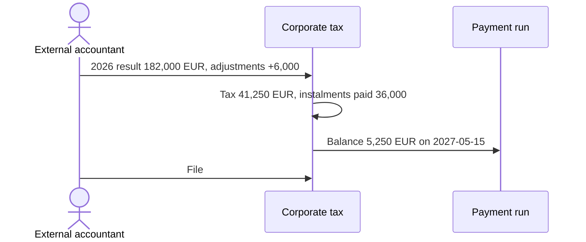

🏠 [Specs](../../../../README.md) › 🧩 [Functional capabilities](../../../README.md) ›
📒 [F8 Accounting](../../README.md) › 📝 [Use cases](../README.md) › 📝 [Use cases: FL-F8-08 Year-end duties](README.md) ›
📝 UC-F8-24 Compute and pay corporate tax and local business taxes

# 📝 UC-F8-24 Compute and pay corporate tax and local business taxes

**Status:** 🔄 waiting for the owner

## Summary

The accountant computes corporate tax from the result and its adjustments, follows the instalments, and the local
business taxes (CFE, CVAE), with their payment dates.

## Personas

- [U08 External accountant](../../../../01-users/personas/u08-external-accountant.md)
- [U05 Accounting](../../../../01-users/personas/u05-accounting.md)

## Goal

The right tax, paid on time, with no late penalty.

## Trigger

The year's end and each instalment date.

## Frequency

Quarterly instalments; yearly balance.

## Preconditions

- The year's result is known
  ([UC-F8-10](../05-close-report-and-consolidate/uc-f08-10-close-the-period-and-the-year.md)).

## Postconditions

- **Succeeded:** tax computed, instalments and balance scheduled for payment.
- **Failed:** a missing adjustment keeps the computation in draft.

## Main flow

1. The accountant opens Corporate tax ([S-F8-24](../../screens/08-year-end-duties/s-f08-24-corporate-tax.md)) for the
   year.
2. SimpleERP starts from the accounting result; the accountant adds the tax adjustments (non-deductible expenses,
   provisions).
3. Corporate tax at the reduced and normal rates is computed; instalments already paid are deducted
   ([BR-F8-16](../../business-rules/br-f08-16-corporate-tax-deducts-the-instalments-paid.md)).
4. The balance and the next year's instalments are scheduled in the payment run
   ([UC-F8-04](../02-purchase-to-pay/uc-f08-04-pay-suppliers.md)).
5. CFE and CVAE amounts and dates are recorded; the return is filed through the EDI partner
   ([BR-F8-04](../../business-rules/br-f08-04-filings-need-an-accountant.md)).

## Alternative flows

- 2a. The accountant's own software computes it: the result is imported.

## Error flows

- 5e. The EDI partner rejects the return: its reason shown.
- 4e. An instalment date passed unpaid: flagged.

## Business rules

- [BR-F8-16 Corporate tax deducts the instalments paid](../../business-rules/br-f08-16-corporate-tax-deducts-the-instalments-paid.md)
- [BR-F8-04 Filings need an accountant](../../business-rules/br-f08-04-filings-need-an-accountant.md)

## Entities

- [E-F8-21 Corporate tax computation](../../data/e-f08-21-corporate-tax-computation.md)
- [E-F8-06 Tax return](../../data/e-f08-06-tax-return.md)

## Permissions

The external accountant; accounting prepares; the owner approves payment.

## Notifications

Accounting: instalment dates.

## Audit events

Computation, adjustments, filing, payments.

## AI involvement

The AI proposes, people post ([BR-F8-09](../../business-rules/br-f08-09-the-ai-proposes-people-post.md)); figures come
from queries ([BR-F3-03](../../../f03-assistant/business-rules/br-f03-03-figures-come-from-queries.md)).

## API, MCP and A2A exposure

T5 operations of F8 with the caller's rights; the MCP tool of F8; no A2A skill.

## Screens

- [S-F8-24 Corporate tax](../../screens/08-year-end-duties/s-f08-24-corporate-tax.md)

## Flowchart

See [FL-F8-08 Year-end duties](../../flows/fl-f08-08-year-end-duties.md#flowchart).

## Sequence diagram

## Acceptance criteria

1. **Given** Acme Bâtiment's 2026 result with 6,000 EUR of non-deductible expenses **when** the tax is computed **then**
   it starts from the result plus 6,000 EUR.
2. **Given** instalments of 36,000 EUR paid **when** the balance is computed **then** only the difference is scheduled.
3. **Given** an instalment of 2027-03-15 unpaid on 03-16 **when** the date passes **then** it is flagged.

## Non-functional notes

None.

## Regulatory references

[CR-FR-011](../../../../10-country-packs/france/tax-and-vat/cr-fr-011-vat-returns-and-filings.md); (Proposed) to read:
CGI articles 219 and 1668 on corporate tax.

## Related use cases

- [UC-F8-10 Close the period and the year](../05-close-report-and-consolidate/uc-f08-10-close-the-period-and-the-year.md)
- [UC-F8-25 Approve and file the annual accounts](uc-f08-25-approve-and-file-the-annual-accounts.md)

## Open questions

None.

---

⬅️ [UC-F8-23](../07-client-money-grants-and-non-profits/uc-f08-23-keep-non-profit-accounts.md) · ⬆️ [Up](README.md) ·
➡️ [UC-F8-25 Approve and file the annual accounts](uc-f08-25-approve-and-file-the-annual-accounts.md)
