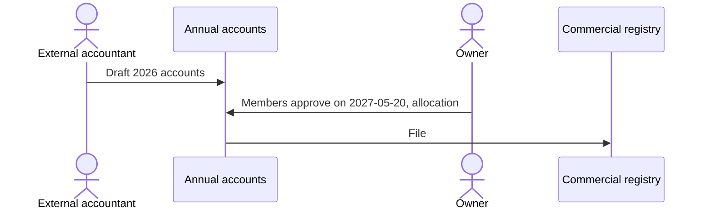

🏠 [Specs](../../../../README.md) › 🧩 [Functional capabilities](../../../README.md) ›
📒 [F8 Accounting](../../README.md) › 📝 [Use cases](../README.md) › 📝 [Use cases: FL-F8-08 Year-end duties](README.md) ›
📝 UC-F8-25 Approve and file the annual accounts

# 📝 UC-F8-25 Approve and file the annual accounts

**Status:** 🔄 waiting for the owner

## Summary

The accountant drafts the annual accounts (balance sheet, income statement, notes); the owner or members approve them
and the earnings allocation; they are filed with the commercial registry.

## Personas

- [U13 Owner](../../../../01-users/personas/u13-owner.md)
- [U08 External accountant](../../../../01-users/personas/u08-external-accountant.md)

## Goal

Accounts approved and filed in time.

## Trigger

The year closed.

## Frequency

Yearly.

## Preconditions

- The year is closed and hard locked
  ([UC-F8-10](../05-close-report-and-consolidate/uc-f08-10-close-the-period-and-the-year.md)).

## Postconditions

- **Succeeded:** the accounts are approved, the earnings allocated, the filing done.
- **Failed:** the accounts wait; the deadline is shown.

## Main flow

1. The accountant drafts the annual accounts on Annual accounts
   ([S-F8-25](../../screens/08-year-end-duties/s-f08-25-annual-accounts.md)): balance sheet, income statement, notes.
2. The owner reviews them with the accountant's report.
3. The members' meeting approves them and the earnings allocation within six months of the year end
   ([BR-F8-17](../../business-rules/br-f08-17-annual-accounts-are-approved-within-six-months.md)); the minutes are
   attached.
4. The allocation is posted ([UC-F8-10](../05-close-report-and-consolidate/uc-f08-10-close-the-period-and-the-year.md)).
5. The accounts are filed with the commercial registry, with the confidentiality option where allowed.

## Alternative flows

- 3a. A single-member company: the owner approves alone.

## Error flows

- 3e. The six-month deadline nears without approval: the owner is reminded.
- 5e. The registry rejects the filing: its reason shown.

## Business rules

- [BR-F8-17 Annual accounts are approved within six months](../../business-rules/br-f08-17-annual-accounts-are-approved-within-six-months.md)
- [BR-F8-04 Filings need an accountant](../../business-rules/br-f08-04-filings-need-an-accountant.md)

## Entities

- [E-F8-22 Annual accounts file](../../data/e-f08-22-annual-accounts-file.md)
- [E-F8-10 Fiscal period](../../data/e-f08-10-fiscal-period.md)

## Permissions

The accountant drafts; the owner approves; accounting files.

## Notifications

The owner: deadline.

## Audit events

Drafted, approved, allocated, filed.

## AI involvement

The AI proposes, people post ([BR-F8-09](../../business-rules/br-f08-09-the-ai-proposes-people-post.md)); figures come
from queries ([BR-F3-03](../../../f03-assistant/business-rules/br-f03-03-figures-come-from-queries.md)).

## API, MCP and A2A exposure

T5 operations of F8 with the caller's rights; the MCP tool of F8; no A2A skill.

## Screens

- [S-F8-25 Annual accounts](../../screens/08-year-end-duties/s-f08-25-annual-accounts.md)

## Flowchart

See [FL-F8-08 Year-end duties](../../flows/fl-f08-08-year-end-duties.md#flowchart).

## Sequence diagram

## Acceptance criteria

1. **Given** the 2026 year of Acme Bâtiment closed on 2026-12-31 **when** the accounts are approved on 2027-05-20
   **then** the allocation is posted and filing opens.
2. **Given** no approval by 2027-06-15 **when** the date passes **then** the owner is reminded of the 2027-06-30
   deadline.
3. **Given** the registry's rejection "missing minutes" **when** it arrives **then** the reason shows.

## Non-functional notes

None.

## Regulatory references

(Proposed) to read: Code de commerce articles L223-26, L232-21 to L232-23.

## Related use cases

- [UC-F8-10 Close the period and the year](../05-close-report-and-consolidate/uc-f08-10-close-the-period-and-the-year.md)
- [UC-F8-24 Compute and pay corporate tax and local business taxes](uc-f08-24-compute-and-pay-corporate-tax-and-local-business-taxes.md)

## Open questions

None.

---

⬅️ [UC-F8-24](uc-f08-24-compute-and-pay-corporate-tax-and-local-business-taxes.md) · ⬆️ [Up](README.md) ·
➡️ [UC-F8-26 Provision doubtful debts](uc-f08-26-provision-doubtful-debts.md)
