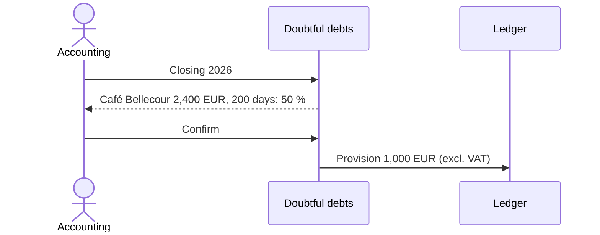

🏠 [Specs](../../../../README.md) › 🧩 [Functional capabilities](../../../README.md) ›
📒 [F8 Accounting](../../README.md) › 📝 [Use cases](../README.md) › 📝 [Use cases: FL-F8-08 Year-end duties](README.md) ›
📝 UC-F8-26 Provision doubtful debts

# 📝 UC-F8-26 Provision doubtful debts

**Status:** 🔄 waiting for the owner

## Summary

At closing, accounting reviews overdue receivables and provisions those at risk by age, dispute or procedure; provisions
are reversed when paid or written off.

## Personas

- [U05 Accounting](../../../../01-users/personas/u05-accounting.md)
- [U08 External accountant](../../../../01-users/personas/u08-external-accountant.md)

## Goal

Receivables valued at what will really be collected.

## Trigger

The period or year closing.

## Frequency

Quarterly or yearly.

## Preconditions

- Aged receivables ([UC-F8-11](../05-close-report-and-consolidate/uc-f08-11-read-financial-reports.md)).

## Postconditions

- **Succeeded:** provisions posted and justified per customer.
- **Failed:** the provision stays as it was.

## Main flow

1. Accounting opens Doubtful debts ([S-F8-26](../../screens/08-year-end-duties/s-f08-26-doubtful-debts.md)): receivables
   by age, disputes and procedures.
2. SimpleERP proposes a provision per invoice by the company's rates by age (Proposed: 50 % beyond 180 days, 100 % for
   a customer in liquidation).
3. The accountant confirms or changes each, with the reason
   ([BR-F8-18](../../business-rules/br-f08-18-provisions-are-justified-per-invoice.md)).
4. The entries post; the invoice is moved to doubtful debts.
5. When paid, the provision is reversed; when written off, the loss is posted and the VAT recovered.

## Alternative flows

- 2a. A customer in a collective procedure: the claim declared to the administrator.

## Error flows

- 3e. A provision on a paid invoice: refused.
- 5e. A write-off without a reason: refused.

## Business rules

- [BR-F8-18 Provisions are justified per invoice](../../business-rules/br-f08-18-provisions-are-justified-per-invoice.md)
- [BR-F8-01 Posted entries never change](../../business-rules/br-f08-01-posted-entries-never-change.md)

## Entities

- [E-F8-23 Doubtful debt provision](../../data/e-f08-23-doubtful-debt-provision.md)
- [E-F8-03 Journal entry](../../data/e-f08-03-journal-entry.md)

## Permissions

Accounting and the external accountant; the owner reads; lock dates apply
([BR-F8-02](../../business-rules/br-f08-02-lock-dates.md)).

## Notifications

None.

## Audit events

Provisions proposed, confirmed, reversed, written off.

## AI involvement

The AI proposes, people post ([BR-F8-09](../../business-rules/br-f08-09-the-ai-proposes-people-post.md)); figures come
from queries ([BR-F3-03](../../../f03-assistant/business-rules/br-f03-03-figures-come-from-queries.md)).

## API, MCP and A2A exposure

T5 operations of F8 with the caller's rights; the MCP tool of F8; no A2A skill.

## Screens

- [S-F8-26 Doubtful debts](../../screens/08-year-end-duties/s-f08-26-doubtful-debts.md)

## Flowchart

See [FL-F8-08 Year-end duties](../../flows/fl-f08-08-year-end-duties.md#flowchart).

## Sequence diagram

## Acceptance criteria

1. **Given** an invoice of 2,400 EUR incl. VAT unpaid for 200 days **when** the closing runs **then** a provision of 50
   % of 2,000 EUR is proposed.
2. **Given** the same invoice paid in 2027 **when** it is matched **then** the provision is reversed.
3. **Given** a customer in liquidation **when** the closing runs **then** 100 % is proposed.
4. **Given** a paid invoice **when** a provision is asked **then** it is refused.

## Non-functional notes

None.

## Regulatory references

(Proposed) to read: PCG account 491 and CGI article 39-1-5°.

## Related use cases

- [UC-F8-10 Close the period and the year](../05-close-report-and-consolidate/uc-f08-10-close-the-period-and-the-year.md)
- [UC-F6-08 Remind late payers](../../../f06-customers-and-sales/use-cases/03-invoice-and-get-paid/uc-f06-08-remind-late-payers.md)

## Open questions

None.

---

⬅️ [UC-F8-25 Approve and file the annual accounts](uc-f08-25-approve-and-file-the-annual-accounts.md) ·
⬆️ [Up](README.md) · ➡️ [UC-F8-27](../09-pay-analyse-and-report/uc-f08-27-analyse-the-months-flux-with-ai-comments.md)
