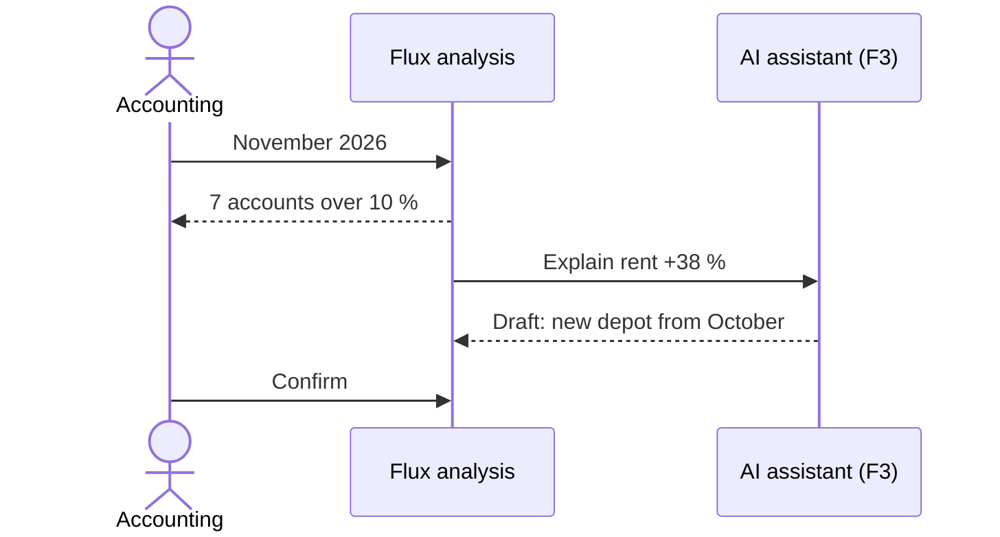

🏠 [Specs](../../../../README.md) › 🧩 [Functional capabilities](../../../README.md) ›
📒 [F8 Accounting](../../README.md) › 📝 [Use cases](../README.md) ›
📝 [Use cases: FL-F8-09 Pay, analyse and report](README.md) › 📝 UC-F8-27 Analyse the month's flux with AI comments

# 📝 UC-F8-27 Analyse the month's flux with AI comments

**Status:** ✅ specified

## Summary

After each month, accounting reads the variances of each account against last month, last year and budget, with comments
drafted by the AI from the entries behind them.

## Personas

- [U05 Accounting](../../../../01-users/personas/u05-accounting.md)
- [U13 Owner](../../../../01-users/personas/u13-owner.md)
- [U08 External accountant](../../../../01-users/personas/u08-external-accountant.md)

## Goal

Explain every large change before the owner asks.

## Trigger

The month is closed or soft-locked.

## Frequency

Monthly.

## Preconditions

- The month's entries posted.

## Postconditions

- **Succeeded:** each large variance has a reviewed comment.
- **Failed:** drafts stay drafts until reviewed
  ([BR-F8-19](../../business-rules/br-f08-19-flux-comments-are-drafts-until-reviewed.md)).

## Main flow

1. Accounting opens Flux analysis ([S-F8-27](../../screens/09-pay-analyse-and-report/s-f08-27-flux-analysis.md)) for the
   month.
2. Accounts whose variance passes the threshold (Proposed: 10 % and 5,000 EUR) are listed.
3. For each, the AI drafts a comment from the entries behind it ("rent up: new depot from October").
4. The accountant edits or confirms; the comments go into the monthly report for the owner.

## Alternative flows

- 3a. Agents of [UC-F8-17](../06-benchmark-additions/uc-f08-17-close-continuously-with-agents.md) keep it current during
  the month.

## Error flows

- 3e. The AI cannot explain a variance: it says so and lists the entries.

## Business rules

- [BR-F8-19 Flux comments are drafts until reviewed](../../business-rules/br-f08-19-flux-comments-are-drafts-until-reviewed.md)
- [BR-F8-09 The AI proposes, people post](../../business-rules/br-f08-09-the-ai-proposes-people-post.md)

## Entities

- [E-F8-24 Variance comment](../../data/e-f08-24-variance-comment.md)

## Permissions

Accounting and the external accountant; the owner reads; lock dates apply
([BR-F8-02](../../business-rules/br-f08-02-lock-dates.md)).

## Notifications

The owner: monthly report.

## Audit events

Comments drafted, edited, confirmed.

## AI involvement

Drafts comments from entries; never posts or changes them.

## API, MCP and A2A exposure

T5 operations of F8 with the caller's rights; the MCP tool of F8; no A2A skill.

## Screens

- [S-F8-27 Flux analysis](../../screens/09-pay-analyse-and-report/s-f08-27-flux-analysis.md)

## Flowchart

See [FL-F8-09 Pay, analyse and report](../../flows/fl-f08-09-pay-analyse-and-report.md#flowchart).

## Sequence diagram

## Acceptance criteria

1. **Given** rent of 13,800 EUR in November against 10,000 EUR in October **when** the analysis runs **then** rent is
   listed with +38 %.
2. **Given** the draft "new depot from October" **when** the accountant confirms it **then** it goes into the monthly
   report.
3. **Given** a variance with no explaining entry **when** the AI is asked **then** it says it cannot explain and lists
   the entries.

## Non-functional notes

None.

## Regulatory references

None.

## Related use cases

- [UC-F8-11 Read financial reports](../05-close-report-and-consolidate/uc-f08-11-read-financial-reports.md)
- [UC-F8-17 Close continuously with agents](../06-benchmark-additions/uc-f08-17-close-continuously-with-agents.md)

## Open questions

None.

---

⬅️ [UC-F8-26 Provision doubtful debts](../08-year-end-duties/uc-f08-26-provision-doubtful-debts.md) ·
⬆️ [Up](README.md) · ➡️ [UC-F8-28 Prepare the sustainability report](uc-f08-28-prepare-the-sustainability-report.md)
