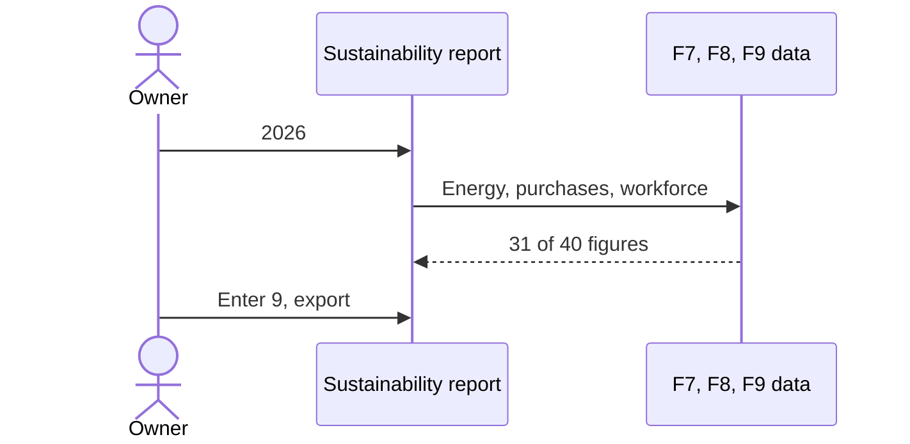

🏠 [Specs](../../../../README.md) › 🧩 [Functional capabilities](../../../README.md) ›
📒 [F8 Accounting](../../README.md) › 📝 [Use cases](../README.md) ›
📝 [Use cases: FL-F8-09 Pay, analyse and report](README.md) › 📝 UC-F8-28 Prepare the sustainability report

# 📝 UC-F8-28 Prepare the sustainability report

**Status:** 🔄 waiting for the owner

## Summary

The owner prepares a sustainability report on the voluntary standard for small companies (VSME): energy, emissions,
workforce and governance figures, taken from simple-ERP where they exist.

## Personas

- [U13 Owner](../../../../01-users/personas/u13-owner.md)
- [U05 Accounting](../../../../01-users/personas/u05-accounting.md)

## Goal

Answer banks' and customers' sustainability questionnaires without a consultant.

## Trigger

A bank, a customer or a tender asks; the yearly report.

## Frequency

Yearly.

## Preconditions

- The year's data: purchases,
  [UC-F7-24](../../../f07-purchasing-and-stock/use-cases/09-compliance-and-carbon/uc-f07-24-measure-the-carbon-of-purchases.md),
  energy bills, HR records (F9).

## Postconditions

- **Succeeded:** the report is drafted with each figure's source and method.
- **Failed:** missing data is listed.

## Main flow

1. The owner opens the sustainability report
   ([S-F8-28](../../screens/09-pay-analyse-and-report/s-f08-28-sustainability-report.md)) for the year.
2. simple-ERP fills the figures it holds: energy from bills, emissions from purchases and energy, headcount, turnover,
   accidents and training from F9
   ([BR-F8-20](../../business-rules/br-f08-20-sustainability-figures-carry-their-source.md)).
3. Missing figures are listed for the owner to enter, with where to find them.
4. The owner reviews and exports the report, in the standard's layout.

## Alternative flows

- 4a. Answer one customer's questionnaire from the same figures.

## Error flows

- 2e. A figure without a source: entered by hand and marked so.

## Business rules

- [BR-F8-20 Sustainability figures carry their source](../../business-rules/br-f08-20-sustainability-figures-carry-their-source.md)
- [BR-F7-17 Carbon figures say how they were computed](../../../f07-purchasing-and-stock/business-rules/br-f07-17-carbon-figures-say-how-they-were-computed.md)

## Entities

- [E-F8-25 Sustainability report](../../data/e-f08-25-sustainability-report.md)
- [E-F7-20 Emission factor](../../../f07-purchasing-and-stock/data/e-f07-20-emission-factor.md)

## Permissions

The owner and accounting.

## Notifications

None.

## Audit events

Figures entered, report exported.

## AI involvement

The AI proposes, people post ([BR-F8-09](../../business-rules/br-f08-09-the-ai-proposes-people-post.md)); figures come
from queries ([BR-F3-03](../../../f03-assistant/business-rules/br-f03-03-figures-come-from-queries.md)).

## API, MCP and A2A exposure

T5 operations of F8 with the caller's rights; the MCP tool of F8; no A2A skill.

## Screens

- [S-F8-28 Sustainability report](../../screens/09-pay-analyse-and-report/s-f08-28-sustainability-report.md)

## Flowchart

See [FL-F8-09 Pay, analyse and report](../../flows/fl-f08-09-pay-analyse-and-report.md#flowchart).

## Sequence diagram

## Acceptance criteria

1. **Given** Distribution Lemoine's 2026 energy bills of 410 MWh **when** the report is drafted **then** energy shows
   410 MWh from the bills.
2. **Given** no water figure **when** the report is drafted **then** water is listed as missing.
3. **Given** figures entered by hand **when** the report is exported **then** they are marked as entered by hand.

## Non-functional notes

None.

## Regulatory references

(Proposed) to read: the EFRAG VSME standard.

## Related use cases

- [UC-F7-24 Measure the carbon of purchases](../../../f07-purchasing-and-stock/use-cases/09-compliance-and-carbon/uc-f07-24-measure-the-carbon-of-purchases.md)
- [UC-F9-20 Publish the equality index and pay-transparency information](../../../f09-hr-and-projects/use-cases/07-fair-pay-and-speaking-up/uc-f09-20-publish-the-equality-index-and-pay-transparency-information.md)

## Open questions

None.

---

⬅️ [UC-F8-27 Analyse the month's flux with AI comments](uc-f08-27-analyse-the-months-flux-with-ai-comments.md) ·
⬆️ [Up](README.md) ·
➡️ [UC-F8-29](../10-accountant-collaboration/uc-f08-29-answer-the-accountants-questions-and-requests.md)
