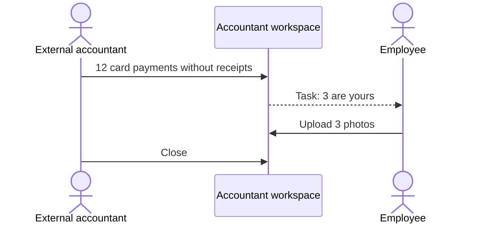

🏠 [Specs](../../../../README.md) › 🧩 [Functional capabilities](../../../README.md) ›
📒 [F8 Accounting](../../README.md) › 📝 [Use cases](../README.md) ›
📝 [Use cases: FL-F8-10 Accountant collaboration](README.md) › 📝 UC-F8-29 Answer the accountant's questions and requests

# 📝 UC-F8-29 Answer the accountant's questions and requests

**Status:** ✅ specified

## Summary

The external accountant asks questions on entries and requests missing receipts; the company answers in simple-ERP and
each answer stays with its entry.

## Personas

- [U08 External accountant](../../../../01-users/personas/u08-external-accountant.md)
- [U05 Accounting](../../../../01-users/personas/u05-accounting.md)
- [U01 Employee](../../../../01-users/personas/u01-employee.md)

## Goal

No more emails lost between the company and its accountant.

## Trigger

The accountant reviews entries.

## Frequency

Weekly during reviews; at each closing.

## Preconditions

- The accountant's access ([UC-F8-14](../01-set-up-and-post/uc-f08-14-work-with-the-external-accountant.md)).

## Postconditions

- **Succeeded:** each question is answered on its entry; receipts are linked.
- **Failed:** unanswered ones are listed at the closing
  ([BR-F8-21](../../business-rules/br-f08-21-open-questions-are-listed-at-closing.md)).

## Main flow

1. The accountant selects entries in the accountant workspace
   ([S-F8-14](../../screens/01-set-up-and-post/s-f08-14-accountant-workspace.md)) and asks a question or requests the
   missing receipts.
2. Each request becomes a task for the person concerned (the buyer, the employee who spent).
3. The employee uploads the receipt from the phone; it links to the entry.
4. Accounting answers the questions; the accountant closes them.
5. At closing, open requests are listed in the checklist
   ([UC-F8-10](../05-close-report-and-consolidate/uc-f08-10-close-the-period-and-the-year.md)).

## Alternative flows

- 1a. A batch request: "12 card payments without receipts in November".

## Error flows

- 2e. Nobody known for the entry: the request goes to accounting.
- 1e. An entry of a locked period: the answer is kept, the entry unchanged.

## Business rules

- [BR-F8-21 Open questions are listed at closing](../../business-rules/br-f08-21-open-questions-are-listed-at-closing.md)
- [BR-F8-05 Expenses need a receipt and an approval](../../business-rules/br-f08-05-expenses-need-a-receipt-and-an-approval.md)

## Entities

- [E-F8-26 Accountant request](../../data/e-f08-26-accountant-request.md)
- [E-F8-03 Journal entry](../../data/e-f08-03-journal-entry.md)

## Permissions

The accountant asks; the company's users answer what concerns them.

## Notifications

Tasks and reminders.

## Audit events

Questions, answers, receipts linked.

## AI involvement

The AI assistant finds the likely receipt in the documents for confirmation.

## API, MCP and A2A exposure

T5 operations of F8 with the caller's rights; the MCP tool of F8; no A2A skill.

## Screens

- [S-F8-14 Accountant workspace](../../screens/01-set-up-and-post/s-f08-14-accountant-workspace.md)

## Flowchart

See [FL-F8-10 Accountant collaboration](../../flows/fl-f08-10-accountant-collaboration.md#flowchart).

## Sequence diagram

## Acceptance criteria

1. **Given** 12 card payments without receipts in November at Delorme Conseil **when** the accountant requests them
   **then** each card holder gets a task for their payments.
2. **Given** an employee uploads a receipt **when** it is matched **then** it is linked to the entry.
3. **Given** 2 requests open at the closing **when** the checklist runs **then** they are listed.

## Non-functional notes

Uploading a receipt works on a phone.

## Regulatory references

[CR-FR-002](../../../../10-country-packs/france/accounting/cr-fr-002-accounting-records-kept-ten-years.md).

## Related use cases

- [UC-F8-14 Work with the external accountant](../01-set-up-and-post/uc-f08-14-work-with-the-external-accountant.md)
- [UC-F8-12 Submit and approve expenses](../02-purchase-to-pay/uc-f08-12-submit-and-approve-expenses.md)

## Open questions

None.

---

⬅️ [UC-F8-28](../09-pay-analyse-and-report/uc-f08-28-prepare-the-sustainability-report.md) · ⬆️ [Up](README.md) ·
➡️ [UC-F8-30 Manage loans and borrowings](../11-treasury-and-payment-means/uc-f08-30-manage-loans-and-borrowings.md)
