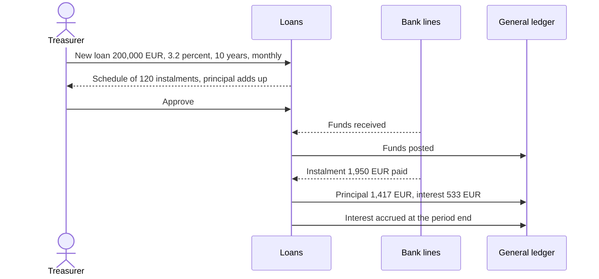

🏠 [Specs](../../../../README.md) › 🧩 [Functional capabilities](../../../README.md) ›
📒 [F8 Accounting](../../README.md) › 📝 [Use cases](../README.md) › 📝 UC-F8-30 Manage loans and borrowings

# 📝 UC-F8-30 Manage loans and borrowings

**Status:** ✅ specified

## Summary

The treasurer records the company's loans and borrowings: the bank loan, the association's loan, a shareholder's loan.
Each has a repayment schedule, its instalments are matched with the bank, and its interest is accrued in every period.

## Personas

- [U31 Treasurer](../../../../01-users/personas/u31-treasurer.md)
- [U05 Accounting](../../../../01-users/personas/u05-accounting.md)

## Goal

The books always show what is owed, what falls due this year and the interest of each period, without waiting for the
bank's statement.

## Trigger

A loan is taken or taken over, an instalment is paid, or a period closes.

## Frequency

A loan is recorded once; an instalment each month or quarter; accrual at each period end.

## Preconditions

- The lender and the loan account exist in the chart of accounts ([E-F8-01 Account](../../data/e-f08-01-account.md)).
- The loan contract gives the amount, the rate, the term and the repayment type.
- A bank account receives the funds and pays the instalments
  ([UC-F8-06](../03-bank-and-collect/uc-f08-06-connect-banks-and-reconcile.md)).

## Postconditions

- **Succeeded:** the loan is recorded ([E-F8-34 Loan](../../data/e-f08-34-loan.md)) with its schedule; the funds are
  posted when received; each instalment splits into principal and interest; interest is accrued each period
  ([BR-F8-22](../../business-rules/br-f08-22-loan-interest-is-accrued-each-period.md)).
- **Failed:** no entry is posted; the loan stays Draft and the schedule is shown with what does not add up.

## Main flow

1. The treasurer opens the loans screen ([S-F8-29 Loans](../../screens/11-treasury-and-payment-means/s-f08-29-loans.md))
   and creates a loan from its contract: lender, amount, rate (fixed or variable), start date, term, repayment type
   (constant instalment, constant principal or at maturity) and the first due date.
2. SimpleERP builds the repayment schedule and checks that the principal repaid adds up to the amount borrowed.
3. The treasurer approves the loan; the receipt of the funds is matched with the bank line
   ([UC-F8-06](../03-bank-and-collect/uc-f08-06-connect-banks-and-reconcile.md)) and posted.
4. At each due date the bank line of the instalment is matched with the schedule; SimpleERP posts the principal and the
   interest.
5. At each period end, SimpleERP accrues the interest earned since the last instalment
   ([BR-F8-22](../../business-rules/br-f08-22-loan-interest-is-accrued-each-period.md)) and reverses it when the
   instalment is posted.
6. The accounting reads the balance, the part due within one year and the interest of the year in the reports
   ([UC-F8-11](../05-close-report-and-consolidate/uc-f08-11-read-financial-reports.md)); the cash forecast takes the
   future instalments ([UC-F8-33 Follow the daily cash position](uc-f08-33-follow-the-daily-cash-position.md)).

## Alternative flows

- 2a. A variable rate: the treasurer enters the new rate from its date and the schedule is rebuilt from that date.
- 4a. An early repayment: the treasurer records the extra amount and its penalty; the schedule is shortened or the
  instalment lowered, as chosen.
- 5a. Grace period: interest is paid and no principal until the first principal date.

## Error flows

- 2e. The schedule does not add up to the principal: the loan cannot be approved and the difference is shown
  ([BR-F8-06](../../business-rules/br-f08-06-balanced-entries-continuous-numbers.md)).
- 4e. The bank line differs from the scheduled instalment: it is shown with the difference and left for the treasurer to
  match or to add as a fee.
- 5e. The period is locked ([BR-F8-02](../../business-rules/br-f08-02-lock-dates.md)): the accrual is posted in the next
  open period and flagged.
- Any step: a service does not answer; the call is retried first
  ([BR-F3-32](../../../f03-assistant/business-rules/br-f03-32-retry-before-an-error.md)), then the message follows the
  error pattern ([D122](../../../../06-decisions/ux/d122-error-message-standard.md)) and what the user typed stays on
  the screen.

## Business rules

- [BR-F8-22](../../business-rules/br-f08-22-loan-interest-is-accrued-each-period.md)
- [BR-F8-03](../../business-rules/br-f08-03-every-bank-line-is-reconciled.md)
- [BR-F8-06](../../business-rules/br-f08-06-balanced-entries-continuous-numbers.md)
- [BR-F8-02 Lock dates](../../business-rules/br-f08-02-lock-dates.md)

## Entities

- [E-F8-34 Loan](../../data/e-f08-34-loan.md): created, changed
- [E-F8-04 Bank line](../../data/e-f08-04-bank-line.md): read, the bank lines matched
- [E-F8-03 Journal entry](../../data/e-f08-03-journal-entry.md): created, the entries of funds, instalments and accruals
- [E-F8-10 Fiscal period](../../data/e-f08-10-fiscal-period.md): read, the period of each accrual
- [E-F8-01 Account](../../data/e-f08-01-account.md): read, the loan and interest accounts

## Permissions

The treasurer and accounting create, change and read loans; the owner reads them; the external accountant reads them
([UC-F8-14](../01-set-up-and-post/uc-f08-14-work-with-the-external-accountant.md)).

## Notifications

The treasurer, in the app and on a phone: an instalment due in 5 days; an instalment not found on the bank statement; a
variable rate to update.

## Audit events

Each loan created, approved, changed and repaid; each schedule rebuilt with the old and the new one; each entry posted,
with who and when.

## AI involvement

The AI assistant reads a loan contract the treasurer uploads and prefills the amount, the rate and the term for the
treasurer to check ([BR-F8-09](../../business-rules/br-f08-09-the-ai-proposes-people-post.md)); it never approves a
loan.

## API, MCP and A2A exposure

T5 operations of the capability for the personas above: create, read, update and list. The MCP tool of the
capability may read and propose, never confirm alone. No A2A skill.

## Screens

- [S-F8-29 Loans](../../screens/11-treasury-and-payment-means/s-f08-29-loans.md)

## Flowchart

See [FL-F8-11 Treasury and payment means](../../flows/fl-f08-11-treasury-and-payment-means.md#flowchart).

## Sequence diagram

## Acceptance criteria

1. **Given** a loan of 200,000 EUR over 120 instalments **when** the treasurer approves it **then** the principal of the
   instalments adds up to 200,000 EUR.
2. **Given** an instalment paid on 5 November **when** the bank line is matched **then** the principal and the interest
   are posted.
3. **Given** a period closing on 31 October with 25 days of interest **when** the accrual runs **then** the interest of
   25 days is posted and reversed at the next instalment.
4. **Given** a schedule whose principal does not add up **when** the treasurer approves **then** it is refused with the
   difference.

## Non-functional notes

The screen answers within 2 seconds for 10,000 records; every change is audited.

## Regulatory references

Interest is an expense of the period it relates to, whatever the payment date
([CR-FR-064](../../../../10-country-packs/france/accounting/cr-fr-064-accounting-frameworks.md),
[CR-FR-004](../../../../10-country-packs/france/accounting/cr-fr-004-balanced-entries-continuous-numbers.md)).

## Related use cases

- [UC-F8-31 Issue LCR and deposit cheques](uc-f08-31-issue-lcr-and-deposit-cheques.md)
- [UC-F8-33 Follow the daily cash position](uc-f08-33-follow-the-daily-cash-position.md)
- [UC-F8-19 Plan and forecast](../06-benchmark-additions/uc-f08-19-plan-and-forecast.md)
- [UC-F8-10](../05-close-report-and-consolidate/uc-f08-10-close-the-period-and-the-year.md)

## Open questions

None.

---

⬅️ [UC-F8-29](../10-accountant-collaboration/uc-f08-29-answer-the-accountants-questions-and-requests.md) ·
⬆️ [Up](README.md) · ➡️ [UC-F8-31 Issue LCR and deposit cheques](uc-f08-31-issue-lcr-and-deposit-cheques.md)
