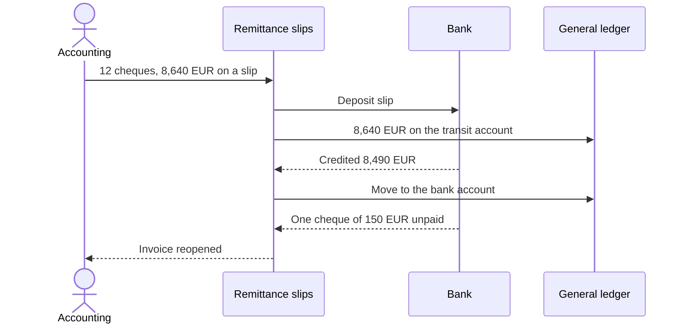

🏠 [Specs](../../../../README.md) › 🧩 [Functional capabilities](../../../README.md) ›
📒 [F8 Accounting](../../README.md) › 📝 [Use cases](../README.md) › 📝 UC-F8-31 Issue LCR and deposit cheques

# 📝 UC-F8-31 Issue LCR and deposit cheques

**Status:** 🔄 waiting for the owner

## Summary

Accounting and the treasurer issue and remit French payment means: customer cheques received are grouped on a deposit
slip, and bills of exchange (LCR) are issued, remitted to the bank and followed until the bank credits or rejects them.
Nothing is posted to the bank until the bank credits it.

## Personas

- [U05 Accounting](../../../../01-users/personas/u05-accounting.md)
- [U31 Treasurer](../../../../01-users/personas/u31-treasurer.md)

## Goal

Cheques and LCR are never lost between the customer and the bank, and the bank balance in the books shows only what the
bank has credited.

## Trigger

A customer pays by cheque, a customer agrees to an LCR, or a supplier is paid by LCR.

## Frequency

Weekly deposit slips for companies that receive cheques; LCR runs monthly.

## Preconditions

- The bank account and its remittance method are set up ([E-F8-04 Bank line](../../data/e-f08-04-bank-line.md),
  [UC-F8-06](../03-bank-and-collect/uc-f08-06-connect-banks-and-reconcile.md)).
- The customer payment or the supplier bill exists
  ([E-F6-06 Customer payment](../../../f06-customers-and-sales/data/e-f06-06-customer-payment.md),
  [UC-F8-03](../02-purchase-to-pay/uc-f08-03-process-supplier-bills.md)).
- The customer agreed in writing to the LCR, or the cheque is received.

## Postconditions

- **Succeeded:** each remittance slip ([E-F8-35 Remittance slip](../../data/e-f08-35-remittance-slip.md)) lists its
  cheques or LCR; a cheque or LCR is posted to the bank only when the bank credits it
  ([BR-F8-23](../../business-rules/br-f08-23-a-cheque-or-lcr-is-posted-when-the-bank-credits-it.md)); unpaid ones come
  back to the customer's account.
- **Failed:** nothing is posted to the bank; the slip stays Draft, or an item is marked Unpaid with the bank's reason.

## Main flow

1. Accounting records the cheques received (number, bank, drawer, amount, date) or creates the LCR for the invoices to
   collect ([S-F8-30 Payment means](../../screens/11-treasury-and-payment-means/s-f08-30-payment-means.md)).
2. Accounting groups them on a remittance slip for one bank account and checks the total.
3. Accounting prints the deposit slip or sends the LCR file to the bank in the bank's format, and the slip becomes
   Remitted.
4. Until the bank credits, the amounts sit on a transit account, not on the bank account
   ([BR-F8-23](../../business-rules/br-f08-23-a-cheque-or-lcr-is-posted-when-the-bank-credits-it.md)).
5. The bank credits the slip: the bank line is matched to the slip, the transit amounts move to the bank account and the
   customers' invoices are cleared ([UC-F8-05](../03-bank-and-collect/uc-f08-05-collect-customer-payments.md)).
6. An unpaid cheque or LCR returns from the bank: the item is marked Unpaid, the invoice is reopened and the customer is
   reminded
   ([UC-F6-08](../../../f06-customers-and-sales/use-cases/03-invoice-and-get-paid/uc-f06-08-remind-late-payers.md)).

## Alternative flows

- 1a. The treasurer pays a supplier by LCR: the supplier's bill is settled when the bank debits the due date.
- 5a. The bank credits part of the slip: the credited items are posted and the others stay Remitted.
- 5b. The LCR is discounted: the bank advances the amount, the advance is a loan until the due date and its fees are
  posted ([UC-F8-30](uc-f08-30-manage-loans-and-borrowings.md)).

## Error flows

- 2e. A cheque's amount in digits and in words differ: it is flagged for correction before the slip is remitted.
- 5e. The bank line does not match any slip: it stays unmatched
  ([BR-F8-03](../../business-rules/br-f08-03-every-bank-line-is-reconciled.md)).
- 6e. A cheque comes back unpaid twice: the customer's credit is reviewed
  [UC-F6-18](../../../f06-customers-and-sales/use-cases/06-accounts-and-credit/uc-f06-18-set-a-credit-limit-and-hold-orders.md).
- Any step: a service does not answer; the call is retried first
  ([BR-F3-32](../../../f03-assistant/business-rules/br-f03-32-retry-before-an-error.md)), then the message follows the
  error pattern ([D122](../../../../06-decisions/ux/d122-error-message-standard.md)) and what the user typed stays on
  the screen.

## Business rules

- [BR-F8-23](../../business-rules/br-f08-23-a-cheque-or-lcr-is-posted-when-the-bank-credits-it.md)
- [BR-F8-03](../../business-rules/br-f08-03-every-bank-line-is-reconciled.md)
- [BR-F8-08 New IBANs are checked](../../business-rules/br-f08-08-new-ibans-are-checked.md)

## Entities

- [E-F8-35 Remittance slip](../../data/e-f08-35-remittance-slip.md): created, changed
- [E-F6-06 Customer payment](../../../f06-customers-and-sales/data/e-f06-06-customer-payment.md): changed, the customer
  payments by cheque or LCR
- [E-F8-04 Bank line](../../data/e-f08-04-bank-line.md): read, the credit by the bank
- [E-F6-05 Invoice](../../../f06-customers-and-sales/data/e-f06-05-invoice.md): changed, cleared or reopened
- [E-F8-03 Journal entry](../../data/e-f08-03-journal-entry.md): created, the entries on credit

## Permissions

Accounting and the treasurer create slips and record cheques; the owner reads them. The treasurer remits
slips above a set amount.

## Notifications

Accounting, in the app: a slip not credited 5 working days after remittance; an unpaid cheque or LCR.

## Audit events

Each cheque recorded, slip remitted, credit matched and unpaid item, with who, when and the bank reference.

## AI involvement

The AI assistant may read a cheque's image and prefill the number, the amount and the drawer for accounting to check;
accounting remits.

## API, MCP and A2A exposure

T5 operations of the capability for the personas above: create, read, update and list. The MCP tool of the
capability may read and propose, never confirm alone. No A2A skill.

## Screens

- [S-F8-30 Payment means](../../screens/11-treasury-and-payment-means/s-f08-30-payment-means.md)

## Flowchart

See [FL-F8-11 Treasury and payment means](../../flows/fl-f08-11-treasury-and-payment-means.md#flowchart).

## Sequence diagram

## Acceptance criteria

1. **Given** 12 cheques on a remitted slip **when** the bank has not credited it **then** the amounts are on the transit
   account, not on the bank account.
2. **Given** a slip credited by the bank **when** the bank line is matched **then** the amounts move to the bank account
   and the invoices are cleared.
3. **Given** a cheque returned unpaid **when** the bank reports it **then** the item is Unpaid and the invoice is
   reopened.
4. **Given** a slip credited in part **when** the bank line is matched **then** only the credited items are posted.

## Non-functional notes

The screen answers within 2 seconds for 10,000 records; every change is audited.

## Regulatory references

Cheques and LCR are French payment means with their own remittance and rejection rules: (Proposed) the France-pack rule
is listed below ([CR-FR-023](../../../../10-country-packs/france/payments/cr-fr-023-sepa-formats.md) covers only SEPA).
This page states only that a cheque or an LCR is a claim until the bank credits it.

- France-pack rule, (Proposed) until its law is read:
  [CR-FR-212 LCR and cheque remittances](../../../../10-country-packs/france/payments/cr-fr-212-lcr-and-cheque-remittances.md)

## Related use cases

- [UC-F8-30 Manage loans and borrowings](uc-f08-30-manage-loans-and-borrowings.md)
- [UC-F8-32 Revalue foreign-currency items](uc-f08-32-revalue-foreign-currency-items.md)
- [UC-F8-05](../03-bank-and-collect/uc-f08-05-collect-customer-payments.md)
- [UC-F8-06](../03-bank-and-collect/uc-f08-06-connect-banks-and-reconcile.md)
- [UC-F8-34 Pay suppliers from the ERP](uc-f08-34-pay-suppliers-from-the-erp.md)

## Open questions

None.

---

⬅️ [UC-F8-30 Manage loans and borrowings](uc-f08-30-manage-loans-and-borrowings.md) · ⬆️ [Up](README.md) ·
➡️ [UC-F8-32 Revalue foreign-currency items](uc-f08-32-revalue-foreign-currency-items.md)
