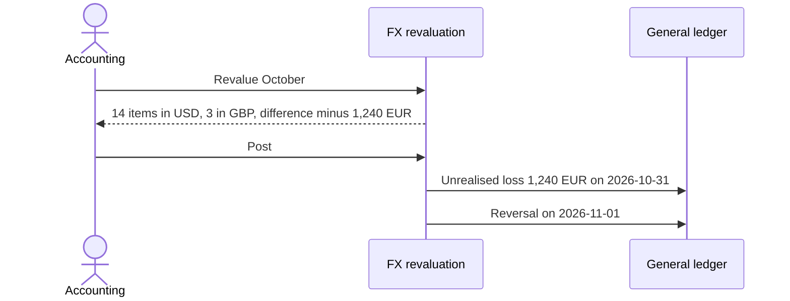

🏠 [Specs](../../../../README.md) › 🧩 [Functional capabilities](../../../README.md) ›
📒 [F8 Accounting](../../README.md) › 📝 [Use cases](../README.md) › 📝 UC-F8-32 Revalue foreign-currency items

# 📝 UC-F8-32 Revalue foreign-currency items

**Status:** ✅ specified, ⚖️ lawyer review before launch (D574)

## Summary

At the end of each period accounting revalues the open foreign-currency items (customer invoices, supplier bills, bank
balances and loans) at the closing rate, posts the unrealised exchange differences, and reverses them at the start of
the next period.

## Personas

- [U05 Accounting](../../../../01-users/personas/u05-accounting.md)

## Goal

The balance sheet shows foreign-currency items at the closing rate, and the real gain or loss appears only when the item
is settled.

## Trigger

The period closing reaches the FX step
([UC-F8-10](../05-close-report-and-consolidate/uc-f08-10-close-the-period-and-the-year.md)), or accounting runs it on
request.

## Frequency

Each period end for companies with foreign-currency items.

## Preconditions

- Closing rates for the period are loaded for every currency used.
- Foreign-currency items exist ([E-F6-05 Invoice](../../../f06-customers-and-sales/data/e-f06-05-invoice.md),
  [E-F7-05 Supplier invoice](../../../f07-purchasing-and-stock/data/e-f07-05-supplier-invoice.md),
  [E-F8-04 Bank line](../../data/e-f08-04-bank-line.md)).
- The period is open ([E-F8-10 Fiscal period](../../data/e-f08-10-fiscal-period.md)).

## Postconditions

- **Succeeded:** the revaluation run is saved ([E-F8-36 Revaluation run](../../data/e-f08-36-revaluation-run.md)) with
  each item's old and new value; one entry posts the unrealised difference and its reversal is scheduled for the first
  day of the next period
  ([BR-F8-24](../../business-rules/br-f08-24-unrealised-differences-are-reversed-next-period.md)).
- **Failed:** nothing is posted; the run stays Computed with the items that lack a rate.

## Main flow

1. Accounting opens the FX revaluation
   ([S-F8-31 FX revaluation](../../screens/11-treasury-and-payment-means/s-f08-31-fx-revaluation.md)) and chooses the
   period.
2. SimpleERP lists every open foreign-currency item and every foreign-currency bank balance with its booked value and
   its value at the closing rate.
3. Accounting checks the rates and the difference per currency.
4. Accounting posts the run: unrealised gains and losses go to the exchange accounts, per currency and per item type.
5. On the first day of the next period, SimpleERP posts the reversal of the run
   ([BR-F8-24](../../business-rules/br-f08-24-unrealised-differences-are-reversed-next-period.md)).
6. When an item is settled, the real exchange difference is posted against the original booked value.

## Alternative flows

- 3a. Accounting overrides a rate with a reason (a contracted rate): the run uses it for that item.
- 4a. The run is posted by the AI assistant's closing agent
  ([UC-F8-17](../06-benchmark-additions/uc-f08-17-close-continuously-with-agents.md)); accounting approves first.
- 6a. A partial payment settles part of the item: the real difference is posted for the paid part only.

## Error flows

- 2e. A currency has no closing rate: its items are listed and the run cannot be posted until a rate is added.
- 4e. The period is locked ([BR-F8-02](../../business-rules/br-f08-02-lock-dates.md)): the run is refused.
- 5e. The reversal fails because the next period is not open yet: it is posted when that period opens.
- Any step: a service does not answer; the call is retried first
  ([BR-F3-32](../../../f03-assistant/business-rules/br-f03-32-retry-before-an-error.md)), then the message follows the
  error pattern ([D122](../../../../06-decisions/ux/d122-error-message-standard.md)) and what the user typed stays on
  the screen.

## Business rules

- [BR-F8-24](../../business-rules/br-f08-24-unrealised-differences-are-reversed-next-period.md)
- [BR-F8-01](../../business-rules/br-f08-01-posted-entries-never-change.md)
- [BR-F8-02 Lock dates](../../business-rules/br-f08-02-lock-dates.md)
- [BR-F8-06](../../business-rules/br-f08-06-balanced-entries-continuous-numbers.md)

## Entities

- [E-F8-36 Revaluation run](../../data/e-f08-36-revaluation-run.md): created, changed
- [E-F6-05 Invoice](../../../f06-customers-and-sales/data/e-f06-05-invoice.md): read, open customer invoices
- [E-F7-05 Supplier invoice](../../../f07-purchasing-and-stock/data/e-f07-05-supplier-invoice.md): read, open supplier
  bills
- [E-F8-04 Bank line](../../data/e-f08-04-bank-line.md): read, foreign-currency bank balances
- [E-F8-03 Journal entry](../../data/e-f08-03-journal-entry.md): created, the revaluation and its reversal

## Permissions

Accounting runs and posts; the external accountant and the owner read the run.

## Notifications

Accounting, in the app: a currency lacks its closing rate; the run is ready to post.

## Audit events

Each run, rate used and override with its reason, entry posted and reversal, with who and when.

## AI involvement

The AI assistant may flag rates that differ from the official rate by more than a threshold; accounting decides
([BR-F8-09](../../business-rules/br-f08-09-the-ai-proposes-people-post.md)).

## API, MCP and A2A exposure

T5 operations of the capability for the personas above: create, read, update and list. The MCP tool of the
capability may read and propose, never confirm alone. No A2A skill.

## Screens

- [S-F8-31 FX revaluation](../../screens/11-treasury-and-payment-means/s-f08-31-fx-revaluation.md)

## Flowchart

See [FL-F8-11 Treasury and payment means](../../flows/fl-f08-11-treasury-and-payment-means.md#flowchart).

## Sequence diagram

## Acceptance criteria

1. **Given** an invoice of 10,000 USD booked at 0.92 and a closing rate of 0.95 **when** the run is computed **then**
   the unrealised gain of 300 EUR is shown for that item.
2. **Given** a posted run **when** the next period opens **then** its reversal is posted on the first day.
3. **Given** a currency with no closing rate **when** accounting posts **then** the run is refused and lists the items.
4. **Given** the invoice paid in the next period **when** the payment is posted **then** the real difference is against
   the original booked value.

## Non-functional notes

The screen answers within 2 seconds for 10,000 records; every change is audited.

## Regulatory references

Foreign-currency items are valued at the closing rate at the period end: (⚖️ lawyer review before launch, D574) the France-pack rule on
conversion differences is still to write, to read: PCG articles 420-5 and following; posted entries are inalterable
([CR-FR-003](../../../../10-country-packs/france/accounting/cr-fr-003-posted-entries-are-inalterable.md)).

## Related use cases

- [UC-F8-31 Issue LCR and deposit cheques](uc-f08-31-issue-lcr-and-deposit-cheques.md)
- [UC-F8-33 Follow the daily cash position](uc-f08-33-follow-the-daily-cash-position.md)
- [UC-F8-10](../05-close-report-and-consolidate/uc-f08-10-close-the-period-and-the-year.md)
- [UC-F8-03 Process supplier bills](../02-purchase-to-pay/uc-f08-03-process-supplier-bills.md)
- [UC-F8-05](../03-bank-and-collect/uc-f08-05-collect-customer-payments.md)

## Open questions

None.

---

⬅️ [UC-F8-31 Issue LCR and deposit cheques](uc-f08-31-issue-lcr-and-deposit-cheques.md) · ⬆️ [Up](README.md) ·
➡️ [UC-F8-33 Follow the daily cash position](uc-f08-33-follow-the-daily-cash-position.md)
