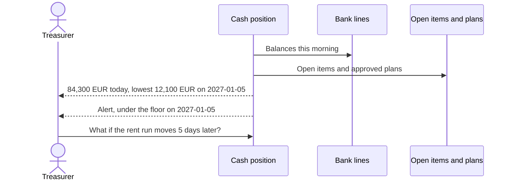

🏠 [Specs](../../../../README.md) › 🧩 [Functional capabilities](../../../README.md) ›
📒 [F8 Accounting](../../README.md) › 📝 [Use cases](../README.md) › 📝 UC-F8-33 Follow the daily cash position

# 📝 UC-F8-33 Follow the daily cash position

**Status:** ✅ specified

## Summary

The treasurer and the owner follow the daily cash position: the balance of every bank account today, and a forecast of
the weeks ahead built from the open invoices and bills, the loan instalments, the payroll and tax dates and the approved
plans, with an alert before the balance goes under a floor.

## Personas

- [U31 Treasurer](../../../../01-users/personas/u31-treasurer.md)
- [U13 Owner](../../../../01-users/personas/u13-owner.md)

## Goal

The owner knows each morning how much cash the company has and will have, and is warned in time.

## Trigger

Every morning, an alert on a phone, or a question to the AI assistant.

## Frequency

Daily; the forecast is recomputed each night.

## Preconditions

- Bank accounts are connected and reconciled
  ([UC-F8-06](../03-bank-and-collect/uc-f08-06-connect-banks-and-reconcile.md)).
- Open invoices and bills carry their due dates
  ([E-F6-05 Invoice](../../../f06-customers-and-sales/data/e-f06-05-invoice.md),
  [E-F7-05 Supplier invoice](../../../f07-purchasing-and-stock/data/e-f07-05-supplier-invoice.md)).
- Plans are approved when used ([UC-F8-19](../06-benchmark-additions/uc-f08-19-plan-and-forecast.md),
  [E-F8-16 Budget plan](../../data/e-f08-16-budget-plan.md)).

## Postconditions

- **Succeeded:** the day's forecast is saved ([E-F8-37 Cash forecast](../../data/e-f08-37-cash-forecast.md)) with the
  daily balances for the horizon; alerts have been sent for any day under the floor.
- **Failed:** the previous forecast stays; the screen says which source failed and its age.

## Main flow

1. Each night SimpleERP reads the bank balances and the open items and builds the forecast
   ([BR-F8-25](../../business-rules/br-f08-25-the-forecast-uses-only-open-items-and-approved-plans.md)).
2. Expected receipts use the invoice due date moved by the customer's average delay; expected payments use the bill due
   dates, the loan instalments, payroll and tax dates.
3. Approved plans add their planned receipts and payments; plans not approved are left out.
4. The treasurer opens the cash position on a phone
   ([S-F8-32 Cash position](../../screens/11-treasury-and-payment-means/s-f08-32-cash-position.md)): today's balance,
   the lowest point of the next 13 weeks and the days under the floor.
5. The owner reads the same on their phone and drills into a day to see the items behind it.
6. When a day goes under the floor, an alert goes out; the treasurer postpones payments or asks for financing
   ([UC-F8-34 Pay suppliers from the ERP](uc-f08-34-pay-suppliers-from-the-erp.md),
   [UC-F8-30 Manage loans and borrowings](uc-f08-30-manage-loans-and-borrowings.md)).

## Alternative flows

- 2a. The treasurer moves a customer's expected date by hand with a note; it is used for that item only.
- 4a. The treasurer asks the AI assistant: "can we pay the VAT on the 20th?"; it answers from the forecast with the
  lowest balance before that date.
- 6a. A what-if: the treasurer postpones a payment run and sees the forecast change without saving it.

## Error flows

- 1e. A bank connection failed: the account's last balance is used and shown with its age.
- 2e. An invoice is far overdue: its expected date is not guessed; it is shown apart as doubtful.
- 4e. A currency has no rate: its items are valued at the last rate and flagged.
- Any step: a service does not answer; the call is retried first
  ([BR-F3-32](../../../f03-assistant/business-rules/br-f03-32-retry-before-an-error.md)), then the message follows the
  error pattern ([D122](../../../../06-decisions/ux/d122-error-message-standard.md)) and what the user typed stays on
  the screen.

## Business rules

- [BR-F8-25](../../business-rules/br-f08-25-the-forecast-uses-only-open-items-and-approved-plans.md)
- [BR-F8-03](../../business-rules/br-f08-03-every-bank-line-is-reconciled.md)
- [BR-F8-26](../../business-rules/br-f08-26-payments-above-the-limit-need-two-approvals.md)

## Entities

- [E-F8-37 Cash forecast](../../data/e-f08-37-cash-forecast.md): created
- [E-F8-04 Bank line](../../data/e-f08-04-bank-line.md): read, the balances
- [E-F6-05 Invoice](../../../f06-customers-and-sales/data/e-f06-05-invoice.md): read, expected receipts
- [E-F7-05 Supplier invoice](../../../f07-purchasing-and-stock/data/e-f07-05-supplier-invoice.md): read, expected
  payments
- [E-F8-16 Budget plan](../../data/e-f08-16-budget-plan.md): read, approved plans only

## Permissions

The treasurer, accounting and the owner read the position and the forecast; the external accountant reads it on request.

## Notifications

The treasurer and the owner, on their phones: the balance falls under the floor on a given day; a large customer payment
is late.

## Audit events

Each forecast generated with its sources and ages; each manual change of an expected date, with who and why; each alert.

## AI involvement

The AI assistant answers questions about the forecast and explains the biggest movements; it never moves money
([BR-F8-26](../../business-rules/br-f08-26-payments-above-the-limit-need-two-approvals.md)).

## API, MCP and A2A exposure

T5 operations of the capability for the personas above: create, read, update and list. The MCP tool of the
capability may read and propose, never confirm alone. No A2A skill.

## Screens

- [S-F8-32 Cash position](../../screens/11-treasury-and-payment-means/s-f08-32-cash-position.md)

## Flowchart

See [FL-F8-11 Treasury and payment means](../../flows/fl-f08-11-treasury-and-payment-means.md#flowchart).

## Sequence diagram

## Acceptance criteria

1. **Given** approved plans and unapproved plans **when** the forecast is built **then** only the approved plans are
   included.
2. **Given** an invoice due on the 10th and a customer who pays 8 days late on average **when** the forecast is built
   **then** the receipt is expected on the 18th.
3. **Given** a day where the balance falls under the floor **when** the forecast is saved **then** an alert goes to the
   treasurer and the owner.
4. **Given** a bank connection that failed **when** the forecast is built **then** the last balance is used and its age
   is shown.

## Non-functional notes

The screen answers within 2 seconds for 10,000 records; every change is audited.

## Regulatory references

None specific; payment terms and late payment follow the invoice rules
([CR-FR-018](../../../../10-country-packs/france/invoicing/cr-fr-018-payment-terms-cap.md),
[CR-FR-019](../../../../10-country-packs/france/invoicing/cr-fr-019-late-payment-penalties.md)).

## Related use cases

- [UC-F8-32 Revalue foreign-currency items](uc-f08-32-revalue-foreign-currency-items.md)
- [UC-F8-34 Pay suppliers from the ERP](uc-f08-34-pay-suppliers-from-the-erp.md)
- [UC-F8-19 Plan and forecast](../06-benchmark-additions/uc-f08-19-plan-and-forecast.md)
- [UC-F8-34 Pay suppliers from the ERP](uc-f08-34-pay-suppliers-from-the-erp.md)
- [UC-F8-30 Manage loans and borrowings](uc-f08-30-manage-loans-and-borrowings.md)

## Open questions

None.

---

⬅️ [UC-F8-32 Revalue foreign-currency items](uc-f08-32-revalue-foreign-currency-items.md) · ⬆️ [Up](README.md) ·
➡️ [UC-F8-34 Pay suppliers from the ERP](uc-f08-34-pay-suppliers-from-the-erp.md)
