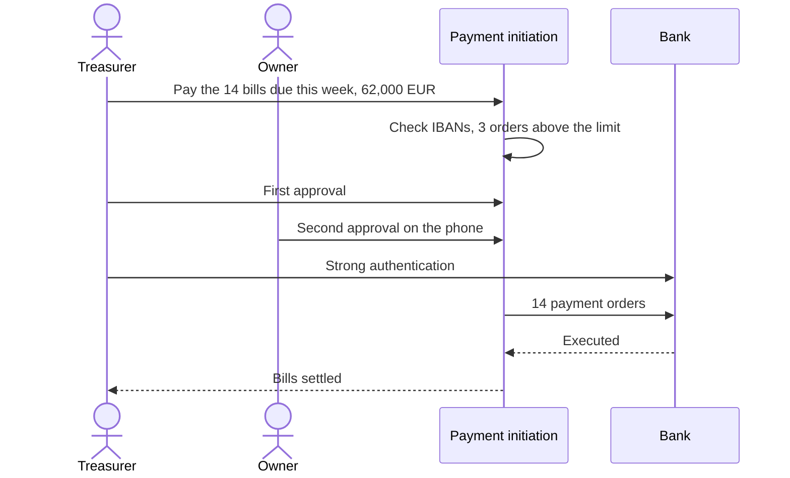

🏠 [Specs](../../../../README.md) › 🧩 [Functional capabilities](../../../README.md) ›
📒 [F8 Accounting](../../README.md) › 📝 [Use cases](../README.md) › 📝 UC-F8-34 Pay suppliers from the ERP

# 📝 UC-F8-34 Pay suppliers from the ERP

**Status:** 🔄 waiting for the owner

## Summary

The treasurer pays approved supplier bills from simple-ERP: payment orders are built from the bills, approved by one or
two people depending on the amount, authorised with the bank's strong authentication and sent to the bank through its
payment initiation service, then matched with the bank lines.

## Personas

- [U31 Treasurer](../../../../01-users/personas/u31-treasurer.md)
- [U13 Owner](../../../../01-users/personas/u13-owner.md)

## Goal

A supplier is paid without leaving simple-ERP for the bank's site, and no large payment leaves without two people
agreeing.

## Trigger

Approved supplier bills fall due, or the treasurer starts a payment run
([UC-F8-04](../02-purchase-to-pay/uc-f08-04-pay-suppliers.md)).

## Frequency

Weekly or twice a month for a payment run; single payments as needed.

## Preconditions

- The bills are matched and approved
  ([UC-F7-04](../../../f07-purchasing-and-stock/use-cases/01-procure/uc-f07-04-capture-and-match-supplier-invoices.md),
  [UC-F8-03](../02-purchase-to-pay/uc-f08-03-process-supplier-bills.md)).
- The supplier's IBAN is recorded and checked ([BR-F8-08](../../business-rules/br-f08-08-new-ibans-are-checked.md)).
- The bank is connected for payment initiation, with the company's consent
  ([UC-F8-06](../03-bank-and-collect/uc-f08-06-connect-banks-and-reconcile.md)).

## Postconditions

- **Succeeded:** each payment order ([E-F8-38 Payment order](../../data/e-f08-38-payment-order.md)) is executed by the
  bank and matched with its bank line; the bills are settled.
- **Failed:** no money leaves; the order stays Draft, Awaiting approval or Rejected with the reason.

## Main flow

1. The treasurer opens payment initiation
   ([S-F8-33](../../screens/11-treasury-and-payment-means/s-f08-33-payment-initiation.md)) and selects the bills to pay,
   or accepts the proposed run of the bills falling due.
2. simple-ERP creates one payment order per supplier with the IBAN, the amount, the reference and the execution date,
   and checks the IBAN against the checked ones.
3. The first approver approves; an order above the limit waits for a second, different approver
   ([BR-F8-26](../../business-rules/br-f08-26-payments-above-the-limit-need-two-approvals.md)), for example the owner on
   their phone.
4. The treasurer authorises the approved orders with the bank's strong authentication.
5. simple-ERP sends the orders to the bank; the bank executes them.
6. The bank lines are matched with the orders, the bills are settled and the supplier is told.

## Alternative flows

- 3a. The owner approves from a phone with a biometric confirmation.
- 4a. The bank accepts the file but the authentication is not completed in time: the orders go back to Approved.
- 6a. An order is cancelled before the bank executes it: the bill returns to the open items.

## Error flows

- 2e. The IBAN is new or changed and not yet checked: the order is refused until accounting checks it
  ([BR-F8-08](../../business-rules/br-f08-08-new-ibans-are-checked.md)).
- 3e. The same person tries to give both approvals: refused
  ([BR-F8-26](../../business-rules/br-f08-26-payments-above-the-limit-need-two-approvals.md)).
- 5e. The bank rejects an order (account closed, insufficient funds): it is Rejected with the bank's reason and the bill
  stays open.
- Any step: a service does not answer; the call is retried first
  ([BR-F3-32](../../../f03-assistant/business-rules/br-f03-32-retry-before-an-error.md)), then the message follows the
  error pattern ([D122](../../../../06-decisions/ux/d122-error-message-standard.md)) and what the user typed stays on
  the screen.

## Business rules

- [BR-F8-26](../../business-rules/br-f08-26-payments-above-the-limit-need-two-approvals.md)
- [BR-F8-08 New IBANs are checked](../../business-rules/br-f08-08-new-ibans-are-checked.md)
- [BR-F8-12](../../business-rules/br-f08-12-spend-follows-limits.md)

## Entities

- [E-F8-38 Payment order](../../data/e-f08-38-payment-order.md): created, changed
- [E-F8-28 Payment run](../../data/e-f08-28-payment-run.md): read, the payment run the orders come from
- [E-F7-05 Supplier invoice](../../../f07-purchasing-and-stock/data/e-f07-05-supplier-invoice.md): changed, settled
- [E-F8-04 Bank line](../../data/e-f08-04-bank-line.md): read, matched
- [E-F7-01 Supplier record](../../../f07-purchasing-and-stock/data/e-f07-01-supplier-record.md): read, the supplier's
  IBAN

## Permissions

The treasurer prepares and authorises; approvers are set per amount; the owner approves above the limit. The
preparer is never the second approver.

## Notifications

The approvers, in the app and on their phones: an order waits for your approval. The treasurer: orders executed or
rejected by the bank.

## Audit events

Each order created, approved (who, when, how), authorised, sent, executed or rejected, with the bank's reference.

## AI involvement

The AI assistant may propose the run (bills due, cash available) and warn about an unusual amount; it never approves or
authorises ([BR-F8-09](../../business-rules/br-f08-09-the-ai-proposes-people-post.md)).

## API, MCP and A2A exposure

T5 operations of the capability for the personas above: create, read, update and list. The MCP tool of the
capability may read and propose, never confirm alone. No A2A skill.

## Screens

- [S-F8-33](../../screens/11-treasury-and-payment-means/s-f08-33-payment-initiation.md)

## Flowchart

See [FL-F8-11 Treasury and payment means](../../flows/fl-f08-11-treasury-and-payment-means.md#flowchart).

## Sequence diagram

## Acceptance criteria

1. **Given** a payment of 18,000 EUR with a limit of 10,000 EUR **when** one person approves it **then** it waits for a
   second approver.
2. **Given** the same person giving both approvals **when** they try the second **then** it is refused.
3. **Given** a supplier whose IBAN changed yesterday **when** an order is created **then** it is refused until
   accounting checks the IBAN.
4. **Given** the bank rejecting an order **when** it answers **then** the order is Rejected with the reason and the bill
   stays open.

## Non-functional notes

The screen answers within 2 seconds for 10,000 records; every change is audited.

## Regulatory references

SEPA credit transfers: [CR-FR-023](../../../../10-country-packs/france/payments/cr-fr-023-sepa-formats.md). (Proposed)
Payment initiation needs the bank's strong authentication and the company's consent, as the bank's service requires.

## Related use cases

- [UC-F8-33 Follow the daily cash position](uc-f08-33-follow-the-daily-cash-position.md)
- [UC-F8-35 Schedule recurring entries](uc-f08-35-schedule-recurring-entries.md)
- [UC-F8-04 Pay suppliers](../02-purchase-to-pay/uc-f08-04-pay-suppliers.md)
- [UC-F8-06](../03-bank-and-collect/uc-f08-06-connect-banks-and-reconcile.md)
- [UC-F8-33 Follow the daily cash position](uc-f08-33-follow-the-daily-cash-position.md)

## Open questions

None.

---

⬅️ [UC-F8-33 Follow the daily cash position](uc-f08-33-follow-the-daily-cash-position.md) · ⬆️ [Up](README.md) ·
➡️ [UC-F8-35 Schedule recurring entries](uc-f08-35-schedule-recurring-entries.md)
