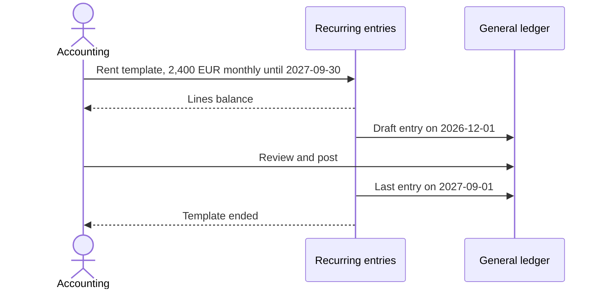

🏠 [Specs](../../../../README.md) › 🧩 [Functional capabilities](../../../README.md) ›
📒 [F8 Accounting](../../README.md) › 📝 [Use cases](../README.md) › 📝 UC-F8-35 Schedule recurring entries

# 📝 UC-F8-35 Schedule recurring entries

**Status:** ✅ specified

## Summary

Accounting schedules recurring entries from templates: a monthly rent, an insurance spread over the year, a fixed
provision. Each template says when the entry is created, whether it is posted or left as a draft, and when it stops.

## Personas

- [U05 Accounting](../../../../01-users/personas/u05-accounting.md)

## Goal

Repeating entries are never forgotten and never keep running after they should have ended.

## Trigger

A new recurring item (a lease, a subscription, an accrual), or the date a template is due.

## Frequency

A few templates per company; an entry per template each period.

## Preconditions

- The accounts used exist ([E-F8-01 Account](../../data/e-f08-01-account.md)).
- The journal and the first period exist ([E-F8-02 Journal](../../data/e-f08-02-journal.md),
  [E-F8-10 Fiscal period](../../data/e-f08-10-fiscal-period.md)).
- The template's lines balance ([BR-F8-06](../../business-rules/br-f08-06-balanced-entries-continuous-numbers.md)).

## Postconditions

- **Succeeded:** each due date creates one entry from the template
  ([E-F8-39 Entry template](../../data/e-f08-39-entry-template.md)) as a draft or posted, until the end date
  ([BR-F8-27](../../business-rules/br-f08-27-recurring-entries-stop-at-their-end-date.md)).
- **Failed:** no entry is created for a template that is unbalanced or past its end date; the template shows why.

## Main flow

1. Accounting opens the recurring entries
   ([S-F8-34](../../screens/11-treasury-and-payment-means/s-f08-34-recurring-entries.md)) and creates a template: lines
   with accounts, debit and credit amounts, the journal and the description.
2. simple-ERP checks that the template balances.
3. Accounting sets the frequency (monthly, quarterly, yearly), the start date, the end date or the number of
   occurrences, and whether the entry is posted or left as a draft for review.
4. On each due date simple-ERP creates the entry in the right period
   ([UC-F8-02](../01-set-up-and-post/uc-f08-02-post-and-review-entries.md)).
5. Accounting reviews the drafts and posts them; posted ones are as any other entry
   ([BR-F8-01](../../business-rules/br-f08-01-posted-entries-never-change.md)).
6. After the last occurrence or the end date the template ends
   ([BR-F8-27](../../business-rules/br-f08-27-recurring-entries-stop-at-their-end-date.md)).

## Alternative flows

- 3a. A template with variable amounts asks for the amount at each due date before creating the entry.
- 4a. A due date in a locked period: the entry is created in the next open period and flagged
  ([BR-F8-02](../../business-rules/br-f08-02-lock-dates.md)).
- 6a. Accounting pauses a template for a while; the missed dates are not created.

## Error flows

- 2e. The lines do not balance: the template cannot be activated and the difference is shown.
- 4e. An account of the template was closed: the entry is created as a draft with the problem flagged.
- 6e. A template is changed after entries were posted: the posted ones stay as they are and only future ones change.
- Any step: a service does not answer; the call is retried first
  ([BR-F3-32](../../../f03-assistant/business-rules/br-f03-32-retry-before-an-error.md)), then the message follows the
  error pattern ([D122](../../../../06-decisions/ux/d122-error-message-standard.md)) and what the user typed stays on
  the screen.

## Business rules

- [BR-F8-27](../../business-rules/br-f08-27-recurring-entries-stop-at-their-end-date.md)
- [BR-F8-01](../../business-rules/br-f08-01-posted-entries-never-change.md)
- [BR-F8-06](../../business-rules/br-f08-06-balanced-entries-continuous-numbers.md)
- [BR-F8-02 Lock dates](../../business-rules/br-f08-02-lock-dates.md)

## Entities

- [E-F8-39 Entry template](../../data/e-f08-39-entry-template.md): created, changed
- [E-F8-03 Journal entry](../../data/e-f08-03-journal-entry.md): created, the entries
- [E-F8-02 Journal](../../data/e-f08-02-journal.md): read, the journal
- [E-F8-10 Fiscal period](../../data/e-f08-10-fiscal-period.md): read, the period

## Permissions

Accounting creates and changes templates; the external accountant reads them; the owner reads them.

## Notifications

Accounting, in the app: drafts created today wait for review; a template ends in 30 days.

## Audit events

Each template created, changed, paused and ended, and each entry created from it, with who or what, when and the date it
was due.

## AI involvement

The AI assistant may propose a template from a posted entry that repeats three months in a row; accounting confirms
([BR-F8-09](../../business-rules/br-f08-09-the-ai-proposes-people-post.md)).

## API, MCP and A2A exposure

T5 operations of the capability for the personas above: create, read, update and list. The MCP tool of the
capability may read and propose, never confirm alone. No A2A skill.

## Screens

- [S-F8-34](../../screens/11-treasury-and-payment-means/s-f08-34-recurring-entries.md)

## Flowchart

See [FL-F8-11 Treasury and payment means](../../flows/fl-f08-11-treasury-and-payment-means.md#flowchart).

## Sequence diagram

## Acceptance criteria

1. **Given** a template whose lines do not balance **when** accounting activates it **then** it is refused with the
   difference.
2. **Given** a template ending on 30 September 2027 **when** the 1 October due date comes **then** no entry is created
   and the template is Ended.
3. **Given** a due date in a locked period **when** the entry is created **then** it goes to the next open period,
   flagged.
4. **Given** a template changed after 5 posted entries **when** accounting saves **then** the 5 entries stay as posted.

## Non-functional notes

The screen answers within 2 seconds for 10,000 records; every change is audited.

## Regulatory references

Posted entries are inalterable and numbered continuously:
[CR-FR-003](../../../../10-country-packs/france/accounting/cr-fr-003-posted-entries-are-inalterable.md),
[CR-FR-004](../../../../10-country-packs/france/accounting/cr-fr-004-balanced-entries-continuous-numbers.md).

## Related use cases

- [UC-F8-34 Pay suppliers from the ERP](uc-f08-34-pay-suppliers-from-the-erp.md)
- [UC-F8-02 Post and review entries](../01-set-up-and-post/uc-f08-02-post-and-review-entries.md)
- [UC-F8-08](../04-tax-assets-and-analytics/uc-f08-08-manage-fixed-assets-and-deferrals.md)
- [UC-F8-30 Manage loans and borrowings](uc-f08-30-manage-loans-and-borrowings.md)

## Open questions

None.

---

⬅️ [UC-F8-34 Pay suppliers from the ERP](uc-f08-34-pay-suppliers-from-the-erp.md) · ⬆️ [Up](README.md) ·
➡️ [UC-F8-36](../12-audit-leases-and-special-books/uc-f08-36-open-the-books-to-the-statutory-auditor.md)
