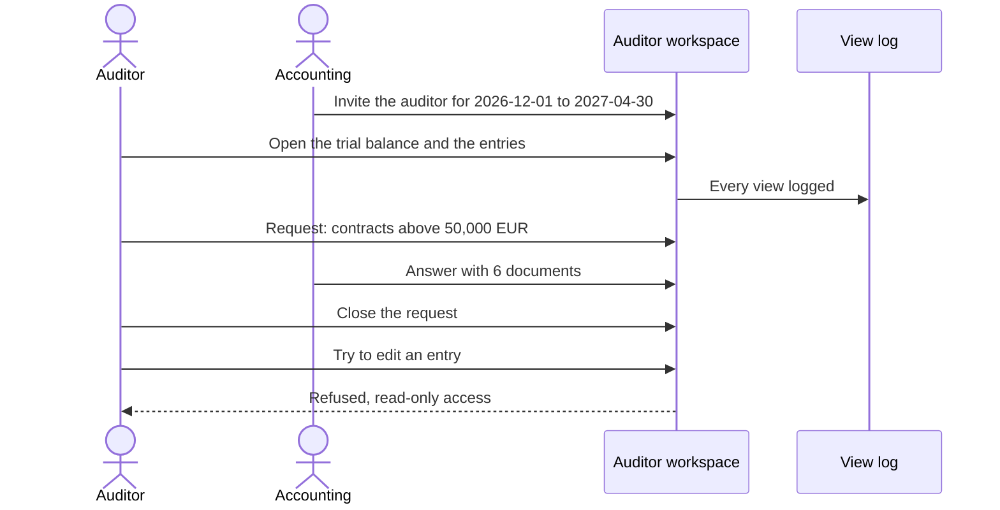

🏠 [Specs](../../../../README.md) › 🧩 [Functional capabilities](../../../README.md) ›
📒 [F8 Accounting](../../README.md) › 📝 [Use cases](../README.md) › 📝 UC-F8-36 Open the books to the statutory auditor

# 📝 UC-F8-36 Open the books to the statutory auditor

**Status:** 🔄 waiting for the owner

## Summary

The company opens its books to its statutory auditor in a read-only workspace: the auditor sees the ledgers, the entries
and the supporting documents they need, lists what they want from the company as requests, and receives the answers;
every page they open is logged, and they can change nothing.

## Personas

- [U49 Statutory auditor](../../../../01-users/personas/u49-statutory-auditor.md)
- [U05 Accounting](../../../../01-users/personas/u05-accounting.md)

## Goal

The audit runs without sending files by email, the auditor can reach what they need, and the company can prove who saw
what.

## Trigger

The audit engagement begins, or the auditor raises a question during the year or at year end.

## Frequency

A few visits a year (interim and year end); dozens of requests during an engagement.

## Preconditions

- The company has a statutory auditor appointed, with their engagement dates
  ([U49](../../../../01-users/personas/u49-statutory-auditor.md)).
- The auditor has an external user with the auditor role, valid for the engagement
  ([UC-F1-01](../../../f01-administration/use-cases/01-guided-setup/uc-f01-01-set-up-a-new-company.md)).
- The books are closed or closing
  ([UC-F8-10](../05-close-report-and-consolidate/uc-f08-10-close-the-period-and-the-year.md)), with the closing
  checklist ([E-F8-31 Closing checklist](../../data/e-f08-31-closing-checklist.md)).

## Postconditions

- **Succeeded:** the auditor's requests are recorded ([E-F8-40 Audit request](../../data/e-f08-40-audit-request.md))
  with their answers; every view and download is in the audit trail
  ([BR-F8-28](../../business-rules/br-f08-28-the-auditor-reads-only-and-every-view-is-logged.md)); the auditor's access
  ends with the engagement.
- **Failed:** a request stays Open or Queried; the books are unchanged.

## Main flow

1. Accounting opens the auditor workspace
   ([S-F8-35](../../screens/12-audit-leases-and-special-books/s-f08-35-auditor-workspace.md)) and invites the auditor
   for the engagement dates; the access is read-only
   ([BR-F8-28](../../business-rules/br-f08-28-the-auditor-reads-only-and-every-view-is-logged.md)).
2. The auditor signs in and sees the trial balance, the ledgers, the journals, the entries with their documents, the
   fixed assets and the closing checklist.
3. The auditor raises a request: a document, an explanation, a confirmation, with a due date.
4. Accounting answers: attaches a document, adds a note or links the entry; the request becomes Provided.
5. The auditor reads the answer and closes the request, or queries it with a question.
6. At the end of the engagement accounting ends the access; the requests and the view log stay with the books.

## Alternative flows

- 3a. The auditor asks by phone: accounting creates the request for them.
- 4a. A request about a posted entry shows the entry and its audit trail
  ([BR-F8-01](../../business-rules/br-f08-01-posted-entries-never-change.md)).
- 5a. The auditor wants a correction: they ask accounting, who posts a correcting entry; the auditor never edits.

## Error flows

- 2e. The auditor tries to change an entry, upload into the books or delete a document: refused with "read-only access",
  and the attempt is logged
  ([BR-F8-28](../../business-rules/br-f08-28-the-auditor-reads-only-and-every-view-is-logged.md)).
- 3e. A request for a person's personal data beyond the audit's need: accounting refuses with the reason and the owner
  is told.
- 6e. The engagement ends with requests still open: they are listed for accounting and access still ends.
- Any step: a service does not answer; the call is retried first
  ([BR-F3-32](../../../f03-assistant/business-rules/br-f03-32-retry-before-an-error.md)), then the message follows the
  error pattern ([D122](../../../../06-decisions/ux/d122-error-message-standard.md)) and what the user typed stays on
  the screen.

## Business rules

- [BR-F8-28](../../business-rules/br-f08-28-the-auditor-reads-only-and-every-view-is-logged.md)
- [BR-F8-01](../../business-rules/br-f08-01-posted-entries-never-change.md)
- [BR-F8-04](../../business-rules/br-f08-04-filings-need-an-accountant.md)

## Entities

- [E-F8-40 Audit request](../../data/e-f08-40-audit-request.md): created, changed
- [E-F8-26 Accountant request](../../data/e-f08-26-accountant-request.md): read, the accountant's requests, kept apart
- [E-F8-22 Annual accounts file](../../data/e-f08-22-annual-accounts-file.md): read, the annual accounts file
- [E-F8-31 Closing checklist](../../data/e-f08-31-closing-checklist.md): read, the closing checklist
- [E-F8-03 Journal entry](../../data/e-f08-03-journal-entry.md): read, the entries and their documents

## Permissions

The auditor reads the books and the supporting documents, raises and closes their requests, and never writes elsewhere.
Accounting answers; the owner and the administrator read the view log.

## Notifications

Accounting, in the app: a new request, a request overdue, a query. The auditor, by email: a request answered, the
engagement ending soon.

## Audit events

Every sign-in, page viewed, search, export and download by the auditor, with the time and the record; every refused
attempt to write; every request and answer.

## AI involvement

The AI assistant may draft an answer from the books and the documents for accounting to check; it is never given to the
auditor without accounting's approval, and it never answers the auditor on its own.

## API, MCP and A2A exposure

T5 operations of the capability for the personas above: create, read, update and list. The MCP tool of the
capability may read and propose, never confirm alone. No A2A skill.

## Screens

- [S-F8-35](../../screens/12-audit-leases-and-special-books/s-f08-35-auditor-workspace.md)

## Flowchart

See [FL-F8-12 Audit, leases and special books](../../flows/fl-f08-12-audit-leases-and-special-books.md#flowchart).

## Sequence diagram

## Acceptance criteria

1. **Given** an invited auditor **when** they open an entry **then** it is shown with its documents and the view is
   logged.
2. **Given** an auditor **when** they try to edit an entry, upload a document or delete one **then** each is refused and
   the attempt is logged.
3. **Given** an engagement that ended yesterday **when** the auditor signs in **then** access is refused.
4. **Given** a request answered by accounting **when** the auditor closes it **then** the request is Closed with the
   date.

## Non-functional notes

The screen answers within 2 seconds for 10,000 records; every change is audited.

## Regulatory references

A company above certain thresholds must have its accounts audited by a statutory auditor, who has the right to see the
books and the supporting documents. The thresholds, the auditor's rights and the engagement rules are written
later as the France-pack rule on when a statutory auditor is required.

- France-pack rule, (Proposed) until its law is read:
  [CR-FR-213 When a statutory auditor is required](../../../../10-country-packs/france/accounting/cr-fr-213-statutory-auditor-thresholds.md)

## Related use cases

- [UC-F8-37 Account for leases](uc-f08-37-account-for-leases.md)
- [UC-F8-14](../01-set-up-and-post/uc-f08-14-work-with-the-external-accountant.md)
- [UC-F8-29](../10-accountant-collaboration/uc-f08-29-answer-the-accountants-questions-and-requests.md)
- [UC-F8-25](../08-year-end-duties/uc-f08-25-approve-and-file-the-annual-accounts.md)
- [UC-F8-10](../05-close-report-and-consolidate/uc-f08-10-close-the-period-and-the-year.md)

## Open questions

None.

---

⬅️ [UC-F8-35 Schedule recurring entries](../11-treasury-and-payment-means/uc-f08-35-schedule-recurring-entries.md) ·
⬆️ [Up](README.md) · ➡️ [UC-F8-37 Account for leases](uc-f08-37-account-for-leases.md)
