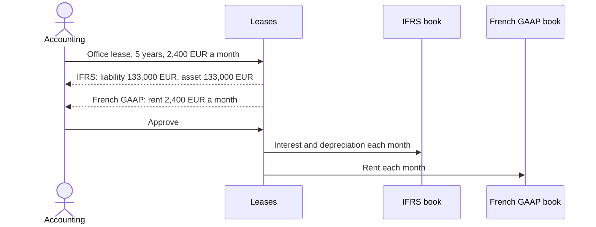

🏠 [Specs](../../../../README.md) › 🧩 [Functional capabilities](../../../README.md) ›
📒 [F8 Accounting](../../README.md) › 📝 [Use cases](../README.md) › 📝 UC-F8-37 Account for leases

# 📝 UC-F8-37 Account for leases

**Status:** 🔄 waiting for the owner

## Summary

Accounting records the company's leases (premises, vehicles, equipment) and accounts for each one in every book by that
book's standard: as a right-of-use asset and a lease liability under the IFRS book, as a rent expense with a commitment
note under the French GAAP book.

## Personas

- [U05 Accounting](../../../../01-users/personas/u05-accounting.md)
- [U08 External accountant](../../../../01-users/personas/u08-external-accountant.md)

## Goal

Each lease is accounted for correctly in each book from a single record, and the external accountant can see how.

## Trigger

A lease is signed, modified or ended, or a period closes.

## Frequency

A few leases per company; a payment each period; remeasurement when the terms change.

## Preconditions

- The books and their frameworks are set ([UC-F8-15](../06-benchmark-additions/uc-f08-15-keep-several-books.md),
  [E-F8-13 Book](../../data/e-f08-13-book.md)).
- The lease contract gives the term, the payments, the options and the rate.
- The lessor exists as a supplier
  ([E-F7-01 Supplier record](../../../f07-purchasing-and-stock/data/e-f07-01-supplier-record.md)).

## Postconditions

- **Succeeded:** the lease is recorded ([E-F8-41 Lease](../../data/e-f08-41-lease.md)) with its schedule; each book
  receives the entries its standard asks for
  ([BR-F8-29](../../business-rules/br-f08-29-leases-follow-the-books-standard.md)); the commitments and the maturity
  table are available for the notes.
- **Failed:** no entry is posted; the lease stays Draft with what is missing.

## Main flow

1. Accounting opens the leases screen
   ([S-F8-36 Leases](../../screens/12-audit-leases-and-special-books/s-f08-36-leases.md)) and records a lease from its
   contract: lessor, asset, start, term, payments, indexation, renewal and purchase options, deposit.
2. simple-ERP shows how each book will treat it
   ([BR-F8-29](../../business-rules/br-f08-29-leases-follow-the-books-standard.md)): in an IFRS book, the discounted
   present value of the payments as a lease liability and a right-of-use asset depreciated over the term; in a French
   GAAP book, the payments as rent in the period.
3. Accounting sets the discount rate for the IFRS book and approves.
4. Each period simple-ERP posts, per book, the entries: interest and depreciation in the IFRS book, rent in the French
   GAAP book.
5. When the payments change (indexation, extension, termination), accounting records the modification and the lease is
   remeasured in the books that need it.
6. The external accountant reads the lease, its schedule and the entries per book
   ([UC-F8-14](../01-set-up-and-post/uc-f08-14-work-with-the-external-accountant.md)).

## Alternative flows

- 1a. A short-term lease or a low-value asset: the IFRS book may choose to expense the payments, as the book's settings
  say.
- 5a. The lease ends early: the liability and the asset are derecognised and the difference posted.
- 5b. The lease is bought at its end: the asset moves to fixed assets
  ([UC-F8-08](../04-tax-assets-and-analytics/uc-f08-08-manage-fixed-assets-and-deferrals.md)).

## Error flows

- 2e. The book has no standard set for leases: the lease stays Draft and accounting is asked to set it.
- 3e. No discount rate is given for an IFRS book: the lease cannot be approved for that book.
- 4e. The period is locked ([BR-F8-02](../../business-rules/br-f08-02-lock-dates.md)): the entries go to the next open
  period, flagged.
- Any step: a service does not answer; the call is retried first
  ([BR-F3-32](../../../f03-assistant/business-rules/br-f03-32-retry-before-an-error.md)), then the message follows the
  error pattern ([D122](../../../../06-decisions/ux/d122-error-message-standard.md)) and what the user typed stays on
  the screen.

## Business rules

- [BR-F8-29](../../business-rules/br-f08-29-leases-follow-the-books-standard.md)
- [BR-F8-01](../../business-rules/br-f08-01-posted-entries-never-change.md)
- [BR-F8-02 Lock dates](../../business-rules/br-f08-02-lock-dates.md)
- [BR-F8-10](../../business-rules/br-f08-10-books-share-one-source.md)

## Entities

- [E-F8-41 Lease](../../data/e-f08-41-lease.md): created, changed
- [E-F8-13 Book](../../data/e-f08-13-book.md): read, the books and their standards
- [E-F8-07 Fixed asset](../../data/e-f08-07-fixed-asset.md): created, the right-of-use asset in an IFRS book
- [E-F8-03 Journal entry](../../data/e-f08-03-journal-entry.md): created, the entries per book
- [E-F7-01 Supplier record](../../../f07-purchasing-and-stock/data/e-f07-01-supplier-record.md): read, the lessor

## Permissions

Accounting records and approves leases; the external accountant and the owner read them; the treatment per book is read
by the auditor.

## Notifications

Accounting, in the app: a lease ends in 90 days (to renew or return); an indexation is due.

## Audit events

Each lease created, approved, modified and ended, each entry per book, with who, when and the standard applied.

## AI involvement

The AI assistant reads a lease contract and prefills the term, the payments and the options for accounting to check; it
never approves a lease.

## API, MCP and A2A exposure

T5 operations of the capability for the personas above: create, read, update and list. The MCP tool of the
capability may read and propose, never confirm alone. No A2A skill.

## Screens

- [S-F8-36 Leases](../../screens/12-audit-leases-and-special-books/s-f08-36-leases.md)

## Flowchart

See [FL-F8-12 Audit, leases and special books](../../flows/fl-f08-12-audit-leases-and-special-books.md#flowchart).

## Sequence diagram

## Acceptance criteria

1. **Given** a 5-year lease with monthly payments **when** accounting approves it **then** the IFRS book gets a lease
   liability and a right-of-use asset, the French GAAP book gets the rent.
2. **Given** a lease indexed after 12 months **when** the new payment is recorded **then** the IFRS liability is
   remeasured and the French GAAP rent changes from that date.
3. **Given** a lease ended early **when** accounting ends it **then** the liability and the asset are removed in the
   IFRS book.
4. **Given** a book with no standard for leases **when** accounting approves a lease **then** it is refused for that
   book.

## Non-functional notes

The screen answers within 2 seconds for 10,000 records; every change is audited.

## Regulatory references

Lease accounting differs by standard: IFRS 16 for IFRS books, the French chart of accounts for the French GAAP book
([CR-FR-064](../../../../10-country-packs/france/accounting/cr-fr-064-accounting-frameworks.md),
[CR-FR-006](../../../../10-country-packs/france/accounting/cr-fr-006-chart-of-accounts.md)). (Proposed) The France-pack
rule on leases in French GAAP is written later; this page states only the effect on each book.

- France-pack rule, (Proposed) until its law is read:
  [CR-FR-216 Leases in French GAAP](../../../../10-country-packs/france/accounting/cr-fr-216-leases-in-french-gaap.md)

## Related use cases

- [UC-F8-36](uc-f08-36-open-the-books-to-the-statutory-auditor.md)
- [UC-F8-38](uc-f08-38-send-and-receive-invoices-through-peppol.md)
- [UC-F8-15 Keep several books](../06-benchmark-additions/uc-f08-15-keep-several-books.md)
- [UC-F8-08](../04-tax-assets-and-analytics/uc-f08-08-manage-fixed-assets-and-deferrals.md)
- [UC-F8-16](../06-benchmark-additions/uc-f08-16-recognise-revenue-under-ifrs-15.md)

## Open questions

None.

---

⬅️ [UC-F8-36 Open the books to the statutory auditor](uc-f08-36-open-the-books-to-the-statutory-auditor.md) ·
⬆️ [Up](README.md) ·
➡️ [UC-F8-38 Send and receive invoices through Peppol](uc-f08-38-send-and-receive-invoices-through-peppol.md)
